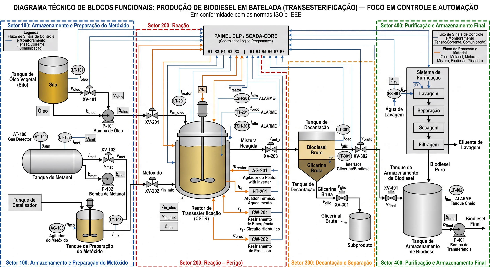

# Indústria Escolhida: Produção de Biodiesel (Transesterificação em Batelada)

## 🌐 Simulador SCADA em Operação (GitHub Pages)

Acesse o sistema supervisório integrado das **Etapas 01, 02 e 03** diretamente pelo navegador (via GitHub Pages):

👉 **[Abrir Simulador SCADA-Core v3.0 (GitHub Pages)](https://igorfantucci.github.io/Aula-Automatica---GRUPO-5/)**

> *(Nota: no repositório do GitHub, clicar diretamente em `index.html` exibe o código-fonte. Para executar localmente no PC, baixe o repositório e abra o arquivo [`index.html`](./index.html) no seu navegador.)*

O simulador web (`SCADA-Core v3.0`) permite:
* **Etapa 01 — Lógica Formal & P&ID:** Diagrama SVG interativo dos 4 setores, injeção dos 5 cenários da Aula 10, sliders analógicos ($PT-201, TT-201, LT-201, AT-100$), painel SIS/SIL-3, *Forward Chaining* (R-01 a R-08) e *Backward Chaining* (XAI);
* **Etapa 02 — Grafos & Roteamento:** Matriz de Adjacência/Incidência, validação de balanço de massa por Lei de Kirchhoff ($B \cdot Q = S$), Dijkstra dinâmico com simulação de vazamentos em malha fechada, percurso Euleriano (Hierholzer NDT), rota Hamiltoniana do `AGV-SAMPLER` (`NN + 2-OPT`) e ordenação DAG (Kahn);
* **Etapa 03 — Árvores & IA Industrial:** Otimização MST (Kruskal/Prim), compressão de telemetria Huffman com quadro `CRC-16`, BDT/AVL, protocolo RSTP 802.1w com corte de fibra `10 Gbps`, canvas interativo RRT + KD-Tree 2D, Rede de Petri P/T passo a passo com teste de exclusão mútua `TK-300`, Behavior Tree (`50 ms`), KD-Tree 4D e classificador CART (Gini).

---

## 🔬 O Processo Químico: Síntese de Biodiesel por Transesterificação

A produção de biodiesel na planta baseia-se na **transesterificação alcalina de triglicerídeos em regime de batelada (*batch*)**. O processo consiste na reação química entre lipídios de origem vegetal ou animal e um álcool de cadeia curta (metanol), catalisada por uma base forte, para produzir ésteres metílicos de ácidos graxos (biodiesel) e glicerol como subproduto de valor comercial agregado.

### 1. Equação Química Estequiométrica
$$\text{Triglicerídeo (Óleo Vegetal)} + 3\,\text{CH}_3\text{OH (Metanol)} \xrightarrow{\text{NaOH / KOH}} 3\,\text{Ésteres Metílicos (Biodiesel)} + \text{Glicerol (Subproduto)}$$

* **Estequiometria:** Para cada $1\text{ mol}$ de triglicerídeo processado, são necessários estequiometricamente $3\text{ mols}$ de metanol. Na prática industrial, opera-se com excesso molar de metanol (proporção típica de 6:1) para deslocar o equilíbrio químico no sentido da formação de produtos, de acordo com o Princípio de Le Chatelier.
* **Catalisador:** Hidróxido de sódio ($\text{NaOH}$) ou hidróxido de potássio ($\text{KOH}$) dissolvido no metanol no Setor 100, gerando a espécie reativa ativa: o **íon metóxido ($\text{CH}_3\text{O}^-$)**.

### 2. Aspectos Termodinâmicos e Cinéticos
* **Termodinâmica:** A reação é **levemente exotérmica** ($\Delta H^\circ \approx -15 \text{ a } -25\text{ kJ/mol}$), liberando calor à medida que os reagentes se convertem em ésteres.
* **Janela Operacional Rígida:** A temperatura da reação deve ser estritamente controlada entre **$55^\circ\text{C}$ e $60^\circ\text{C}$**:
  * *Abaixo de $55^\circ\text{C}$:* A viscosidade do óleo vegetal permanece alta, prejudicando a mistura física das fases imiscíveis e tornando a cinética química excessivamente lenta.
  * *Acima de $60^\circ\text{C}$:* A temperatura aproxima-se perigosamente do **ponto de ebulição do metanol puro ($64.7^\circ\text{C}$ à pressão atmosférica)**.
* **O Fenômeno do Runaway Térmico:** Se o aquecedor permanecer energizado ou se o resfriamento de salvaguarda falhar, a temperatura atinge $65^\circ\text{C}$. Nessa temperatura, o metanol sofre **ebulição instantânea (*flash boiling*)**, expandindo seu volume cerca de 300 vezes. Em um vaso fechado e estanque, essa vaporização súbita faz a pressão ($PT-201$) disparar para além de $2.5\text{ bar}$, criando o cenário de risco iminente de rompimento de vaso ou explosão.

---

## 🏭 Arquitetura da Planta Industrial (Topologia em 4 Setores)

A planta foi estruturada em **quatro setores operacionais segregados**, projetados segundo as normas **ISA-5.1** (simbologia e identificação de instrumentação) e **IEC 61511 / IEC 61508** (Sistemas Instrumentados de Segurança - SIS para malhas de integridade **SIL 3**):

```
┌────────────────────────────────────────────────────────────────────────────────────────┐
│                        PAINEL CLP / SCADA-CORE (Controlador Lógico)                    │
└───────┬────────────────────────┬────────────────────────┬──────────────────────┬───────┘
        │ Sinais / Comandos      │ Sinais / Comandos      │ Sinais / Comandos    │ Sinais
        ▼                        ▼                        ▼                      ▼
┌──────────────────┐     ┌──────────────────┐     ┌──────────────────┐   ┌──────────────────┐
│    SETOR 100     │     │    SETOR 200     │     │    SETOR 300     │   │    SETOR 400     │
│  Armazenamento & │ ──► │   Reator CSTR    │ ──► │   Decantação &   │──►│  Purificação &   │
│ Preparo Metóxido │     │ (Setor Crítico)  │     │ Separação Fases  │   │ Armazenamento    │
└──────────────────┘     └──────────────────┘     └──────────────────┘   └──────────────────┘
```

### Setor 100: Armazenamento e Preparação do Metóxido
* **Objetivo:** Recepção, armazenagem segura e homogeneização dos insumos primários da reação.
* **Equipamentos e Instrumentos:**
  * Silo de Óleo Vegetal Degomado ($TK-101$) com sensor de nível ($LT-101$), válvula de bloqueio ($XV-101$) e bomba de transferência ($P-101$);
  * Vaso de Metanol Líquido ($TK-102$) com detector de vapores de metanol na atmosfera ($AT-100$), válvula de bloqueio ($XV-102$) e bomba dosadora ($P-102$);
  * Tanque de Preparação do Metóxido ($TK-103$) com agitador mecânico de dissolução do catalisador ($AG-103$).

### Setor 200: Reação de Transesterificação (Reator CSTR R-200 — Núcleo Crítico)
* **Objetivo:** Condução da reação química em batelada com controle rigoroso de temperatura, pressão e agitação mecânica.
* **Equipamentos e Instrumentos:**
  * Reator de Batelada Encamisado ($R-200$) com jaqueta térmica para aquecimento e arrefecimento;
  * Agitador Mecânico ($AG-201$) acionado por inversor de frequência, garantindo contato íntimo entre as fases imiscíveis (óleo e metóxido);
  * Aquecedor Elétrico/Vapor ($HT-201$) na jaqueta térmica;
  * Circuito Hidráulico de Resfriamento de Emergência ($CW-201$), mantido sob pressão contínua $\ge 3.0\text{ bar}$ como salvaguarda passiva/ativa;
  * Válvulas de corte rápido: $XV-201$ (admissão de óleo), $XV-202$ (corte rápido de dosagem de metóxido) e $XV-203$ (descarga da batelada);
  * Transmissores de campo de alta integridade: Pressão ($PT-201$), Temperatura ($TT-201$) e Nível ($LT-201$).

### Setor 300: Decantação e Separação de Fases
* **Objetivo:** Separação gravitacional bifásica entre a fase leve (biodiesel bruto) e a fase pesada (glicerina bruta).
* **Equipamentos e Instrumentos:**
  * Vaso Decantador Cônico ($TK-300$), projetado para decantação estática por diferença de massa específica ($\rho_{\text{biodiesel}} \approx 0.88\text{ g/cm}^3$ vs. $\rho_{\text{glicerina}} \approx 1.26\text{ g/cm}^3$);
  * Sensor Óptico de Interface ($IT-301$) baseado em refração infravermelha, posicionado na linha divisória das duas fases;
  * Válvula de dreno inferior ($XV-301$) para purga estrita de glicerina bruta para tambores de subproduto;
  * Válvula de transbordo superior ($XV-302$) para transferência de biodiesel bruto à etapa de purificação.

### Setor 400: Purificação, Lavagem e Armazenamento Final
* **Objetivo:** Remoção de impurezas solúveis (soda residual, sabões e traços de álcool) por lavagem ácida/aquosa e estocagem do produto acabado.
* **Equipamentos e Instrumentos:**
  * Coluna de Lavagem com bicos aspersores (*sprays*) de água desmineralizada e ácido cítrico de neutralização de pH;
  * Chave de fluxo de água de lavagem ($FS-401$) para garantir fluxo contínuo antes da autorização de expedição;
  * Válvula de alimentação final ($XV-401$);
  * Tanque de Armazenamento de Biodiesel Puro ($TK-402$) com transmissor de nível ($LT-402$);
  * Bomba centrífuga de expedição final de combustível ($P-401$).

---

## ⚠️ Riscos Industriais Críticos e Filosofia de Intertravamento Fail-Safe

O sistema de automação implementado no SCADA foi formalizado para prevenir e mitigar os quatro riscos de maior severidade operacional da planta:

1. **Sobrepressão e Runaway Térmico no Reator (Regras R-01 e R-02):**
   * *Gatilho:* $PT-201 \ge 2.5\text{ bar} \land TT-201 \ge 65.0^\circ\text{C}$.
   * *Ação SIS:* Desarme instantâneo do aquecedor $HT-201$ (POP-SIS-01), fechamento forçado da válvula de corte de metóxido $XV-202$ e desligamento da bomba $P-102$ (POP-SIS-02), associado à abertura plena da água de resfriamento $CW-201$.
2. **Vazamento e Formação de Atmosfera Explosiva de Metanol (Regra R-03):**
   * *Gatilho:* $AT-100 \ge 20\text{ ppm}$ no Setor 100 (Limite de pré-alarme para LEL de 6% e limite tóxico IDLH de 300 ppm).
   * *Ação SIS:* Fechamento de $XV-102$ e $XV-202$, desenergização da bomba $P-102$ e acionamento de exaustores de emergência à prova de explosão (POP-SST-03).
3. **Cavitação Mecânica do Agitador por Nível Baixo (Regra R-06):**
   * *Gatilho:* $LT-201 \le 15\% \land AG-201\text{ ligado}$.
   * *Ação SIS:* Desarme imediato do inversor de frequência de $AG-201$ para evitar vórtice destrutivo e empenamento de pás (POP-MA-05).
4. **Perda de Biodiesel Comercial no Dreno de Subproduto (Regra R-07):**
   * *Gatilho:* Comando de purga ativo em $XV-301 \land \text{perda de interface óptica em } IT-301$.
   * *Ação SIS:* Bloqueio imediato do dreno $XV-301$ para impedir descarte acidental de éster puro (POP-SEP-02).
5. **Parada Geral de Emergência em Segurança Positiva (Fail-Safe):**
   * *Gatilho:* Botoeira física de emergência $ESD-100$ ($e_1 = 1$). O contato é eletricamente **Normalmente Fechado (NF)**: se o botão for pressionado, se o cabo romper ou se houver perda de energia, o circuito abre e a planta assume o estado seguro global (*SafeState Global*).

---

## 📦 Insumos: Matérias-Primas e Reagentes Químicos

* **Fontes de Lipídios (Base da Reação):**
  * **Óleo Vegetal (Triglicerídeos):** Matéria-prima primária (soja, girassol, canola) processada para conversão em biocombustível.
  * **Óleos Residuais ou Gordura Animal:** Fontes secundárias alternativas de lipídios compatíveis com o reator em batelada.

* **Fontes de Álcool (Reagente):**
  * **Metanol ($\text{CH}_3\text{OH}$):** Reagente de alta reatividade que reage com os triglicerídeos para liberar as cadeias de ésteres metílicos.

* **Catalisadores e Químicos Auxiliares:**
  * **Hidróxido de Sódio ($\text{NaOH}$) ou de Potássio ($\text{KOH}$):** Catalisador alcalino dissolvido no metanol para formar a solução de metóxido.
  * **Água Industrial Desmineralizada ($\text{H}_2\text{O}$):** Empregada na lavagem para extrair restos de catalisador e sabões por afinidade polar.
  * **Ácido de Neutralização (Ácido Cítrico ou Clorídrico - $\text{HCl}$):** Adicionado em doses controladas para estabilização de pH do biodiesel final.

---

## 📚 Estrutura do Repositório — Etapa 01: Lógica Formal e Sistemas Especialistas

A pasta [`etapa-01-logica`](./etapa-01-logica/) contém toda a modelagem formal, provas matemáticas de segurança e cadernos executáveis em Python/Jupyter:

| Módulo | Documento Teórico (.md) | Caderno Executável (.ipynb) | Conteúdo e Foco de Engenharia |
| :---: | :--- | :---: | :--- |
| **00** | [00 - Materias Primas e Componentes.md](./etapa-01-logica/00%20-%20Materias%20Primas%20e%20Componentes.md) | — | Descrição detalhada dos insumos, produtos, subprodutos e equipamentos por setor (100 a 400). |
| **02** | [02 - Mapeamento de variáveis de processo.md](./etapa-01-logica/02%20-%20Mapeamento%20de%20vari%C3%A1veis%20de%20processo.md) | — | Mapeamento formal de instrumentos e sensores para proposições booleanas (norma ISA-5.1). |
| **03** | [03 - Tautologias e Contradicoes.md](./etapa-01-logica/03%20-%20Tautologias%20e%20Contradicoes.md) | [03 - Tautologias e Contradicoes.ipynb](./etapa-01-logica/03%20-%20Tautologias%20e%20Contradicoes.ipynb) | Provas dedutivas de tautologias de segurança e contradições de risco operacional. |
| **04** | [04 - Logica Proposicional Conectivos e Permissivos.md](./etapa-01-logica/04%20-%20Logica%20Proposicional%20Conectivos%20e%20Permissivos.md) | [04 - Logica Proposicional Conectivos e Permissivos.ipynb](./etapa-01-logica/04%20-%20Logica%20Proposicional%20Conectivos%20e%20Permissivos.ipynb) | Conectivos lógicos, permissivos de partida (*Start Permissives*) e blocos de intertravamento. |
| **05** | [05 - Formas Normais e Otimizacao Booleana.md](./etapa-01-logica/05%20-%20Formas%20Normais%20e%20Otimizacao%20Booleana.md) | [05 - Formas Normais e Otimizacao Booleana.ipynb](./etapa-01-logica/05%20-%20Formas%20Normais%20e%20Otimizacao%20Booleana.ipynb) | Minimização por álgebra de Boole, formas canônicas FND (SOP) e FNC (POS) para CLP. |
| **06** | [06 - Quantificadores e Predicados em Redes de Sensores.md](./etapa-01-logica/06%20-%20Quantificadores%20e%20Predicados%20em%20Redes%20de%20Sensores.md) | [06 - Quantificadores e Predicados em Redes de Sensores.ipynb](./etapa-01-logica/06%20-%20Quantificadores%20e%20Predicados%20em%20Redes%20de%20Sensores.ipynb) | Lógica de predicados de 1ª ordem, quantificadores $\forall$ (FORALL) e $\exists$ (EXISTS) em redes de sensores. |
| **07** | [07 - Validade e Inferencia Logica na Seguranca de Processos.md](./etapa-01-logica/07%20-%20Validade%20e%20Inferencia%20Logica%20na%20Seguranca%20de%20Processos.md) | [07 - Validade e Inferencia Logica na Seguranca de Processos.ipynb](./etapa-01-logica/07%20-%20Validade%20e%20Inferencia%20Logica%20na%20Seguranca%20de%20Processos.ipynb) | Regras canônicas de inferência (MP, MT, SH, SD, RES, DC), falácias e prova formal de matriz ESD. |
| **08** | [08 - Base de Conhecimento e Regras de Diagnostico.md](./etapa-01-logica/08%20-%20Base%20de%20Conhecimento%20e%20Regras%20de%20Diagnostico.md) | [08 - Base de Conhecimento e Regras de Diagnostico.ipynb](./etapa-01-logica/08%20-%20Base%20de%20Conhecimento%20e%20Regras%20de%20Diagnostico.ipynb) | Sistemas especialistas (RBS), Cláusulas de Horn, priorização SIL e procedimentos POP. |
| **09** | [09 - Motor de Inferencia Forward e Backward Chaining.md](./etapa-01-logica/09%20-%20Motor%20de%20Inferencia%20Forward%20e%20Backward%20Chaining.md) | [09 - Motor de Inferencia Forward e Backward Chaining.ipynb](./etapa-01-logica/09%20-%20Motor%20de%20Inferencia%20Forward%20e%20Backward%20Chaining.ipynb) | Motores de encadeamento progressivo (*Forward*) e regressivo (*Backward*) com explicabilidade (XAI). |
| **10** | [10 - Avaliacao Modulo 1 Motor de Intertravamento e Diagnostico.md](./etapa-01-logica/10%20-%20Avaliacao%20Modulo%201%20Motor%20de%20Intertravamento%20e%20Diagnostico.md) | [10 - Avaliacao Modulo 1 Motor de Intertravamento e Diagnostico.ipynb](./etapa-01-logica/10%20-%20Avaliacao%20Modulo%201%20Motor%20de%20Intertravamento%20e%20Diagnostico.ipynb) | SCADA-Core integrado: telemetria, permissivos failsafe, matriz ESD e bateria de estresse de 5 cenários. |

---

## 🕸️ Estrutura do Repositório — Etapa 02: Teoria dos Grafos e Roteamento

A pasta [`etapa-02-grafos`](./etapa-02-grafos/) reúne a modelagem da infraestrutura hidráulica, algoritmos de busca, roteamento dinâmico de fluidos e rotas logísticas de inspeção/amostragem:

| Módulo | Documento Teórico (.md) | Caderno Executável (.ipynb) | Conteúdo e Foco de Engenharia |
| :---: | :--- | :---: | :--- |
| **11** | [11 - Modelagem da Tubulacao e Instrumentos como Grafo.md](./etapa-02-grafos/11%20-%20Modelagem%20da%20Tubulacao%20e%20Instrumentos%20como%20Grafo.md) | [11 - Modelagem da Tubulacao e Instrumentos como Grafo.ipynb](./etapa-02-grafos/11%20-%20Modelagem%20da%20Tubulacao%20e%20Instrumentos%20como%20Grafo.ipynb) | Modelagem da tubulação e instrumentos como grafo dirigido e ponderado. |
| **12** | [12 - Matrizes de Incidencia Adjacencia e Custos.md](./etapa-02-grafos/12%20-%20Matrizes%20de%20Incidencia%20Adjacencia%20e%20Custos.md) | [12 - Matrizes de Incidencia Adjacencia e Custos.ipynb](./etapa-02-grafos/12%20-%20Matrizes%20de%20Incidencia%20Adjacencia%20e%20Custos.ipynb) | Matrizes de adjacência, incidência e ponderação por tempos/custos de processo. |
| **13** | [13 - Algoritmos de Busca BFS e DFS em Tubulacoes.md](./etapa-02-grafos/13%20-%20Algoritmos%20de%20Busca%20BFS%20e%20DFS%20em%20Tubulacoes.md) | [13 - Algoritmos de Busca BFS e DFS em Tubulacoes.ipynb](./etapa-02-grafos/13%20-%20Algoritmos%20de%20Busca%20BFS%20e%20DFS%20em%20Tubulacoes.ipynb) | Busca em largura (BFS) e profundidade (DFS) para alcançabilidade e caminhos ativos. |
| **14** | [14 - Menor Caminho Dijkstra e Roteamento Dinamico.md](./etapa-02-grafos/14%20-%20Menor%20Caminho%20Dijkstra%20e%20Roteamento%20Dinamico.md) | [14 - Menor Caminho Dijkstra e Roteamento Dinamico.ipynb](./etapa-02-grafos/14%20-%20Menor%20Caminho%20Dijkstra%20e%20Roteamento%20Dinamico.ipynb) | Algoritmo de Dijkstra para roteamento dinâmico de fluidos sob bloqueios. |
| **15** | [15 - Simulacao de Vazamentos e Desvio Automatico.md](./etapa-02-grafos/15%20-%20Simulacao%20de%20Vazamentos%20e%20Desvio%20Automatico.md) | [15 - Simulacao de Vazamentos e Desvio Automatico.ipynb](./etapa-02-grafos/15%20-%20Simulacao%20de%20Vazamentos%20e%20Desvio%20Automatico.ipynb) | Injeção de falhas na malha hidráulica e validação de desvio automático. |
| **16** | [16 - Problemas Eulerianos e Inspecao de Infraestrutura.md](./etapa-02-grafos/16%20-%20Problemas%20Eulerianos%20e%20Inspecao%20de%20Infraestrutura.md) | [16 - Problemas Eulerianos e Inspecao de Infraestrutura.ipynb](./etapa-02-grafos/16%20-%20Problemas%20Eulerianos%20e%20Inspecao%20de%20Infraestrutura.ipynb) | Percursos Eulerianos para inspeção completa da infraestrutura física. |
| **17** | [17 - Problemas Hamiltonianos e Roteamento de AGV.md](./etapa-02-grafos/17%20-%20Problemas%20Hamiltonianos%20e%20Roteamento%20de%20AGV.md) | [17 - Problemas Hamiltonianos e Roteamento de AGV.ipynb](./etapa-02-grafos/17%20-%20Problemas%20Hamiltonianos%20e%20Roteamento%20de%20AGV.ipynb) | Problema do Caixeiro Viajante (PCV) para rota de amostragem do AGV nos tanques. |
| **18** | [18 - Grafos de Logistica de Insumos e Produtos Acabados.md](./etapa-02-grafos/18%20-%20Grafos%20de%20Logistica%20de%20Insumos%20e%20Produtos%20Acabados.md) | [18 - Grafos de Logistica de Insumos e Produtos Acabados.ipynb](./etapa-02-grafos/18%20-%20Grafos%20de%20Logistica%20de%20Insumos%20e%20Produtos%20Acabados.ipynb) | Logística externa de insumos (óleo, metanol) e escoamento de biodiesel B100/glicerina. |

---

## 🌳 Estrutura do Repositório — Etapa 03: Árvores

A pasta [`etapa-03-arvores`](./etapa-03-arvores/) contém a aplicação de estruturas em árvore para otimização de infraestrutura, compressão de telemetria, redes industriais, verificação formal e aprendizado de máquina no processo de biodiesel:

| Aula | Documento Teórico (.md) | Caderno Executável (.ipynb) | Conteúdo e Foco de Engenharia |
| :---: | :--- | :---: | :--- |
| **19** | [Aula 19 - Algoritmo de Kruskal e Prim.md](./etapa-03-arvores/Aula%2019%20-%20Algoritmo%20de%20Kruskal%20e%20Prim.md) | [Aula 19 - Algoritmo de Kruskal e Prim - code.ipynb](./etapa-03-arvores/Aula%2019%20-%20Algoritmo%20de%20Kruskal%20e%20Prim%20-%20code.ipynb) | Árvore Geradora Mínima (MST) para *pipe racks* de utilidades e barramento SCADA entre os 4 setores. |
| **20** | [Aula 20 - Algoritmo de Huffman.md](./etapa-03-arvores/Aula%2020%20-%20Algoritmo%20de%20Huffman.md) | [Aula 20 - Algoritmo de Huffman - code.ipynb](./etapa-03-arvores/Aula%2020%20-%20Algoritmo%20de%20Huffman%20-%20code.ipynb) | Compressão sem perdas da telemetria de segurança SIL-3 (`PT-201`, `TT-201`, `AT-100`, `LT-201`, `ESD-100`). |
| **21** | [Aula 21 - Árvores Binárias.md](./etapa-03-arvores/Aula%2021%20-%20%C3%81rvores%20Bin%C3%A1rias.md) | [Aula 21 - Árvores Binárias - code.ipynb](./etapa-03-arvores/Aula%2021%20-%20%C3%81rvores%20Bin%C3%A1rias%20-%20code.ipynb) | BDT de intertravamento SIS do `R-200`, AST de expressões booleanas (`HT-201`) e árvores AVL para tags. |
| **22** | [Aula 22 - Rapidly-exploring Random Trees.md](./etapa-03-arvores/Aula%2022%20-%20Rapidly-exploring%20Random%20Trees.md) | [Aula 22 - Rapidly-exploring Random Trees - code.ipynb](./etapa-03-arvores/Aula%2022%20-%20Rapidly-exploring%20Random%20Trees%20-%20code.ipynb) | Planejamento de trajetória contínua livre de colisão para o robô `AGV-SAMPLER` nos setores da planta. |
| **23** | [Aula 23 - Protocolo de Árvore Geradora (STP - RSTP).md](./etapa-03-arvores/Aula%2023%20-%20Protocolo%20de%20%C3%81rvore%20Geradora%20(STP%20-%20RSTP).md) | [Aula 23 - Protocolo de Árvore Geradora (STP - RSTP) - code.ipynb](./etapa-03-arvores/Aula%2023%20-%20Protocolo%20de%20%C3%81rvore%20Geradora%20(STP%20-%20RSTP)%20-%20code.ipynb) | Redundância em anel Ethernet industrial (IEEE 802.1w RSTP) para prevenção de *broadcast storms* no SCADA. |
| **24** | [Aula 24 - Árvore de Atingibilidade e Cobertura em Redes de Petri.md](./etapa-03-arvores/Aula%2024%20-%20%C3%81rvore%20de%20Atingibilidade%20e%20Cobertura%20em%20Redes%20de%20Petri.md) | [Aula 24 - Árvore de Atingibilidade e Cobertura em Redes de Petri - code.ipynb](./etapa-03-arvores/Aula%2024%20-%20%C3%81rvore%20de%20Atingibilidade%20e%20Cobertura%20em%20Redes%20de%20Petri%20-%20code.ipynb) | Verificação formal de concorrência, limitação e ausência de *deadlock* no ciclo ISA-88 (`R-200` e `TK-300`). |
| **25** | [Aula 25 - Árvores de Comportamento.md](./etapa-03-arvores/Aula%2025%20-%20%C3%81rvores%20de%20Comportamento.md) | [Aula 25 - Árvores de Comportamento - code.ipynb](./etapa-03-arvores/Aula%2025%20-%20%C3%81rvores%20de%20Comportamento%20-%20code.ipynb) | Arquitetura reativa (*Fallback*, *Sequence*, *Parallel*) a 50 ms para preempção SIS e controle de batelada. |
| **26** | [Aula 26 - KD-Trees.md](./etapa-03-arvores/Aula%2026%20-%20KD-Trees.md) | [Aula 26 - KD-Trees - code.ipynb](./etapa-03-arvores/Aula%2026%20-%20KD-Trees%20-%20code.ipynb) | Indexação 4D de estados do Reator `R-200` ($k$-NN e *Range Search*) e aceleração `NEAREST` do `AGV-SAMPLER`. |
| **27** | [Aula 27 - Árvores de Decisão - Algoritmos Clássicos de Construção de Árvore.md](./etapa-03-arvores/Aula%2027%20-%20%C3%81rvores%20de%20Decis%C3%A3o%20-%20Algoritmos%20Cl%C3%A1ssicos%20de%20Constru%C3%A7%C3%A3o%20de%20%C3%81rvore.md) | [Aula 27 - Árvores de Decisão - Algoritmos Clássicos de Construção de Árvore - code.ipynb](./etapa-03-arvores/Aula%2027%20-%20%C3%81rvores%20de%20Decis%C3%A3o%20-%20Algoritmos%20Cl%C3%A1ssicos%20de%20Constru%C3%A7%C3%A3o%20de%20%C3%81rvore%20-%20code.ipynb) | Indução automática de regras diagnósticas (ID3, C4.5 e CART/Gini) e exportação `IF...THEN` para CLP. |

---

## 🖼️ Diagrama Funcional da Planta de Biodiesel


