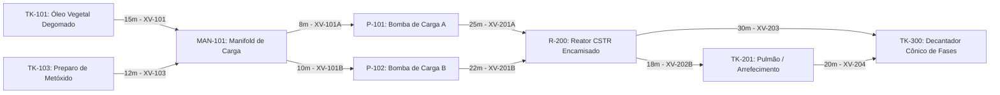

# Aula 11: Teoria dos Grafos — Modelagem de Tubulações e Instrumentos

## 1. Fundamentos Matemáticos: Definição Formal de Dígrafos Ponderados

Na engenharia de controle e automação de processos contínuos e em batelada, a infraestrutura física de transporte de fluidos (tubulações, manifolds, bombas, vasos reatores e separadores) não deve ser tratada como um mero agrupamento estático de equipamentos. Ela constitui uma **rede hidráulica orientada**, cujas propriedades de conectividade, vazão, redundância e tempo de trânsito são rigorosamente formalizadas através da **Teoria dos Grafos**.

Um **Grafo Dirigido e Ponderado (Dígrafo)** é formalmente definido pela tripla matemática:

$$G = (V, E, W)$$

Onde:
1. **$V = \{v_1, v_2, \dots, v_n\}$** é o conjunto finito e não-vazio de **vértices (nós)**: representa as unidades de processo, incluindo silos de armazenamento, tanques de reagentes, coletores (*manifolds*), bombas centrífugas/dosadoras, reatores encamisados e decantadores separadores de fases.
2. **$E \subseteq V \times V$** é o conjunto de **arestas dirigidas (arcos)**: representa os segmentos de tubulação física por onde há escoamento unidirecional forçado (via bombeamento ou gradiente gravimétrico favorável). Um arco $e_k = (u, v) \in E$ indica que o fluido se desloca estritamente da unidade $u$ para a unidade $v$.
3. **$W: E \rightarrow \mathbb{R}^+$** é a **função de ponderação de arestas**: mapeia cada trecho de tubulação a um custo físico escalar estritamente positivo, tipicamente o seu **comprimento físico linear $L\text{ [m]}$**, tempo de residência hidráulica $\tau\text{ [s]}$ ou perda de carga distribuída $\Delta P\text{ [bar / kPa]}$.

Para a **Planta Piloto de Produção de Biodiesel por Transesterificação em Batelada (Grupo 5)**, o núcleo operacional de preparação de carga, reação química e envio à decantação é modelado pela topologia industrial apresentada a seguir:

### Leitura Técnica do Diagrama Hidráulico:
* **Sentido Físico de Escoamento:** Cada flecha orientada fixa o sentido positivo de circulação do fluido. As matérias-primas partem dos tanques de armazenamento e preparo (`TK-101_Oleo` e `TK-103_Mix`), convergem para o nó distribuidor `MAN-101`, passam pelas bombas de pressurização `P-101` ou `P-102`, entram no reator `R-200` para a síntese química a $60^\circ\text{C}$ e, concluída a batelada, descarregam em direção ao vaso decantador `TK-300_Decant` diretamente ou passando pelo trocador/pulmão de estabilização `TK-201_Pulmao`.
* **Rótulos de Engenharia:** Sobre cada aresta são explicitados o comprimento da linha em metros e a **Tag de Instrumentação ISA-5.1** da válvula automatizada de bloqueio rápido instalada naquele duto de processo.

---

## 2. Por que um Grafo e não uma Lista de Equipamentos?

Em projetos de automação industrial tradicionais, a documentação mecânica é frequentemente sintetizada em tabelas relacionais de linhas (*line lists*) e índices de equipamentos (*equipment lists*). No entanto, sob a ótica de engenharia de controle, sistemas especialistas e supervisão SCADA avançada, essa modelagem tabular oculta propriedades fundamentais que emergem espontaneamente quando adotamos a **Teoria dos Grafos**:

1. **Conectividade Formal e Roteamento de Bateladas:** A representação em grafo permite provar matematicamente a existência de caminhos viáveis entre qualquer nó de alimentação e as unidades finais sem necessidade de inspeção visual humana no Diagrama de Tubulação e Instrumentação (P&ID).
2. **Identificação Imediata de Redundâncias e Gargalos:** O grau de entrada do nó reator ($\deg^-(R\text{-}200) = 2$) expõe diretamente no grafo que o sistema conta com uma linha de bombeamento redundante em paralelo (`P-101` e `P-102`), viabilizando comutação automática em caso de sobrecarga térmica do motor ou cavitação.
3. **Composição Algorítmica Reutilizável:** Uma vez formalizada a malha como $G=(V, E, W)$, algoritmos consagrados da ciência da computação e matemática discreta (Euler, Dijkstra, Busca em Largura, Busca em Profundidade, Algoritmo de Fleury) tornam-se diretamente aplicáveis para resolver problemas vitais de controle:
   - Desvio automático de vazamentos e bloqueios em tempo real (Aulas 13, 14 e 15);
   - Planejamento de rondas de inspeção autônoma sem repetição desnecessária de tubulações (Aula 16);
   - Coleta de amostras químicas de controle de qualidade por robôs móveis AGV (Aula 17).

---

### 2.1. Definições Fundamentais de Teoria dos Grafos Aplicadas a Processos

Para consolidar a fundamentação teórica que permeará todo o Módulo 2, definem-se os conceitos centrais:

* **Ordem do Grafo ($|V| = n$):** Número total de equipamentos ativos modelados como vértices. Na rede básica da planta de biodiesel, temos $n = 8$ nós.
* **Tamanho do Grafo ($|E| = m$):** Número total de tubulações dirigidas que interligam os equipamentos. Na rede básica, temos $m = 9$ dutos.
* **Passeio (*Walk*):** Sequência alternada de vértices e arestas $v_0, e_1, v_1, e_2, \dots, e_k, v_k$, onde cada $e_i = (v_{i-1}, v_i) \in E$. Modela fisicamente o trajeto exato percorrido por uma fração volumétrica de reagente ou produto na planta, podendo repetir nós e linhas.
* **Caminho (*Path*):** Passeio no qual **todos os vértices são distintos**. É a estrutura de interesse primário para a definição de rotas de transferência sem recirculação indesejada entre setores.
* **Trilha (*Trail*):** Passeio no qual **nenhuma aresta é repetida**, embora vértices intermediários possam ser revisitados. É o conceito-chave da Aula 16 para trajetos de inspeção preventiva de soldas e dutos por robôs com sensores ultrassônicos.
* **Ciclo (*Cycle*):** Caminho fechado ($v_0 = v_k$, com $k \ge 1$) sem repetição de vértices intermediários. A presença de ciclos na malha hidráulica denuncia a existência de caminhos alternativos de contingência e alívio de pressão.
* **Grau de Saída ($\deg^+(v)$):** Quantidade de arestas direcionadas que partem do nó $v$. Fisicamente, representa o número de dutos de descarga acoplados àquele equipamento.
* **Grau de Entrada ($\deg^-(v)$):** Quantidade de arestas direcionadas que convergem para o nó $v$. Fisicamente, representa o número de dutos de admissão que alimentam o equipamento.

---

### 2.2. Lema do Aperto de Mãos Dirigido (*Directed Handshaking Lemma*)

Para qualquer grafo direcionado $G = (V, E)$, vale rigorosamente a identidade fundamental:

$$\sum_{v \in V} \deg^+(v) = \sum_{v \in V} \deg^-(v) = |E|$$

**Demonstração e Significado Físico:**  
Cada segmento de tubulação física cadastrado no sistema possui exatamente uma extremidade de montante (origem do fluxo) e uma extremidade de jusante (destino do fluxo). Logo, ao inserir uma nova tubulação $e = (u, v)$ no banco de dados do SCADA, incrementa-se simultaneamente o grau de saída do equipamento de origem $\deg^+(u)$ em $+1$ e o grau de entrada do equipamento de destino $\deg^-(v)$ em $+1$. Nenhum trecho pode ser criado ou destruído de forma assimétrica.

**Verificação na Malha da Planta de Biodiesel:**  
Avaliando os graus calculados no notebook da Aula 11 para os 8 equipamentos:

| Equipamento / Vértice ($v$) | Descrição Funcional | $\deg^-(v)$ | $\deg^+(v)$ |
| :--- | :--- | :---: | :---: |
| `TK-101_Oleo` | Tanque de Óleo Vegetal Degomado | 0 | 1 |
| `TK-103_Mix` | Tanque de Preparação do Metóxido | 0 | 1 |
| `MAN-101` | Manifold Coletor / Distribuidor de Carga | 2 | 2 |
| `P-101` | Motobomba de Alimentação Principal A | 1 | 1 |
| `P-102` | Motobomba de Alimentação Reserva B | 1 | 1 |
| `R-200` | Reator CSTR Encamisado | 2 | 2 |
| `TK-201_Pulmao` | Tanque Pulmão / Arrefecimento | 1 | 1 |
| `TK-300_Decant` | Decantador Cônico de Separação | 2 | 0 |
| **Soma Total ($\sum$)** | **Balanço Topológico Global** | **9** | **9** |

Constata-se: $\sum \deg^+ = 9$ e $\sum \deg^- = 9$, igualando perfeitamente a quantidade de dutos $|E| = 9$. Essa verificação algébrica automática é empregada no boot do sistema supervisório para certificar que não existem dutos órfãos ou desconexos no cadastro da planta.

---

### 2.3. Representações Computacionais e Análise de Desempenho

A escolha da estrutura de dados para representar o grafo na memória do CLP ou servidor SCADA impõe um *trade-off* clássico entre consumo de memória e latência de consulta algorítmica:

| Representação Computacional | Estrutura de Memória | Espaço em Memória | Consulta de Adjacência: Existe $(u,v)$? | Casos de Uso Recomendados |
| :--- | :--- | :---: | :---: | :--- |
| **Matriz de Adjacência** | Array bidimensional $n \times n$ (`float[n][n]`) | $O(n^2)$ | $O(1)$ | Grafos densos ou quando são exigidas operações algébricas matriciais diretas (potências da matriz para contagem de passeios, Aula 12). |
| **Lista de Adjacência** | Dicionário de listas ligadas (`dict[str, list]`) | $O(n + m)$ | $O(\deg(u))$ | Redes industriais reais altamente esparsas ($m \approx n$ a $2n$), com melhor eficiência de memória e rápida iteração sobre vizinhos. |
| **Matriz de Incidência** | Array bidimensional $n \times m$ (`int[n][m]`) | $O(n \cdot m)$ | — | Formulação estrita de leis de conservação física (Kirchhoff) e balanço de massa matricial (Aula 12). |

A classe `GrafoTubulacao` implementada no notebook adota uma matriz binária de adjacência associada a uma **matriz de pesos (custos métricos)**. Fora da diagonal principal, as posições sem arco direto são inicializadas com valor infinito ($\infty$), enquanto a diagonal é preenchida com custo zero ($0.0$), atendendo à convenção matemática necessária para os algoritmos gulosos de caminho mínimo (Dijkstra e Floyd-Warshall).

---

### 2.4. Grafo Simples vs. Multigrafo em Plantas Industriais

Em processos químicos altamente perigosos que exigem conformidade com as normas **IEC 61511 (SIL 3)**, é comum projetar **duas tubulações físicas idênticas e paralelas** conectando os mesmos dois equipamentos, com válvulas de segurança independentes, para assegurar suprimento ininterrupto em caso de entupimento ou ruptura.

Quando dois nós $u$ e $v$ possuem mais de uma aresta direcionada no mesmo sentido ($e_a = (u,v)$ e $e_b = (u,v)$), o modelo matemático deixa de ser um grafo simples e passa a ser classificado como um **Multigrafo**. Uma matriz de adjacência escalar padrão `adj[u][v]` é incapaz de representar diretamente essa multiplicidade sem perda de informação (ela sobreescreveria o peso). Nesses cenários, a representação deve evoluir para listas de adjacência contendo identificadores únicos de dutos ou tensores de dimensão $n \times n \times k$.

---

## 3. Exemplo Resolvido

**Problema:**  
O engenheiro de automação responsável pela documentação técnica da planta de biodiesel precisa extrair da topologia o número total de saídas instrumentadas ativas e verificar se algum equipamento atua como fonte pura ou sumidouro puro. Demonstre a resolução através das propriedades de graus topológicos.

**Resolução:**  
1. **Identificação de Fontes Puras ($\deg^-(v) = 0 \land \deg^+(v) > 0$):**  
   Os nós `TK-101_Oleo` e `TK-103_Mix` possuem grau de entrada nulo e grau de saída igual a 1. Logo, são **fontes puras** de matéria-prima (admissão externa de insumos).
2. **Identificação de Sumidouro Puro ($\deg^-(v) > 0 \land \deg^+(v) = 0$):**  
   O nó `TK-300_Decant` possui grau de entrada 2 e grau de saída 0. É o **sumidouro final** do subsistema de transesterificação, recepcionando a batelada para separação bifásica.
3. **Grau de Saída Global:**  
   $$\sum_{v \in V} \deg^+(v) = 1 + 1 + 2 + 1 + 1 + 2 + 1 + 0 = 9$$  
   Fisicamente, este valor comprova que existem exatamente **9 válvulas automatizadas de controle/bloqueio ISA-5.1** instaladas nas linhas de saída de equipamentos da malha, dado essencial para o dimensionamento dos módulos de saída digital (DO) do CLP do SCADA.

---

## 4. Atividades de Investigação

1. **Teorema do Grau Par em Grafos Dirigidos:** A partir do Lema do Aperto de Mãos Dirigido, prove que é impossível construir uma malha hidráulica direcionada contendo exatamente um equipamento com grau de saída ímpar e todos os demais com grau de saída par, sob a condição de que a soma dos graus de entrada da rede seja um número par.
2. **Modelagem de Redundância Crítica de Catalisador (Multígrafo):** Suponha que, por exigência de segurança contra incrustações de metóxido de sódio, seja adicionada uma segunda tubulação independente ligando `TK-103_Mix` ao `MAN-101`. Explique por que a matriz `adj_binaria[8][8]` falha nessa representação e proponha a modificação em Python para suportar essa especificação.
3. **Análise de Caminhos vs. Trilhas na Malha:** Considere a rota completa de escoamento partindo de `TK-101_Oleo`, atravessando o reator `R-200`, passando pelo tanque de arrefecimento `TK-201_Pulmao` e finalizando em `TK-300_Decant`. Classifique formalmente essa sequência como passeio, caminho ou trilha.
4. **Impacto Topológico de Linha de Reciclo de Batelada:** Se a engenharia de processos instalar uma linha de reciclo de batelada incompleta retornando de `TK-300_Decant` para o reator `R-200`, quantos ciclos direcionados simples passarão a existir na malha? Enumere formalmente os vértices que compõem cada um deles.

---

## 5. Entregável da Aula 11

* **Classe `GrafoTubulacao` em Python:** Estrutura orientada a objetos desenvolvida especificamente para a **Planta de Produção de Biodiesel (Transesterificação em Batelada)**, parametrizada segundo a norma ISA-5.1, com métodos de inserção de tubulações, geração de graus topológicos e matrizes de adjacência (binária e ponderada).
* **Caderno Jupyter Executável:** Arquivo [`11 - Modelagem da Tubulacao e Instrumentos como Grafo.ipynb`](./11%20-%20Modelagem%20da%20Tubulacao%20e%20Instrumentos%20como%20Grafo.ipynb) com testes e formatação de saídas em console.
