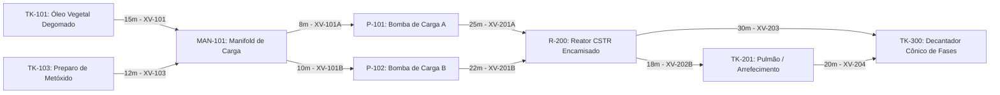

# Aula 13: Algoritmos de Busca (BFS e DFS) em Malhas de Tubulação de Biodiesel

## 1. Fundamentos Matemáticos: Travessia e Descoberta em Grafos Industriais

Na operação automatizada de plantas contínuas e em batelada, a supervisão SCADA e os controladores lógicos programáveis (CLPs) necessitam frequentemente responder a duas perguntas operacionais fundamentais:
1. **Qual é o caminho que exige o menor número de manobras de válvulas motorizadas?**
2. **Quais são todas as rotas alternativas fisicamente viáveis de escoamento caso ocorra uma falha mecânica em um equipamento intermediário?**

Para resolver esses desafios sobre o dígrafo da planta de processo $G = (V, E)$, empregam-se algoritmos clássicos de **travessia em grafos**:

1. **Busca em Largura (BFS - *Breadth-First Search*):** Utiliza uma fila **FIFO (*First-In, First-Out*)**. Explora a topologia em camadas concêntricas a partir do nó de origem, garantindo encontrar o caminho com o **menor número de arestas (ou seja, menor número de válvulas automatizadas a acionar)** em tempo assintótico $O(|V| + |E|)$.
2. **Busca em Profundidade (DFS - *Depth-First Search*):** Utiliza uma pilha **LIFO (*Last-In, First-Out*)** ou recursão. Penetra exaustivamente ao longo de cada ramal antes de realizar o retrocesso (*backtracking*), permitindo **detectar ciclos operacionais**, classificar arestas estruturais e **enumerar todos os caminhos alternativos de contingência** entre qualquer par de unidades industriais.

### Topologia Operacional do Processo (Planta de Biodiesel - Grupo 5):

A malha hidráulica do núcleo de reação e decantação da planta de biodiesel é modelada pelo grafo orientado:

---

## 2. Aprofundamento Teórico

### 2.1. Busca em Largura (BFS) — Definição Formal e Invariante de Camadas

O algoritmo **BFS** explora o grafo sistematicamente **por camadas de conectividade**: a partir de um vértice de partida $s \in V$, visita-se inicialmente todos os nós a distância de 1 aresta, em seguida todos a distância de 2 arestas, e assim sucessivamente.

Seja $d(s, v)$ a distância mínima (medida estritamente em número de arestas) do vértice fonte $s$ até o vértice $v$. O BFS garante a seguinte **invariante fundamental** durante o esvaziamento da fila FIFO:

$$\text{Se o vértice } v \text{ é retirado da fila antes de } u, \text{ então } d(s, v) \leq d(s, u).$$

#### Consequência Direta para a Engenharia de Controle:
Essa invariante assegura matematicamente que **o primeiro caminho descoberto pela BFS até o equipamento de destino é estritamente a rota de menor número de arestas**. 

Na planta de biodiesel, cada aresta percorrida contém uma válvula automática de bloqueio (ex.: $XV\text{-}101, XV\text{-}101A, XV\text{-}201A, XV\text{-}203$). Minimizar a quantidade de arestas equivale a **minimizar o número de válvulas acionadas na manobra**. Isso diminui a taxa acumulada de falha mecânica de atuadores, reduz o tempo total de transição de estado da planta e mitiga transitórios hidráulicos de golpe de aríete (*water hammer*).

**Complexidade Computacional da BFS:**
* Cada equipamento (vértice) entra e sai da fila FIFO no máximo uma vez: $O(|V|)$.
* Cada duto (aresta) adjacente é inspecionado exatamente uma vez ao examinar a vizinhança: $O(|E|)$.
* A complexidade temporal total é linear: $\mathcal{O}(|V| + |E|)$. Para a malha da planta ($|V| = 8$, $|E| = 9$), a execução ocorre em microssegundos no processador do CLP.

---

### 2.2. Busca em Profundidade (DFS) — Definição Formal e Classificação de Arestas

Ao contrário da BFS, a **DFS** aprofunda-se até atingir um nó sem sucessores não-visitados (sumidouro) ou o destino pretendido, retrocedendo (*backtracking*) para explorar ramos alternativos.

Durante a execução da DFS em um grafo dirigido, cada trecho de tubulação $(u, v) \in E$ é formalmente classificado em uma de quatro categorias com base nos instantes de descoberta $d[u]$ e finalização $f[u]$ na árvore de busca:

| Tipo de Aresta | Definição Algébrica | Interpretação Física na Planta de Biodiesel |
| :--- | :--- | :--- |
| **Aresta de Árvore** (*Tree Edge*) | O nó $v$ é descoberto pela primeira vez a partir de $u$. | Rota primária de carregamento ou transferência direta de batelada. |
| **Aresta de Retorno** (*Back Edge*) | O nó $v$ é um ancestral de $u$ na árvore de busca ($d[v] < d[u] < f[u] < f[v]$). | Indica a existência de um **ciclo** (ex.: linha de reciclo de batelada não reagida). |
| **Aresta de Avanço** (*Forward Edge*) | O nó $v$ é um descendente de $u$ já finalizado ($d[u] < d[v] < f[v] < f[u]$). | Atalho direto entre setores da planta sem passar pelas etapas intermediárias normais. |
| **Aresta de Cruzamento** (*Cross Edge*) | Conecta vértices em sub-árvores distintas sem relação direta de ancestralidade. | Interligação entre ramais paralelos de bombeamento ou setores independentes. |

#### Verificação de DAG (Grafo Acíclico Dirigido):
Um dígrafo é um **DAG** se, e somente se, a busca em profundidade não detecta **nenhuma aresta de retorno (*back edge*)**. Na rede nominal da Aula 11 (alimentação dos reagentes até a decantação), a malha é estritamente acíclica, assegurando que o escoamento caminha unidirecionalmente para a separação dos ésteres sem recirculações descontroladas.

**Complexidade Computacional da DFS:**
* Para travessia simples e detecção de ciclos: $\mathcal{O}(|V| + |E|)$.
* Para a **enumeração de todos os caminhos simples**: no pior caso de grafos densos, o número de caminhos pode ser exponencial ($O(2^{|V|})$). Contudo, em plantas industriais reais, a topologia é esparsa com manifolds limitados, tornando a enumeração completa instantânea.

---

### 2.3. BFS vs. DFS: Critérios de Escolha na Engenharia de Controle

| Critério de Comparação | Busca em Largura (BFS) | Busca em Profundidade (DFS) |
| :--- | :---: | :---: |
| **Garantia de Caminho Mínimo em Nº de Arestas** | **Sim** (garantia matemática por camadas) | **Não** (depende da ordem de visita dos vizinhos) |
| **Consumo de Memória no Pior Caso** | $\mathcal{O}(|V|)$ (fronteira mantida na fila FIFO) | $\mathcal{O}(\text{profundidade máxima}) \le \mathcal{O}(|V|)$ |
| **Enumeração de Todas as Rotas Alternativas** | Ineficiente / Complexa | **Natural e Direta** (via recursão com retrocesso) |
| **Detecção de Ciclos e Análise Topológica** | Indireta | **Direta e Eficiente** (arestas de retorno) |
| **Aplicação Típica no SCADA da Planta** | Roteamento com menor número de manobras de válvulas | Mapeamento integral de rotas de contingência e redundância |

---

### 2.4. Bloqueio Dinâmico de Nós e Simulação de Falhas em Tempo Real

A classe `NavegadorGrafos` recebe em seus métodos o parâmetro opcional `nos_bloqueados: Optional[Set[str]]`. Quando um equipamento entra em estado de manutenção preventiva, sobretemperatura ($TT-201 \ge 65^\circ\text{C}$), cavitação de bomba ou vazamento detectado pelo sensor $AT-100$, o SCADA inclui sua identificação no conjunto de bloqueios.

Do ponto de vista de complexidade algorítmica:
* Utilizando a estrutura `set` em Python (tabela hash), a verificação `if v_nome not in nos_bloqueados` opera em tempo amortizado $\mathcal{O}(1)$.
* A complexidade global permanece estritamente linear $\mathcal{O}(|V| + |E|)$, permitindo que o sistema de controle comute para a linha reserva em tempo real sem interrupção do ciclo de clock do CLP.

---

## 3. Exemplo Resolvido

**Cenário de Engenharia:**  
O operador da sala de controle inicia o carregamento de óleo vegetal a partir do tanque `TK-101_Oleo` com destino final no decantador de fases `TK-300_Decant`. 

1. Demonstre qual caminho é retornado pela BFS e explique por que a rota direta é escolhida.
2. Simule a parada de emergência da bomba principal `P-101` e demonstre como o algoritmo BFS recalcula automaticamente a rota de contingência pela bomba reserva `P-102`.

**Resolução Passo a Passo:**

1. **Execução da BFS Nominal (`TK-101_Oleo` $\rightarrow$ `TK-300_Decant`):**
   * *Camada 0:* Fila FIFO: `[TK-101_Oleo]`. Distância em arestas: $0$.
   * *Camada 1:* Retira `TK-101_Oleo`. Vizinho descoberto: `MAN-101`. Fila: `[MAN-101]`.
   * *Camada 2:* Retira `MAN-101`. Vizinhos descobertos: `P-101` e `P-102`. Fila: `[P-101, P-102]`.
   * *Camada 3:* Retira `P-101`. Vizinho descoberto: `R-200`. Fila: `[P-102, R-200]`. Ao retirar `P-102`, seu vizinho `R-200` já está marcado como visitado.
   * *Camada 4:* Retira `R-200`. Vizinhos descobertos: `TK-300_Decant` e `TK-201_Pulmao`. Fila: `[TK-300_Decant, TK-201_Pulmao]`.
   * *Descoberta do Alvo:* Ao inspecionar `TK-300_Decant`, o destino é atingido na camada 4!
   * *Caminho Resultante:*  
     $$\text{TK-101\_Oleo} \xrightarrow{\text{XV-101}} \text{MAN-101} \xrightarrow{\text{XV-101A}} \text{P-101} \xrightarrow{\text{XV-201A}} \text{R-200} \xrightarrow{\text{XV-203}} \text{TK-300\_Decant}$$  
     Total: **4 arestas (4 válvulas)**.  
     A rota passando por `TK-201_Pulmao` exigiria 5 arestas (5 válvulas), sendo portanto preterida pela BFS.

2. **Simulação de Contingência com Falha em `P-101` (`nos_bloqueados={"P-101"}`):**
   * Na expansão do nó `MAN-101`, o vértice `P-101` é rejeitado pelo filtro de bloqueio.
   * Apenas `P-102` é inserido na fila FIFO.
   * A partir de `P-102`, alcança-se `R-200` e em seguida `TK-300_Decant`.
   * *Novo Caminho de Contingência:*  
     $$\text{TK-101\_Oleo} \xrightarrow{\text{XV-101}} \text{MAN-101} \xrightarrow{\text{XV-101B}} \text{P-102} \xrightarrow{\text{XV-201B}} \text{R-200} \xrightarrow{\text{XV-203}} \text{TK-300\_Decant}$$  
     A planta mantém sua capacidade produtiva sem interrupção de batelada, provando a eficácia da redundância do Grupo 5.

---

## 4. Atividades de Investigação

1. **Rastreamento Manual da BFS a Partir do Metóxido:**  
   Execute manualmente o algoritmo BFS partindo de `TK-103_Mix` até `TK-300_Decant`. Determine a camada (distância em arestas) de cada vértice visitado e indique a rota obtida.
2. **Classificação Estrutural de Arestas via DFS:**  
   Ao executar a DFS para listar todos os caminhos entre `TK-101_Oleo` e `TK-300_Decant`, classifique cada uma das 9 arestas da malha. Confirme formalmente a inexistência de arestas de retorno (*back edges*) e comprove que a topologia nominal da planta é um DAG.
3. **Cenário de Falha Dupla Simultânea:**  
   Suponha que ocorram simultaneamente: a indisponibilidade mecânica de `P-101` e o bloqueio operacional do duto direto de saída do reator `R-200` (válvula $XV\text{-}203$). Execute a BFS e determine se ainda existe caminho viável até o decantador `TK-300_Decant`. Qual rota física será selecionada e com quantas válvulas?
4. **DFS Truncada para Sistemas Especialistas:**  
   Em uma planta industrial de grande porte com centenas de ramais paralelos, a enumeração completa de caminhos pode sobrecarregar a memória do controlador. Proponha uma modificação algorítmica na DFS para limitar a busca às primeiras $K = 2$ rotas alternativas viáveis e discuta o ganho de tempo de resposta.

---

## 5. Entregável da Aula 13

* **Motor de Busca Topológica em Python:** Implementação orientada a objetos das classes `GrafoTubulacao` e `NavegadorGrafos`, com os métodos `bfs_menor_numero_valvulas` e `dfs_todos_os_caminhos`, parametrizados com isolamento dinâmico de equipamentos via `nos_bloqueados`.
* **Caderno Jupyter Executável:** Arquivo [`13 - Algoritmos de Busca BFS e DFS em Tubulacoes.ipynb`](./13%20-%20Algoritmos%20de%20Busca%20BFS%20e%20DFS%20em%20Tubulacoes.ipynb) validado com testes unitários, formatação de saídas em console e tratamento de contingência de bombas.
