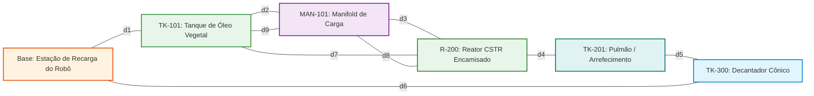

<a href="https://colab.research.google.com/github/igorfantucci/Aula-Automatica---GRUPO-5/blob/main/etapa-02-grafos/16%20-%20Problemas%20Eulerianos%20e%20Inspecao%20de%20Infraestrutura.ipynb" target="_parent"></a>

# Aula 16: Problemas Eulerianos e Inspeção Autônoma de Infraestrutura de Biodiesel

## 1. Fundamentos Matemáticos: Teorema de Euler e Circuitos Eulerianos em Malhas Industriais

Na engenharia de confiabilidade e manutenção mecânica de plantas químicas e refinarias de biocombustíveis, a integridade estrutural das tubulações de transferência de fluidos é uma exigência inegociável de segurança operacional, ambiental e ocupacional. Em instalações industriais de processamento contínuo e batelada, como a **Planta Piloto de Produção de Biodiesel (Grupo 5)**, as tubulações que transportam matérias-primas e reagentes químicos estão continuamente expostas a mecanismos agressivos de degradação:

1. **Ataque Químico e Corrosão por Pitting:** O catalisador metóxido de sódio ($\text{NaOCH}_3$) e o álcool metílico ($\text{CH}_3\text{OH}$) apresentam acentuada agressividade corrosiva sobre ligas ferrosas e juntas poliméricas;
2. **Corrosão por Ácidos Graxos Livres:** O óleo vegetal degomado residual possui acidez graxa capaz de provocar corrosão alveolar localizada sob temperaturas operacionais elevadas ($55^\circ\text{C}$ a $65^\circ\text{C}$);
3. **Fadiga Mecânica e Trincas por Vibração:** A pulsação contínua de escoamento gerada pelas motobombas $P\text{-}101$ e $P\text{-}102$ induz fadiga cíclica nas soldas circunferenciais dos dutos (*weld toe cracking*).

Em conformidade com os padrões regulatórios **NR-13 (Caldeiras, Vasos de Pressão e Tubulações)**, **API 570 (Piping Inspection Code)** e **ASME B31.3 (Process Piping)**, a malha de dutos deve ser inspecionada periodicamente por ensaios não-destrutivos (NDT - *Non-Destructive Testing*).

Para eliminar a necessidade de andaimes manuais, espaços confinados e paradas demoradas de produção, a engenharia de automação moderna emprega **robôs móveis autônomos rastreadores (*pipe crawlers*)** equipados com transdutores de ultrassom phased-array (PAUT) e medição de dispersão de fluxo magnético (MFL). O objetivo da missão robótica autônoma consiste em: **percorrer todas as tubulações da planta para varredura completa de espessura de parede, passando exatamente uma vez por cada trecho e retornando à base de recarga sem consumo inútil de energia de bateria**.

Esse desafio é a formulação física direta do **Problema do Circuito Euleriano**.

---

### 1.1. Definições Formais de Teoria dos Grafos

Seja um grafo não-dirigido conexo $G = (V, E)$, onde $V$ representa os nós de equipamentos ou juntas mecânicas da planta e $E$ representa os segmentos físicos de tubulação:

* **Passeio (*Walk*):** Uma sequência alternada de vértices e arestas $v_0, e_1, v_1, e_2, \dots, e_k, v_k$, onde cada aresta $e_i = \{v_{i-1}, v_i\} \in E$. Vértices e arestas podem se repetir arbitrariamente.
* **Trilha (*Trail*):** Um passeio no qual **nenhuma aresta é repetida** ($e_i \neq e_j$ para todo $i \neq j$), embora vértices intermediários possam ser revisitados mais de uma vez.
* **Caminho (*Path*):** Um passeio no qual **nenhum vértice é repetido** (e, consequentemente, nenhuma aresta se repete).
* **Trilha Euleriana (*Eulerian Trail*):** Uma trilha que percorre **todas as arestas do conjunto $E$ exatamente uma vez**.
* **Circuito Euleriano (*Eulerian Circuit*):** Uma trilha euleriana fechada, na qual o ponto de término coincide rigorosamente com o ponto de partida ($v_0 = v_k$).

---

### 1.2. O Teorema Fundamental de Euler (1736)

> **Teorema de Euler (Caso Não-Dirigido):**  
> Um multigrafo conexo $G = (V, E)$ admite um Circuito Euleriano se e somente se **todos os seus vértices possuem grau par**:
> $$\forall v \in V, \quad \deg(v) \equiv 0 \pmod 2$$
> 
> Caso existam **exatamente dois vértices com grau ímpar**, o grafo não admite circuito, mas admite uma **Trilha Euleriana aberta**, iniciando obrigatoriamente em um dos vértices ímpares e finalizando no outro. Se existirem mais de dois vértices ímpares, não existe qualquer passeio euleriano no grafo.

---

### 1.3. Por Que a Inspeção Robótica É Modelada como Grafo Não-Dirigido?

Enquanto o fluxo hidrodinâmico das Aulas 11 a 15 obedece a um sentido unidirecional estrito (dígrafo) imposto pela pressão de bombeamento, o veículo robótico de manutenção trafega mecanicamente **ao longo da carcaça externa das tubulações em pipe racks suspensos em qualquer sentido de deslocamento**:
$$\{u, v\} = \{v, u\}$$

Assim, a inspeção de solda e medição ultrassônica de espessura de chapa pode ser efetuada com o robô se deslocando de montante para jusante ou vice-versa, justificando com rigor a adoção da modelagem não-dirigida.

---

### 1.4. Topologia da Malha de Inspeção e Manutenção Preventiva (Planta de Biodiesel)

O diagrama a seguir exibe a malha física de inspeção preventiva da planta do Grupo 5, contendo o ponto de ancoragem e carregamento do robô (`Base`), os 5 nós operacionais centrais e os 9 dutos de inspeção (`d1` a `d9`):



---

### 1.5. Especificações Técnicas dos Segmentos de Inspeção

A tabela a seguir consolida os parâmetros mecânicos e de instrumentação de cada duto a ser percorrido pelo robô autônomo:

| ID Duto | Vértice Origem ($u$) | Vértice Destino ($v$) | Equipamentos Interligados | Comprimento $L$ [m] | Diâmetro $D$ [pol] | Técnica NDT Aplicada |
| :---: | :---: | :---: | :--- | :---: | :---: | :--- |
| `d1` | `Base` | `TK101` | Estação de Recarga $\leftrightarrow$ Tanque de Óleo | 10.0 | 4.0 | Ultrassom Phased-Array (PAUT) |
| `d2` | `TK101` | `MAN101` | Tanque de Óleo $\leftrightarrow$ Manifold Distribuidor | 15.0 | 4.0 | Dispersão de Fluxo Magnético (MFL) |
| `d3` | `MAN101` | `R200` | Manifold Coletor $\leftrightarrow$ Reator CSTR Encamisado | 25.0 | 4.0 | Ultrassom Phased-Array (PAUT) |
| `d4` | `R200` | `TK201` | Reator CSTR $\leftrightarrow$ Pulmão / Arrefecimento | 18.0 | 6.0 | Correntes Parasitas Pulsadas (PEC) |
| `d5` | `TK201` | `TK300` | Tanque Pulmão $\leftrightarrow$ Decantador Cônico | 20.0 | 6.0 | Ultrassom Phased-Array (PAUT) |
| `d6` | `TK300` | `Base` | Decantador Cônico $\leftrightarrow$ Estação de Recarga | 12.0 | 6.0 | MFL e Perfilometria a Laser |
| `d7` | `TK101` | `R200` | Duto Intersetorial de Bypass de Reação | 28.0 | 4.0 | Ultrassom Phased-Array (PAUT) |
| `d8` | `R200` | `MAN101` | Linha Secundária de Reciclo e Manifold | 22.0 | 4.0 | Ultrassom de Onda Guiada (GWT) |
| `d9` | `MAN101` | `TK101` | Ramal de Interligação Manifold / Armazenamento | 15.0 | 4.0 | Dispersão de Fluxo Magnético (MFL) |

---

### 1.6. Representação Matricial da Malha Não-Dirigida de Inspeção

A estrutura algébrica do grafo de inspeção pode ser expressa por sua **Matriz de Adjacência Não-Dirigida** $A \in \{0, 1, 2\}^{6 \times 6}$, onde valores maiores que 1 representam multiarestas paralelas:

```
           Base  TK101 MAN101   R200  TK201  TK300   Grau Somado (deg)
Base     |    0      1      0      0      0      1  |        2 (Par)
TK101    |    1      0      2      1      0      0  |        4 (Par)
MAN101   |    0      2      0      2      0      0  |        4 (Par)
R200     |    0      1      2      0      1      0  |        4 (Par)
TK201    |    0      0      0      1      0      1  |        2 (Par)
TK300    |    1      0      0      0      1      0  |        2 (Par)
```

Observe que a soma dos elementos da linha $i$ é exatamente o grau do vértice $v_i$:
$$\deg(v_i) = \sum_{j=1}^n A[i, j]$$
Como todas as somas resultam em 2 ou 4, a paridade par é verificada algebricamente em nível matricial.

---

## 2. Aprofundamento Teórico

### 2.1. Contexto Histórico: O Problema das Sete Pontes de Königsberg (Euler, 1736)

A Teoria dos Grafos e a Topologia nasceram formalmente em **1736**, quando o matemático suíço Leonhard Euler publicou seu artigo fundacional *"Solutio problematis ad geometriam situs pertinentis"* na Academia de São Petersburgo, solucionando o célebre enigma das **Sete Pontes de Königsberg**.

A cidade de Königsberg (antiga capital da Prússia Oriental, atual território russo de Kaliningrado) era cortada pelo Rio Pregel, que envolvia duas grandes ilhas (Kneiphof e Lomse). Sete pontes de madeira interligavam as duas ilhas e as duas margens continentais do rio:

* Margem Norte ($A$): conectada por 2 pontes à ilha Kneiphof e 1 ponte à ilha Lomse;
* Ilha Kneiphof ($B$): conectada por 2 pontes à Margem Norte, 2 à Margem Sul e 1 à ilha Lomse;
* Margem Sul ($C$): conectada por 2 pontes à ilha Kneiphof e 1 ponte à ilha Lomse;
* Ilha Lomse ($D$): conectada por 1 ponte à Margem Norte, 1 à Margem Sul e 1 à ilha Kneiphof.

A pergunta que intrigava a sociedade letrada era se existiria um itinerário que atravessasse **cada uma das sete pontes exatamente uma vez, retornando ao ponto de origem**.

Euler fez a abstração pioneira de ignorar completamente as distâncias geométricas, larguras de pontes e formato dos terrenos, reduzindo a questão a propriedades topológicas puras:
* As quatro regiões terrestres foram modeladas como **vértices** ($|V| = 4$);
* As sete pontes foram modeladas como **arestas** ($|E| = 7$).

Ao computar os graus dos vértices no grafo resultante:
$$\deg(A) = 3, \quad \deg(B) = 5, \quad \deg(C) = 3, \quad \deg(D) = 3$$

Euler provou matematicamente que o passeio era **impossível**, pois todos os quatro vértices possuíam grau ímpar. Essa dedução estabeleceu as bases do critério de paridade de graus que governa até hoje o planejamento de rotas autônomas em robótica e logística.

---

### 2.2. Demonstração Formal Completa do Teorema de Euler

**Teorema:** Um multigrafo não-dirigido conexo $G = (V, E)$ admite um Circuito Euleriano se e somente se todo vértice $v \in V$ tem grau par.

#### Demonstração da Condição de Necessidade ($\implies$):
Suponha que $G$ admite um circuito euleriano $C = (v_0, e_1, v_1, e_2, \dots, e_m, v_0)$.
* Como $C$ é um circuito fechado, para qualquer vértice intermediário $u \neq v_0$, toda vez que a sequência atinge $u$ por uma aresta incidente, ela deve necessariamente deixar $u$ por outra aresta não utilizada anteriormente.
* Cada visita ao nó $u$ consome exatamente um par de arestas distintas $\{e_{\text{entrada}}, e_{\text{saída}}\}$, adicionando $+2$ ao cômputo de incidências em $u$.
* Como todas as arestas de $E$ pertencem a $C$ e nenhuma se repete, o número total de arestas incidentes em $u$ é dado por $\deg(u) = 2 \cdot k$ (onde $k$ é o número de vezes que $u$ foi visitado), sendo portanto estritamente par.
* Para o nó inicial/final $v_0$, a primeira aresta do circuito consome uma aresta de saída e a última consome uma aresta de entrada. Quaisquer visitas intermediárias adicionais a $v_0$ também consomem arestas em pares. Logo, o grau de $v_0$ é $1 + 1 + 2 \cdot k' = 2(k' + 1)$, que é igualmente par. $\blacksquare$

#### Demonstração da Condição de Suficiência ($\impliedby$, Método Construtivo):
Suponha que $G$ é conexo e todo vértice tem grau par não-nulo ($\deg(v) \ge 2$).
1. **Lema do Ciclo Simples:** Em qualquer grafo finito onde todo vértice possui grau par $\ge 2$, existe pelo menos um ciclo simples.  
   *Justificativa:* Partindo de um nó qualquer $u_0$ e caminhando por arestas adjacentes sem repetir arestas, nunca ficaremos presos em um nó $w \neq u_0$, pois ao entrar em $w$ com grau par, resta sempre um número ímpar de arestas disponíveis para sair. Como o número de vértices é finito, o passeio eventualmente deve revisitar algum nó já explorado, fechando um ciclo simples $C_1$.
2. **Decomposição em Ciclos Disjuntos:** Se $C_1$ contiver todas as arestas de $E$, o circuito está completo. Caso contrário, removemos as arestas de $C_1$ de $G$, gerando o subgrafo $G' = G \setminus E(C_1)$. Como a remoção de um ciclo subtrai exatamente 2 do grau de cada vértice participante, **todos os vértices em $G'$ continuam tendo grau par**.
3. **Costura de Ciclos (*Cycle Splicing*):** Pela conexidade de $G$, pelo menos um vértice de $C_1$ tem arestas incidentes em $G'$. Construímos um novo ciclo $C_2$ em $G'$ e o intercalamos no vértice compartilhado com $C_1$.
4. Iterando esse processo até exaurir $E$, obtemos um único circuito fechado que percorre todas as arestas de $G$. $\blacksquare$

---

### 2.3. O Algoritmo de Hierholzer (1873) — Análise Detalhada e Complexidade

Em 1873, o matemático alemão Carl Hierholzer publicou postumamente a formalização algorítmica ótima para a construção do circuito euleriano. A implementação com pilha explícita e consumo de adjacência opera nos seguintes passos:

```
Algoritmo de Hierholzer (Grafo Não-Dirigido Conexo G, Vértice Inicial 'inicio')
1. Inicializar pilha <- [inicio]
2. Inicializar circuito <- []
3. Fazer cópia dinâmica das listas de adjacência: adj_copia <- copiar(adj)
4. Enquanto pilha não estiver vazia:
5.     u <- topo da pilha
6.     Se adj_copia[u] não for vazia:
7.         Remover uma aresta (u, v, id_duto) de adj_copia[u]
8.         Remover a aresta simétrica (v, u, id_duto) de adj_copia[v]
9.         Empilhar v na pilha
10.    Senão:
11.        u_final <- desempilhar(pilha)
12.        Adicionar u_final ao circuito
13. Retornar inverter(circuito)
```

#### Análise de Complexidade Computacional:
* **Complexidade Temporal:** $\mathcal{O}(|E|)$.  
  Cada aresta física da malha é visitada e removida das listas de adjacência exatamente uma vez. Cada nó entra e sai da pilha proporcionalmente ao seu grau $\deg(v)$. Como o somatório dos graus é $2|E|$ (Lema do Aperto de Mãos), o laço executa em tempo estritamente linear em relação ao número de dutos. Em plantas industriais reais ($|E| \approx 10$ a $1.000$), o tempo de cálculo em processadores convencionais é de microssegundos.
* **Complexidade Espacial:** $\mathcal{O}(|V| + |E|)$, requerida pela estrutura de cópia de listas ligadas e pela pilha de nós.
* **Otimalidade Assintótica:** Como qualquer algoritmo de inspeção precisa examinar cada aresta ao menos uma vez, o limite inferior de complexidade é $\Omega(|E|)$, provando que o algoritmo de Hierholzer é **teoricamente ótimo**.

---

### 2.4. Comparativo Histórico: Algoritmo de Fleury (1883) vs. Algoritmo de Hierholzer (1873)

Antes da consolidação de Hierholzer nos sistemas computacionais, o **Algoritmo de Fleury (1883)** era ensinado como método padrão para traçado de circuitos eulerianos. A regra central de Fleury preconiza: *"atravesse qualquer aresta disponível, a menos que ela seja uma ponte no subgrafo remanescente"*.

| Característica de Engenharia | Algoritmo de Hierholzer (1873) | Algoritmo de Fleury (1883) |
| :--- | :---: | :---: |
| **Complexidade Temporal** | $\mathcal{O}(\|E\|)$ (Estritamente Linear) | $\mathcal{O}(\|E\|^2)$ (Quadrática em arestas) |
| **Sobrecarga de Teste por Passo** | Nenhuma (remoção direta de topo) | Exige teste de pontes (DFS de Tarjan) a cada aresta |
| **Facilidade de Implementação** | Simples com Pilha FIFO/LIFO | Complexa devido ao teste contínuo de conexidade |
| **Aplicabilidade em RTOS/CLPs** | **Padrão Recomendado** | Inviável para grafos com mais de 100 arestas |

Hierholzer é preferido universalmente na automação moderna porque constrói ciclos e os costura naturalmente sem nunca precisar testar a condição de ponte em tempo de execução.

---

### 2.5. Inspeção em Grafos Dirigidos vs. Não-Dirigidos na Indústria Petroquímica

Na engenharia de processos químicos e refino, a modelagem euleriana bifurca-se em duas realidades operacionais distintas:

| Parâmetro de Comparação | Robôs Rastejadores Externos (*Pipe Crawlers*) | PIGs Inteligentes Instrumentados (*In-Line PIGs*) |
| :--- | :--- | :--- |
| **Ambiente de Operação** | Superfície externa dos dutos em pipe racks suspensos | Interior de tubulações pressurizadas em linha viva |
| **Força Motriz** | Motor elétrico acoplado a esteiras/rodas magnéticas | Gradiente de pressão hidráulica do fluido de processo |
| **Sentido de Movimento** | Bidirecional livre (montante $\leftrightarrow$ jusante) | Estritamente unidirecional (conforme fluxo de fluido) |
| **Modelo Matemático** | **Grafo Não-Dirigido** $G = (V, E)$ | **Dígrafo Ponderado** $G = (V, E, W)$ |
| **Critério de Euler** | Todo vértice tem $\deg(v) \equiv 0 \pmod 2$ | Grafo fortemente conexo e $\deg^+(v) = \deg^-(v), \forall v$ |
| **Cálculo de Circuitos** | Algoritmo de Hierholzer Simples | Teorema de BEST (1951) e Hierholzer Dirigido |

#### O Teorema de BEST (1951):
Para grafos dirigidos eulerianos, o número exato de circuitos eulerianos distintos $\text{ec}(G)$ é computado pelo teorema de de Bruijn, van Aardenne-Ehrenfest, Smith e Tutte (BEST):

$$\text{ec}(G) = t_r(G) \cdot \prod_{u \in V} (\deg^+(u) - 1)!$$

Onde $t_r(G)$ é o número de árvores geradoras dirigidas convergentes para a raiz $r$, obtido pelo Teorema da Matriz-Árvore de Kirchhoff.

---

### 2.6. O Problema do Carteiro Chinês (*Chinese Postman Problem* - CPP)

Quando a malha de tubulações de uma planta não satisfaz o critério de Euler (existindo vértices com grau ímpar), é matematicamente impossível inspecionar todos os dutos sem repetir pelo menos um trecho de linha.

O problema de **determinar o trajeto fechado de menor custo que percorre todas as tubulações, permitindo repetições de arestas onde necessário**, é denominado **Problema do Carteiro Chinês** (*Chinese Postman Problem*, introduzido por Kwan Mei-Ko em 1962).

#### Protocolo Algorítmico de Resolução:
1. **Identificação de Vértices Ímpares:** Pelo Lema do Aperto de Mãos ($\sum \deg(v) = 2|E|$), o número de vértices de grau ímpar $V_{\text{ímpar}}$ é sempre um número par ($|V_{\text{ímpar}}| = 2k$).
2. **Cálculo da Matriz de Menores Distâncias:** Utiliza-se o Algoritmo de Dijkstra (Aula 14) para determinar a menor distância métrica entre todos os pares de vértices ímpares em $V_{\text{ímpar}}$.
3. **Emparelhamento Perfeito de Custo Mínimo (*MWPM*):** Agrupam-se os $2k$ vértices ímpares em $k$ pares disjuntos de modo a minimizar a soma dos menores caminhos entre eles. Em grafos gerais, isso é resolvido em tempo polinomial $\mathcal{O}(|V|^3)$ pelo **Algoritmo Blossom de Edmonds (1965)**.
4. **Augmentação da Malha:** As arestas pertencentes aos caminhos mínimos do emparelhamento ótimo são duplicadas no grafo. Como cada vértice ímpar recebe exatamente uma aresta duplicada incidente, todos os vértices passam a ter grau par.
5. **Geração do Circuito Ótimo:** Aplica-se o Algoritmo de Hierholzer no multigrafo euleriano aumentado, gerando a rota ótima de inspeção com a menor sobreposição mecânica possível.

---

## 3. Exemplo Resolvido

### Cálculo Topológico e Balanço de Graus da Planta de Biodiesel

**Problema:**  
Avalie a malha de inspeção preventiva da planta de produção de biodiesel do Grupo 5 composta pelos 9 dutos de NDT descritos na Seção 1.5.

1. Calcule os graus de todos os equipamentos pelo Lema do Aperto de Mãos e comprove formalmente que o grafo é Euleriano.
2. Demonstre o rastreamento da pilha de Hierholzer passo a passo partindo da `Base` e determine a rota de inspeção gerada.

**Resolução Passo a Passo:**

1. **Balanço de Incidências e Graus dos Equipamentos:**  
   Contando as incidências de cada aresta não-dirigida nos vértices da malha:
   * **`Base`:** Incide em `d1` (com `TK101`) e `d6` (com `TK300`) $\implies \deg(\text{Base}) = 2$ (par);
   * **`TK101`:** Incide em `d1`, `d2` (`MAN101`), `d7` (`R200`) e `d9` (`MAN101`) $\implies \deg(\text{TK101}) = 4$ (par);
   * **`MAN101`:** Incide em `d2`, `d3` (`R200`), `d8` (`R200`) e `d9` (`TK101`) $\implies \deg(\text{MAN101}) = 4$ (par);
   * **`R200`:** Incide em `d3`, `d4` (`TK201`), `d7` (`TK101`) e `d8` (`MAN101`) $\implies \deg(\text{R200}) = 4$ (par);
   * **`TK201`:** Incide em `d4` (`R200`) e `d5` (`TK300`) $\implies \deg(\text{TK201}) = 2$ (par);
   * **`TK300`:** Incide em `d5` (`TK201`) e `d6` (`Base`) $\implies \deg(\text{TK300}) = 2$ (par).

   **Verificação pelo Lema do Aperto de Mãos:**
   $$\sum_{v \in V} \deg(v) = 2 + 4 + 4 + 4 + 2 + 2 = 18 = 2 \times 9 = 2|E|$$
   Como todos os 6 vértices possuem grau par ($2$ ou $4$) e o grafo é conexo, **o Teorema de Euler é satisfeito com exatidão**, garantindo a existência de circuito euleriano sem vértices ímpares (`impares = []`).

---

### Rastreamento Passo a Passo da Pilha de Hierholzer

A tabela a seguir demonstra a evolução da pilha e a remoção das arestas consumidas pelo robô a partir do ponto de carga `Base`:

| Passo | Vértice Topo ($u$) | Aresta Consumida | Vértice Destino ($v$) | Estado da Pilha de Nós | Ação de Desempilhamento |
| :---: | :---: | :---: | :---: | :--- | :--- |
| **1** | `Base` | `d6` | `TK300` | `['Base', 'TK300']` | Avança para vizinho |
| **2** | `TK300` | `d5` | `TK201` | `['Base', 'TK300', 'TK201']` | Avança para vizinho |
| **3** | `TK201` | `d4` | `R200` | `[..., 'TK201', 'R200']` | Avança para vizinho |
| **4** | `R200` | `d8` | `MAN101` | `[..., 'R200', 'MAN101']` | Avança para vizinho |
| **5** | `MAN101` | `d9` | `TK101` | `[..., 'MAN101', 'TK101']` | Avança para vizinho |
| **6** | `TK101` | `d7` | `R200` | `[..., 'TK101', 'R200']` | Avança para vizinho |
| **7** | `R200` | `d3` | `MAN101` | `[..., 'R200', 'MAN101']` | Avança para vizinho |
| **8** | `MAN101` | `d2` | `TK101` | `[..., 'MAN101', 'TK101']` | Avança para vizinho |
| **9** | `TK101` | `d1` | `Base` | `[..., 'TK101', 'Base']` | Ciclo fechado na base |
| **10** | `Base` | Nenhuma (Grau 0) | — | `[..., 'TK101']` | Desempilha `Base` $\rightarrow$ Circuito |
| **11-18**| `...` | Nenhuma (Grau 0) | — | Esvazia recursivo | Desempilha todos os nós remanescentes |

Invertendo a sequência dos nós desempilhados, obtém-se o **Circuito Euleriano de Inspeção**:

$$\text{Base} \rightarrow \text{TK300} \rightarrow \text{TK201} \rightarrow \text{R200} \rightarrow \text{MAN101} \rightarrow \text{TK101} \rightarrow \text{R200} \rightarrow \text{MAN101} \rightarrow \text{TK101} \rightarrow \text{Base}$$

* **Comprimento Métrico Total Inspecionado:**  
  $$L_{\text{total}} = 12 + 20 + 18 + 22 + 15 + 28 + 25 + 15 + 10 = 165.0\,\text{m}$$
* O robô conclui a varredura NDT dos 9 trechos de tubulação sem repetir nenhuma linha, retornando exatamente à doca de carregamento com máxima eficiência energética.

---

## 4. Atividades de Investigação

1. **Alteração Topológica e Ruptura da Propriedade Euleriana:**  
   a) Adicione à malha um décimo duto de inspeção conectando diretamente `TK300` a `TK201` (duto redundante paralelo a `d5`).  
   b) Recalcule os graus de todos os 6 vértices da rede.  
   c) Indique quais equipamentos passam a apresentar grau ímpar.  
   d) Justifique por que o algoritmo de Hierholzer falha em gerar um circuito fechado nessa configuração.

2. **Aplicação do Problema do Carteiro Chinês (CPP):**  
   a) Para a malha modificada da Atividade 1 com vértices ímpares, identifique o par de vértices ímpares $V_{\text{ímpar}}$.  
   b) Determine o menor caminho entre esses vértices utilizando a matriz de distâncias de Dijkstra.  
   c) Especifique qual tubulação deve ser duplicada pelo Carteiro Chinês para restaurar a paridade par em todos os nós.  
   d) Calcule o acréscimo métrico total percorrido pelo robô devido à repetição obrigatória.

3. **Invariância de Ponto de Partida e Gestão de Bateria:**  
   a) Execute o algoritmo de Hierholzer partindo do reator `R200` em vez da `Base`.  
   b) Compare a sequência de visitação e comprove que o comprimento total percorrido ($165.0\text{ m}$) permanece estritamente invariante.  
   c) Suponha que o robô consuma $28\text{ Wh/m}$ de energia em tracionamento com ultrassom ativo e possua bateria de lítio de $6.000\text{ Wh}$ com margem de segurança de $20\%$. O robô é capaz de completar o circuito em uma única carga?

4. **Comparativo Formal: Circuito Euleriano vs. Ciclo Hamiltoniano (TSP / Aula 17):**  
   a) Diferencie conceitualmente o objetivo do Circuito Euleriano do objetivo do Problema do Caixeiro-Viajante (TSP).  
   b) Explique por que o Circuito Euleriano é resolvido em tempo polinomial linear $\mathcal{O}(|E|)$ enquanto o TSP pertence à classe de complexidade NP-Difícil.  
   c) Relacione cada um desses problemas às suas respectivas funções de engenharia na Planta de Biodiesel: inspeção de tubulações (Aula 16) vs. coleta de amostras em vasos (Aula 17).

---

### 4.1. Gabarito Conceitual e Soluções das Atividades de Investigação

* **Solução da Atividade 1 (Vértices Ímpares):**  
  A adição de uma aresta entre `TK300` e `TK201` incrementa o grau de ambos em $+1$. Assim: $\deg(\text{TK300}) = 2 + 1 = 3$ (ímpar) e $\deg(\text{TK201}) = 2 + 1 = 3$ (ímpar). Os demais vértices mantêm graus pares. Pelo Teorema de Euler, o grafo não admite mais circuito euleriano fechado, admitindo apenas trilha aberta entre `TK300` e `TK201`.
* **Solução da Atividade 2 (Resolução do Carteiro Chinês):**  
  Como existem exatamente dois vértices ímpares ($TK300$ e $TK201$), o emparelhamento perfeito de custo mínimo conecta diretamente esse par. O menor caminho entre eles é a própria tubulação direta `d5` ($20.0\,\text{m}$). Duplicando a aresta `d5`, ambos os vértices voltam a ter grau $4$ (par). O robô percorrerá a linha `d5` duas vezes, elevando o percurso total para $165.0 + 20.0 = 185.0\,\text{m}$.
* **Solução da Atividade 3 (Autonomia de Bateria):**  
  O consumo energético total para inspecionar $165.0\,\text{m}$ é:
  $$E_{\text{consumo}} = 165.0\,\text{m} \times 28\,\text{Wh/m} = 4.620\,\text{Wh}$$
  A energia útil disponível na bateria com $20\%$ de margem de reserva é $E_{\text{útil}} = 6.000 \times 0.80 = 4.800\,\text{Wh}$. Como $4.620\,\text{Wh} \le 4.800\,\text{Wh}$, a bateria atende perfeitamente à missão com margem de sobra de $180\,\text{Wh}$.
* **Solução da Atividade 4 (Euleriano vs. Hamiltoniano):**  
  O Circuito Euleriano busca visitar todas as *arestas* uma vez (verificação local de paridade de graus em tempo linear), enquanto o Ciclo Hamiltoniano busca visitar todos os *vértices* uma vez sem cruzar caminhos (exigindo busca combinatória global com explosão fatorial $\mathcal{O}(n!)$ ou $\mathcal{O}(2^n n^2)$ via Bellman-Held-Karp). Na planta fabril, o Euleriano inspeciona tubulações (arestas) e o Hamiltoniano roteia o AGV coletor de amostras laboratoriais entre os reatores (vértices).

---

## 5. Relação com as Próximas Aulas do Módulo de Grafos

1. **Aula 17 (Problemas Hamiltonianos e Ciclo do Caixeiro-Viajante - TSP):**  
   Enquanto a Aula 16 minimizou o deslocamento sobre os dutos (arestas), a Aula 17 abordará a otimização de rotas de veículos autônomos guiados (AGVs) para coleta de amostras de ésteres metílicos e glicerina, onde cada unidade de processo (vértice) deve ser visitada exatamente uma vez.
2. **Aula 18 (Árvores Geradoras Mínimas - Algoritmos de Prim e Kruskal):**  
   Planejamento do cabeamento físico de instrumentação e comunicação industrial em rede de campo para interligar todos os nós de sensores de NDT com o menor custo total de infraestrutura cabeada.

---

## 6. Glossário Normativo e Técnico

* **API 570:** Norma técnica internacional do *American Petroleum Institute* que estipula critérios de inspeção, reparo, alteração e recálculo de tubulações industriais em serviço.
* **ASME B31.3:** Código da *American Society of Mechanical Engineers* para dimensionamento, materiais e fabricação de tubulações de plantas de processamento químico.
* **Circuito Euleriano:** Passeio fechado em um grafo que atravessa cada aresta exatamente uma vez e retorna ao vértice inicial.
* **MFL (*Magnetic Flux Leakage*):** Método de ensaio não-destrutivo que detecta corrosão e perda de espessura através da perturbação de campos magnéticos induzidos no duto.
* **NR-13:** Norma Regulamentadora do Ministério do Trabalho que rege requisitos mínimos de segurança e integridade de caldeiras, vasos de pressão, tubulações e tanques.
* **PAUT (*Phased Array Ultrasonic Testing*):** Técnica avançada de ultrassom que emprega múltiplos elementos piezelétricos controlados eletronicamente para imageamento volumétrico de soldas.

---

## 7. Entregável da Aula 16

* **Módulo `GrafoInspecaoEuleriano` em Python:** Estrutura orientada a objetos para modelagem de malhas de inspeção não-dirigidas, verificação automática do Teorema de Euler (`verificar_euleriano`) e geração de rotas ótimas de ensaio não-destrutivo com o **Algoritmo de Hierholzer** (`calcular_circuito_hierholzer`).
* **Caderno Jupyter Executável:** Arquivo [`16 - Problemas Eulerianos e Inspecao de Infraestrutura.ipynb`](./16%20-%20Problemas%20Eulerianos%20e%20Inspecao%20de%20Infraestrutura.ipynb) validado com testes unitários, verificação de paridade e asserções formais.
