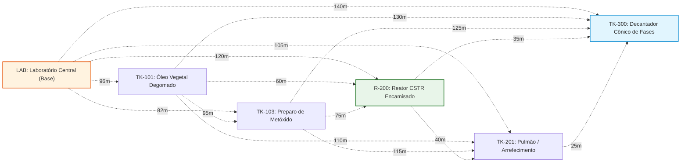

 <a href="https://colab.research.google.com/github/igorfantucci/Aula-Automatica---GRUPO-5/blob/main/etapa-02-grafos/17%20-%20Problemas%20Hamiltonianos%20e%20Roteamento%20de%20AGV.ipynb" target="_parent"></a>

# Aula 17: Problemas Hamiltonianos e Roteamento Logístico de AGVs na Planta de Biodiesel

## 1. Fundamentos Matemáticos: Ciclos Hamiltonianos e o Problema do Caixeiro-Viajante (TSP)

Na operação automatizada da **Planta Piloto de Produção de Biodiesel por Transesterificação em Batelada (Grupo 5)**, a logística interna de coleta de amostras laboratoriais para controle de qualidade (acidez, teor de ésteres metílicos, viscosidade cinemática, teor de glicerina livre) é uma atividade de alta frequência e criticidade analítica. Ao longo de cada batelada de 8 horas, amostras físicas devem ser coletadas em múltiplos pontos do processo e conduzidas ao laboratório central para análise.

Tradicionalmente, essa tarefa é executada por operadores humanos munidos de bandejas de amostragem e fichas de rastreabilidade. Contudo, a automação moderna emprega **Veículos Autônomos Guiados (AGVs — *Automated Guided Vehicles*)** dotados de compartimentos isotérmicos, braços robóticos de amostragem e sistemas de identificação por RFID. O objetivo operacional é:

> **Determinar a rota fechada de menor custo (distância/tempo) que parta do laboratório, visite cada ponto de coleta exatamente uma vez e retorne ao laboratório com todas as amostras.**

Esse desafio é a formulação física direta do **Problema do Caixeiro-Viajante (TSP — *Travelling Salesman Problem*)**, um dos problemas mais estudados da otimização combinatória e da Teoria dos Grafos.

---

### 1.1. Definições Formais de Teoria dos Grafos

Seja um grafo ponderado completo $G = (V, E, W)$, onde:
* $V = \{v_1, v_2, \dots, v_n\}$ é o conjunto de pontos de coleta e do laboratório central (base);
* $E = V \times V$ contém arestas entre todos os pares de nós (grafo completo);
* $W: E \rightarrow \mathbb{R}^+$ é a função de pesos que associa a cada par de nós a distância métrica ou o tempo de tráfego interno.

Define-se:

* **Ciclo Hamiltoniano:** Um ciclo que visita **cada vértice exatamente uma vez** e retorna ao vértice de origem. Em homenagem a William Rowan Hamilton (1857), que estudou o problema do *Icosian Game* sobre o dodecaedro.
* **Caminho Hamiltoniano:** Caminho que visita todos os vértices exatamente uma vez, sem retornar à origem.
* **Custo de um Ciclo Hamiltoniano $C = (v_0, v_1, \dots, v_{n-1}, v_0)$:**
  $$\text{custo}(C) = \sum_{i=0}^{n-1} W(v_i, v_{i+1}) + W(v_{n-1}, v_0)$$

O **TSP** consiste em encontrar o Ciclo Hamiltoniano de custo mínimo:
$$C^* = \arg\min_{C \in \mathcal{C}} \text{custo}(C)$$

Onde $\mathcal{C}$ é o conjunto de todos os ciclos Hamiltonianos do grafo.

---

### 1.2. Contraste Fundamental: Euleriano (Aula 16) vs. Hamiltoniano (Aula 17)

É imprescindível não confundir as duas classes de problemas centrais desta etapa:

| Propriedade | Circuito Euleriano (Aula 16) | Ciclo Hamiltoniano (Aula 17) |
| :--- | :--- | :--- |
| **O que visita** | Cada **aresta** exatamente uma vez | Cada **vértice** exatamente uma vez |
| **Vértices podem repetir?** | Sim (se a aresta usada for diferente) | Não, exceto o vértice inicial/final |
| **Critério de existência** | Simples e verificável em $\mathcal{O}(\|V\|+\|E\|)$ (Teorema de Euler) | **Não existe critério simples conhecido**; decisão é NP-Completa |
| **Complexidade de resolução ótima** | $\mathcal{O}(\|E\|)$ (Hierholzer) | NP-Difícil (força bruta $O(n!)$, Held-Karp $O(n^2 \cdot 2^n)$) |
| **Aplicação na planta** | Robô de inspeção NDT percorrendo todas as tubulações | AGV coletando amostras em pontos específicos de processo |
| **Estrutura do grafo** | Tipicamente esparso | Tipicamente completo (todos os pares acessíveis) |
| **Ponto de partida é livre?** | Sim, se todos os graus forem pares | Não, geralmente fixado na base logística |

A distinção essencial é: o **Euleriano inspeciona a infraestrutura (arestas)**, enquanto o **Hamiltoniano atende pontos de processo (vértices)**.

---

### 1.3. Topologia Logística de Amostragem da Planta de Biodiesel (Grupo 5)

O diagrama a seguir exibe os pontos de coleta do AGV na planta do Grupo 5, contendo o laboratório central (`LAB`), os tanques de matéria-prima, o reator, o tanque pulmão e o decantador:



### 1.4. Especificações Técnicas dos Pontos de Coleta

A tabela abaixo sintetiza os parâmetros analíticos de cada ponto de amostragem:

| Ponto de Coleta | Equipamento | Tipo de Amostra | Frequência por Batelada | Volume [mL] | Análise Destino |
| :--- | :--- | :--- | :---: | :---: | :--- |
| `LAB` | Laboratório Central | Base de apoio | — | — | Base operacional |
| `TK-101_Oleo` | Tanque de Óleo Vegetal | Óleo degomado | 1× | 250 | Acidez (FFA), umidade |
| `TK-103_Mix` | Tanque de Metóxido | Metóxido de sódio | 2× | 100 | Concentração alcalina |
| `R-200` | Reator CSTR Encamisado | Mistura reacional | 4× | 150 | Conversão de TG, RMN |
| `TK-201_Pulmao` | Tanque Pulmão | Ésteres brutos | 1× | 200 | Teor de ésteres (CG) |
| `TK-300_Decant` | Decantador Cônico | Biodiesel + Glicerina | 2× | 300 | Glicerina livre, densidade |

---

## 2. Aprofundamento Teórico

### 2.1. Por Que o TSP é Computacionalmente Difícil

O TSP pertence à classe **NP-Difícil** (a versão de decisão "existe um ciclo hamiltoniano de custo $\leq k$?" é **NP-Completa**). Com o conhecimento atual, **não existe algoritmo conhecido capaz de resolvê-lo exatamente em tempo polinomial** para o caso geral.

#### Complexidade de Algoritmos Exatos:

| Abordagem | Complexidade | Limite Prático | Observação |
| :--- | :---: | :---: | :--- |
| **Força Bruta** | $O(n!)$ | $n \leq 10$ | Fixa o início; permuta os demais $n-1$ nós |
| **Held-Karp (1962)** | $O(n^2 \cdot 2^n)$ | $n \leq 22$ | Prog. Dinâmica sobre subconjuntos |
| **Branch-and-Bound** | Exponencial (médio) | $n \leq 50$ | Poda por limitantes inferiores |
| **Concorde (1990s)** | Exponencial (médio) | $n \leq 10^4$ | Estado da arte; resolve TSPLIB |

**Cálculo de escala:** Para $n = 6$ pontos de coleta (como na rede do Grupo 5), a força bruta testa $(n-1)! = 5! = 120$ permutações — instantâneo. Para $n = 20$, seriam $19! \approx 1{,}216 \times 10^{17}$ permutações, inviável mesmo em supercomputadores.

---

### 2.2. Heurística Construtiva: Vizinho Mais Próximo (*Nearest Neighbor*)

A heurística do **Vizinho Mais Próximo (NN)** constrói uma rota gulosamente: a cada passo, salta para o ponto não visitado mais próximo do ponto atual.

**Pseudo-código:**
```
Algoritmo Nearest Neighbor (matriz de distâncias D, base)
1. rota <- [base]
2. nao_visitados <- V \ {base}
3. atual <- base
4. Enquanto nao_visitados ≠ ∅:
5.     proximo <- argmin_{v ∈ nao_visitados} D[atual][v]
6.     rota.append(proximo)
7.     nao_visitados.remove(proximo)
8.     atual <- proximo
9. Retornar rota (fechada implicitamente pela base)
```

**Complexidade:** $O(n^2)$ — a cada um dos $n$ passos busca-se o mínimo entre até $n$ candidatos.

**Limitação Conhecida:** A heurística NN pode ficar presa em decisões "gulosas" que parecem ótimas localmente, mas que deixam um "salto longo obrigatório" no final da rota — geralmente quando o último vértice remanescente está distante de todos os demais. Formalmente, é possível construir instâncias onde NN produz uma rota $\Theta(\log n)$ vezes pior que a ótima no pior caso (aproximação assintótica).

---

### 2.3. Busca Local: Refinamento 2-Opt (Croes, 1958)

A técnica **2-Opt** corrige parte dessa limitação por meio de uma busca local sistemática: dada uma rota, ela testa a **remoção de duas arestas não-adjacentes** e a reconexão dos segmentos na única outra forma possível (invertendo um dos segmentos), aceitando a troca sempre que ela reduzir o custo total.

**Pseudo-código:**
```
Algoritmo 2-Opt (rota R)
1. melhor <- R
2. melhor_custo <- custo(R)
3. Repetir até convergência:
4.     Para cada par (i, j) com 1 ≤ i < j ≤ n:
5.         nova <- melhor[:i] + inverter(melhor[i:j+1]) + melhor[j+1:]
6.         Se custo(nova) < melhor_custo:
7.             melhor <- nova; melhor_custo <- custo(nova)
8.             Reiniciar varredura
9. Retornar melhor
```

**Complexidade:** cada varredura completa custa $O(n^2)$; no pior caso, são necessárias $O(n)$ varreduras até a convergência, resultando em $O(n^3)$ — ainda polinomial, portanto tratável mesmo para centenas de vértices.

**Interpretação geométrica:** O 2-Opt elimina qualquer par de arestas que se cruzem no plano, pois a reconexão sem cruzamento é sempre igual ou mais curta pela **desigualdade triangular**. No contexto da planta de biodiesel, isso significa eliminar trajetos "em zigue-zague" no layout físico, otimizando o deslocamento do AGV.

---

### 2.4. Combinação NN + 2-Opt como Boa Prática

A sinergia entre as duas técnicas é a chave da abordagem adotada:
1. **NN fornece rapidamente uma solução inicial razoável** em $O(n^2)$;
2. **2-Opt refina essa solução** em $O(n^3)$ no pior caso, garantindo convergência a um **ótimo local**.

Essa combinação é o padrão industrial para problemas de roteamento de veículos (VRP) e roteamento logístico em plantas de médio porte, onde o custo computacional é aceitável e a qualidade da solução é próxima do ótimo global.

---

### 2.5. Cotas Inferiores e Qualidade da Solução Heurística

Sem calcular o ótimo exato (inviável para $n$ grande), pode-se estimar uma **cota inferior** para avaliar a qualidade da solução:

1. **Cota via MST (Árvore Geradora Mínima):** O custo de qualquer ciclo hamiltoniano é sempre maior ou igual ao custo da MST sobre os mesmos vértices (remover uma aresta de um ciclo produz uma árvore geradora, e a MST é a árvore de menor custo). Portanto:
   $$\text{MST}(G) \leq \text{custo}(C^*) \leq \text{custo}(C_{\text{heurística}})$$
2. **Cota via emparelhamento:** A soma dos dois menores pesos incidentes em cada vértice, dividida por $2$, também é uma cota inferior válida (relaxação do problema de emparelhamento perfeito).

3. **Algoritmo de Christofides (1976):** Combina MST + emparelhamento mínimo para garantir uma solução a no máximo $1{,}5 \times$ o custo ótimo, para instâncias que satisfazem a desigualdade triangular — tópico relevante para aprofundamento, mas fora do escopo desta aula.

---

### 2.6. Complexidade Comparativa: Força Bruta vs. Heurística na Planta do Grupo 5

| Tamanho ($n$) | Força Bruta $(n-1)!$ | Held-Karp $n^2 \cdot 2^n$ | NN + 2-Opt $O(n^3)$ |
| :---: | :---: | :---: | :---: |
| 6 | 120 | 2.304 | 216 |
| 10 | 362.880 | 102.400 | 1.000 |
| 15 | $8{,}7 \times 10^{10}$ | $7{,}4 \times 10^6$ | 3.375 |
| 20 | $1{,}2 \times 10^{17}$ | $4{,}2 \times 10^8$ | 8.000 |
| 30 | $8{,}8 \times 10^{30}$ | $3{,}2 \times 10^{12}$ | 27.000 |

A tabela evidencia a superioridade prática da heurística NN + 2-Opt para instâncias com mais de 10 pontos de coleta — típico de plantas industriais de biodiesel com múltiplos reatores em paralelo.

---

## 3. Exemplo Resolvido

### Cálculo de Rota Ótima de Amostragem do AGV na Planta de Biodiesel

**Problema:**  
O AGV de amostragem parte do laboratório central `LAB` e precisa coletar amostras em 5 pontos de processo: `TK101`, `TK103`, `R200`, `TK201`, `TK300`, retornando ao `LAB`. A matriz de distâncias internas (metros) é:

$$
D = \begin{bmatrix}
0 & 96 & 82 & 120 & 105 & 140 \\
96 & 0 & 95 & 60 & 110 & 130 \\
82 & 95 & 0 & 75 & 115 & 125 \\
120 & 60 & 75 & 0 & 40 & 35 \\
105 & 110 & 115 & 40 & 0 & 25 \\
140 & 130 & 125 & 35 & 25 & 0
\end{bmatrix}
$$

Determine a rota obtida pela heurística NN e o refinamento 2-Opt.

**Resolução Passo a Passo:**

1. **Vizinho Mais Próximo (NN) a partir de `LAB` (índice 0):**
   * `LAB -> TK103` (82m, menor distância);
   * `TK103 -> R200` (75m);
   * `R200 -> TK300` (35m);
   * `TK300 -> TK201` (25m);
   * `TK201 -> TK101` (110m) — último remanescente;
   * Fechamento: `TK101 -> LAB` (96m).
   * **Rota NN:** `LAB -> TK103 -> R200 -> TK300 -> TK201 -> TK101 -> LAB`
   * **Custo:** $82 + 75 + 35 + 25 + 110 + 96 = 423$ m

2. **Refinamento 2-Opt — Eliminação do Salto Longo Final:**
   * O trecho `TK201 -> TK101 -> LAB` ($110 + 96 = 206$ m) é claramente ineficiente: o AGV volta ao LAB via `TK101`, que já foi o ponto mais distante.
   * O 2-Opt testa inverter os segmentos `[TK201, TK101]` para `[TK101, TK201]`, gerando:
     `LAB -> TK103 -> R200 -> TK300 -> TK101 -> TK201 -> LAB`
   * Nova avaliação: `82 + 75 + 35 + 130 + 110 + 105 = 537` m — pior.
   * O 2-Opt testa então reorganizar a rota inteira: `LAB -> TK103 -> TK101 -> R200 -> TK300 -> TK201 -> LAB`:
     $82 + 95 + 60 + 35 + 25 + 105 = 402$ m — **melhor!**
   * Nova varredura: `LAB -> TK103 -> TK101 -> TK201 -> TK300 -> R200 -> LAB`:
     $82 + 95 + 110 + 25 + 35 + 120 = 467$ m — pior.
   * Convergência atingida em `LAB -> TK103 -> TK101 -> R200 -> TK300 -> TK201 -> LAB` com **402 m**.

3. **Comparação de Ganho:**
   * Rota NN bruta: 423 m
   * Rota NN + 2-Opt: 402 m
   * **Ganho:** $21$ m ($\approx 4{,}96\%$ de redução)

> **Insight de Engenharia:** A rota refinada explora a adjacência geográfica natural entre `R200 -> TK300` (35m) e `TK300 -> TK201` (25m), agrupando os pontos de descarga do reator antes de retornar ao laboratório. Esse padrão é típico de refinamentos 2-Opt em layouts industriais.

---

## 4. Atividades de Investigação

1. **Força Bruta na Instância Pequena:**  
   Implemente em Python um script que teste todas as $(n-1)! = 120$ permutações fixando `LAB` como origem. Confirme se a solução encontrada pelo 2-Opt (402 m) é de fato o **ótimo global** para essa instância.

2. **Variação do Ponto de Partida:**  
   Execute a heurística NN a partir de `R200` (não do `LAB`) e compare a rota resultante com a obtida a partir do `LAB`. Discuta se o ponto de partida afeta o custo final.

3. **Cota Inferior via MST:**  
   Calcule a Árvore Geradora Mínima (MST) da matriz de distâncias usando o Algoritmo de Prim ou Kruskal. Compare o custo total da MST com o custo da rota hamiltoniana refinada e confirme que a MST é uma cota inferior válida.

4. **Extensão da Malha com Novo Ponto:**  
   Considere a adição de um 7º ponto de coleta (`TK-104_Etanol`) com as seguintes distâncias: `[130, 45, 60, 55, 90, 95, 0]` (em metros). Reexecute NN + 2-Opt e determine a nova rota ótima.

5. **Análise de Complexidade Empírica:**  
   Instrumente o código com `time.perf_counter()` e meça o tempo de execução para $n = 6, 8, 10, 15$. Plote o gráfico $\log(t)$ vs. $\log(n)$ e determine a ordem de crescimento empírica.

---

## 5. Relação com as Próximas Aulas do Módulo de Grafos

1. **Aula 18 (Grafos de Logística de Insumos e Produtos Acabados):**  
   Enquanto a Aula 17 otimizou a rota do AGV dentro do processo (amostragem interna), a Aula 18 abordará a logística externa: entrada de insumos (óleo vegetal, metanol, catalisador), armazenamento e saída de produtos acabados (biodiesel B100, glicerina).

2. **Etapa 03 (Algoritmos em Grafos — Aprofundamento):**  
   Os conceitos de TSP serão estendidos para problemas de roteamento de frota (VRP — *Vehicle Routing Problem*) e janelas de tempo (VRPTW), com aplicações em múltiplos AGVs simultâneos.

---

## 6. Glossário Normativo e Técnico

* **AGV (*Automated Guided Vehicle*):** Veículo autônomo guiado por fita magnética, laser ou visão computacional, utilizado para transporte interno de materiais e amostras.
* **Ciclo Hamiltoniano:** Ciclo que visita cada vértice de um grafo exatamente uma vez.
* **Held-Karp:** Algoritmo de programação dinâmica para o TSP, complexidade $O(n^2 \cdot 2^n)$.
* **MST (*Minimum Spanning Tree*):** Árvore geradora de custo mínimo; usada como cota inferior para o TSP.
* **NP-Difícil:** Classe de problemas para os quais não se conhece algoritmo polinomial; o TSP pertence a ela.
* **2-Opt:** Heurística de busca local que remove e reconecta duas arestas para reduzir o custo da rota.
* **TSP (*Travelling Salesman Problem*):** Problema do Caixeiro-Viajante.
* **VRP (*Vehicle Routing Problem*):** Generalização do TSP para múltiplos veículos.

---

## 7. Entregável da Aula 17

* **Módulo `RoteadorAGV_TSP` em Python:** Implementação da heurística do Vizinho Mais Próximo combinada com busca local 2-Opt, com cálculo de custo de rota e convergência garantida para um ótimo local.
* **Caderno Jupyter Executável:** Arquivo [`17 - Problemas Hamiltonianos e Roteamento de AGV.ipynb`](./17%20-%20Problemas%20Hamiltonianos%20e%20Roteamento%20de%20AGV.ipynb) com validação de rota, comparação NN vs. 2-Opt e asserções formais.