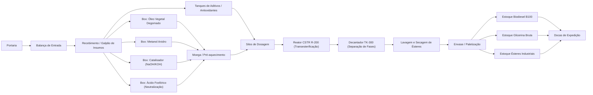
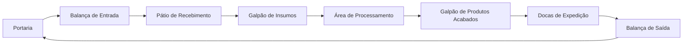

# Aula 18: Grafos de Logística de Insumos, Processo e Produtos Acabados — Planta de Biodiesel

## 1. Situação-Problema: Além da Malha de Tubulação

Nas Aulas 11 a 17, a Planta de Produção de Biodiesel (Grupo 5) foi modelada pela **malha de processo**: tanques de matéria-prima, manifold, bombas, reator CSTR e decantador. Contudo, a operação industrial completa exige também decidir **como os insumos chegam ao processo** (óleo vegetal degomado, metanol anidro, catalisador alcalino) e **como os produtos acabados alcançam a expedição** (biodiesel B100, glicerina bruta, ésteres para uso industrial).

Esta aula constrói **três redes multicamada** sobre o mesmo layout físico:
- $G_M$ — Fluxo de materiais (insumos → processo → produtos);
- $G_V$ — Circulação interna de veículos (caminhões, empilhadeiras, AGVs);
- $G_E$ — Alocação de estoque (endereçamento e retirada de produto acabado).

> **Nota metodológica:** Os comprimentos usados nesta aula são estimativas didáticas para comparação de rotas. O foco é a **estrutura topológica** das redes, não medições operacionais reais.

---

## 2. Fundamentos Teóricos: Redes Multicamada e DAGs

### 2.1. Por que a Cadeia Logística de Biodiesel é um DAG

Diferente da malha de tubulação das Aulas 11–15 (que contém ciclos de contingência, como as rotas paralelas via P-101/P-102), o fluxo de materiais $G_M$ desta aula — do recebimento até a expedição — é, por definição de processo, um **Grafo Acíclico Dirigido (DAG — *Directed Acyclic Graph*)**: não existe caminho que retorne a um vértice já visitado, pois cada etapa de transformação (degomagem, transesterificação, decantação, lavagem, destilação) é irreversível dentro do fluxo normal de produção.

**Definição formal:** Um dígrafo $G=(V,E)$ é um DAG se não existe nenhum ciclo dirigido, ou seja, não existe sequência $v_0, v_1, \dots, v_k = v_0$ com $(v_{i-1}, v_i) \in E$ para todo $i$.

**Propriedade fundamental (ordenação topológica):** Todo DAG admite pelo menos uma **ordenação topológica**, isto é, uma numeração dos vértices $\text{ord}: V \rightarrow \{1, \dots, n\}$ tal que, para toda aresta $(u,v) \in E$, $\text{ord}(u) < \text{ord}(v)$. Essa propriedade torna o grafo de processo auditável: qualquer sequência de produção pode ser verificada como fisicamente possível apenas checando se ela respeita a ordenação topológica do DAG — por exemplo, o modelo não permite que `Envase de Biodiesel` ocorra antes de `Transesterificação`, porque não existe nenhuma ordenação topológica compatível com essa inversão.

**Algoritmo de Kahn (1962):** calcula uma ordenação topológica em $O(|V|+|E|)$ processando repetidamente vértices de grau de entrada zero, removendo-os do grafo (e decrementando o grau de entrada de seus sucessores) até que todos os vértices tenham sido processados. Se, ao final, restarem vértices com grau de entrada positivo, o grafo **não** é um DAG — um teste direto e eficiente de aciclicidade.

---

### 2.2. Redes Multicamada (*Multilayer Networks*)

A estratégia de modelar **três grafos distintos** ($G_M$, $G_V$, $G_E$) sobre a mesma planta física é um caso particular do que a literatura de ciência de redes chama de **rede multicamada**: um mesmo conjunto de entidades físicas é representado por múltiplas camadas de conexão, cada uma correspondendo a um tipo diferente de relação.

Formalmente, uma rede multicamada é uma tupla $\mathcal{M} = (\{G_\alpha\}_{\alpha \in L}, \{V_\alpha\}, \{E_{\alpha\beta}\})$, onde $L$ é o conjunto de camadas (`materiais`, `veículos`, `estoque`) e $E_{\alpha\beta}$ pode incluir arestas de acoplamento entre camadas (por exemplo, ligando o vértice `Galpão de Insumos` de $G_V$ ao vértice `Recebimento de Óleo` de $G_M$, pois fisicamente é o mesmo espaço).

O motivo de **não colapsar tudo em um único grafo** é evitar um erro clássico de modelagem: aplicar um algoritmo de uma camada (como Dijkstra sobre $G_M$) para responder uma pergunta que pertence a outra camada (como a rota de circulação de uma empilhadeira em $G_V$). Vértices com o mesmo nome textual em camadas diferentes **não são o mesmo vértice do grafo** — são representações de um mesmo espaço físico sob óticas distintas.

---

### 2.3. Cadeia de Suprimentos como Composição de Grafos

Uma cadeia de suprimentos completa (*supply chain*) de biodiesel pode ser vista como a composição de subgrafos menores, cada um estudável com as ferramentas já vistas nesta etapa:

| Subproblema da cadeia | Ferramenta da Etapa 02 aplicável |
| :--- | :--- |
| Menor rota entre fornecedor de óleo e fábrica | Dijkstra (Aula 14) |
| Verificar rota alternativa em caso de bloqueio de via | Reponderação dinâmica (Aula 15) |
| Planejar rota de caminhão que visita múltiplos pontos | TSP com NN + 2-Opt (Aula 17) |
| Auditar se a sequência de produção respeita a ordem física | Ordenação topológica de DAG (Seção 2.1) |
| Verificar robustez da cadeia a uma falha de trecho | Detecção de pontes (Aula 15, Seção 2.4) |

Essa tabela evidencia o objetivo pedagógico da Etapa 02: os mesmos poucos algoritmos fundamentais (BFS, DFS, Dijkstra, Hierholzer, heurísticas de TSP) se recombinam para responder a praticamente todas as perguntas operacionais de uma planta industrial.

---

## 3. Três Grafos para o Mesmo Layout

Um único grafo não expressa adequadamente todas as regras da fábrica de biodiesel. Modelaremos três redes.

| Grafo | Vértices | Arestas dirigidas | Peso | Pergunta respondida |
| :--- | :--- | :--- | :--- | :--- |
| $G_M$ — fluxo de materiais | setores, equipamentos e estoques | transferência permitida de material | distância interna estimada (m) | Como um insumo chega à doca como produto acabado? |
| $G_V$ — circulação de veículos | portaria, balanças, pátios, galpões e docas | trechos autorizados para caminhão/empilhadeira | distância de circulação estimada (m) | Qual rota interna o veículo pode percorrer? |
| $G_E$ — alocação de estoque | envase, tanques de armazenagem e docas | endereçamento e retirada de produto | movimentações ou custo de manuseio | Onde armazenar e de onde retirar cada produto? |

O notebook desta aula implementa $G_M$ e $G_V$. A mesma estrutura pode receber custos monetários, tempo, emissões ou risco, desde que todos os pesos de uma consulta representem a mesma grandeza.

---

## 4. Grafo Dirigido do Fluxo de Materiais $G_M$

Definimos:
$$G_M=(V_M,E_M,w_M), \qquad w_M:E_M\rightarrow\mathbb{R}_{\geq0}.$$

O conjunto de vértices inclui os pontos observados no layout da planta de biodiesel:

As arestas de `Portaria` até `Recebimento / Galpão de Insumos` representam a liberação e a entrada física do caminhão-tanque. A partir do recebimento, as arestas representam a disponibilidade do insumo para a transferência interna. Assim, uma rota no grafo é uma **rota operacional de referência**, e não uma alegação de que o mesmo caminhão percorre todas as etapas de fabricação.

### 4.1. Correspondência com os Insumos da Etapa 01

| Insumo da Etapa 01 | Vértice de recebimento | Uso no modelo |
| :--- | :--- | :--- |
| Óleo vegetal degomado (soja, girassol, canola) | `Box: Óleo Vegetal Degomado` | Matéria-prima lipídica (triglicerídeos) |
| Metanol anidro (CH₃OH) | `Box: Metanol Anidro` | Álcool transesterificante |
| Catalisador alcalino (NaOH ou KOH) | `Box: Catalisador (NaOH/KOH)` | Catálise homogênea básica |
| Ácido fosfórico (H₃PO₄) | `Box: Ácido Fosfórico` | Neutralização e lavagem |
| Antioxidantes (BHT, TBHQ) | `Tanques de Aditivos` | Estabilização oxidativa do biodiesel |

Os produtos Biodiesel B100, Glicerina Bruta e Ésteres Industriais aparecem como vértices distintos para preservar a rastreabilidade da alocação após o envase.

---

## 5. Grafo de Circulação de Veículos $G_V$

O fluxo de materiais é dirigido: não se deve retornar produto acabado ao reator sem uma regra específica de retrabalho. Já o anel viário do layout pode ter trechos bidirecionais ou de sentido único. Para cada sentido permitido, inclua uma aresta em $G_V$.

Essa separação impede um erro comum: aplicar Dijkstra sobre o fluxo de materiais para decidir por onde uma empilhadeira deve circular. Os vértices podem ter nomes semelhantes, mas o conjunto de arestas e as restrições são diferentes.

### 5.1. O Anel Viário como Ciclo Hamiltoniano Degenerado

Vale notar que $G_V$, ao contrário de $G_M$, **contém um ciclo dirigido** por construção: `Portaria -> ... -> Docas -> Balança de Saída -> Portaria`. Esse ciclo não é uma falha de modelagem — reflete o fato de que o mesmo veículo entra e sai da planta pelo mesmo ponto de controle (a portaria), fechando o percurso. Trata-se de um caso particular (e simplificado) de Ciclo Hamiltoniano, no sentido da Aula 17: se a planta tivesse múltiplos pontos de coleta de produto a serem visitados em uma única viagem, o problema de definir a melhor ordem de visita se reduziria exatamente ao TSP estudado naquela aula.

---

## 6. Exemplo Resolvido

**Pergunta:** Por que a rota de menor custo de `Portaria` até `Docas de Expedição` em $G_M$ pode passar por `Tanques de Aditivos` no lugar de qualquer um dos boxes sólidos, dependendo dos pesos atribuídos?

**Resolução:** Isso decorre diretamente dos pesos atribuídos às arestas de recebimento. Suponha:
- `Recebimento -> Tanques de Aditivos`: 28 m
- `Tanques de Aditivos -> Silos de Dosagem`: 45 m
- **Total via aditivos: 73 m**

E para um box sólido, por exemplo `Box: Catalisador`:
- `Recebimento -> Box: Catalisador`: 22 m
- `Box: Catalisador -> Moega`: 30 m
- `Moega -> Silos de Dosagem`: 40 m
- **Total via catalisador: 92 m**

Somando os dois trechos, a rota via tanques de aditivos ($73$ m) é mais curta que qualquer rota via um box sólido. Esse resultado ilustra por que o algoritmo de Dijkstra deve sempre considerar a **soma acumulada** do caminho, e não apenas o peso do primeiro trecho — um erro comum de interpretação para quem está aprendendo o algoritmo.

> **Nota:** Em $G_M$ real, os pesos refletem as distâncias físicas no layout, e a rota ótima é determinada exclusivamente pelo algoritmo de Dijkstra — não por intuição sobre qual insumo "deveria" vir primeiro.

---

## 7. Atividades de Investigação

1. **Caminhos Mínimos até os Estoques:**  
   Execute o notebook e identifique o caminho mínimo de `Portaria` até cada um dos três estoques de produto acabado em $G_M$.

2. **Bloqueio de Aresta Crítica:**  
   Remova temporariamente a aresta `Envase / Paletização -> Estoque Biodiesel B100`. O que o algoritmo informa? Relacione o resultado a uma indisponibilidade de área de armazenagem.

3. **Anel Viário com Mão Única:**  
   No $G_V$, altere uma via de mão dupla para mão única e verifique se ainda existe ciclo `Portaria -> ... -> Portaria`.

4. **Substituição de Pesos por Tempo:**  
   Substitua os pesos em metros por tempo médio (minutos). Explique por que uma rota mais curta em metros pode deixar de ser a melhor rota logística.

5. **Inclusão de Área de Quarentena:**  
   Inclua um vértice `Área de Quarentena` entre o recebimento e a moega. Que regra de qualidade deve liberar a nova aresta?

6. **Validação Topológica (Algoritmo de Kahn):**  
   Implemente o Algoritmo de Kahn para calcular uma ordenação topológica de $G_M$ e confirme que a sequência de produção do biodiesel respeita a ordem física.

---

## 8. Glossário Normativo e Técnico

* **AGV (*Automated Guided Vehicle*):** Veículo autônomo guiado utilizado para transporte interno de materiais.
* **DAG (*Directed Acyclic Graph*):** Grafo dirigido sem ciclos; modelo natural de cadeias de processo irreversíveis.
* **Dijkstra:** Algoritmo guloso de menor caminho em grafos com pesos não-negativos.
* **Fronteira de Pareto:** Conjunto de soluções não-dominadas em otimização multiobjetivo.
* **MST (*Minimum Spanning Tree*):** Árvore geradora de custo mínimo.
* **Ordenação Topológica:** Numeração dos vértices de um DAG tal que toda aresta $(u,v)$ satisfaz $\text{ord}(u) < \text{ord}(v)$.
* **Rede Multicamada:** Representação de um mesmo sistema físico por múltiplas camadas de relação.
* **TSP (*Travelling Salesman Problem*):** Problema do Caixeiro-Viajante.

---

## 9. Relação com as Próximas Etapas

1. **Etapa 03 (Algoritmos em Grafos — Aprofundamento):**  
   Os conceitos de DAG, ordenação topológica e redes multicamada serão estendidos para análise de criticidade (caminho crítico em PERT/CPM) e otimização multiobjetivo.

2. **Etapa 04 (Aplicações Industriais):**  
   A modelagem multicamada será integrada a sistemas SCADA/MES para rastreabilidade completa de batelada (*batch traceability*) e alocação dinâmica de estoque.

---

## 10. Entregável da Aula 18

* **Modelo `GrafoLogistico` em Python:** Criação de rotas dirigidas e ponderadas, cálculo do menor caminho por Dijkstra com heap binário e validação de rotas de recebimento até a expedição.
* **Dois modelos coerentes:** Uma rede para fluxo de materiais ($G_M$) e outra para circulação interna ($G_V$), ambas baseadas no layout da Planta de Biodiesel (Grupo 5).
* **Caderno Jupyter Executável:** Arquivo [`18 - Grafos de Logistica de Insumos e Produtos Acabados.ipynb`](./18%20-%20Grafos%20de%20Logistica%20de%20Insumos%20e%20Produtos%20Acabados.ipynb) com validação topológica e asserções formais.
