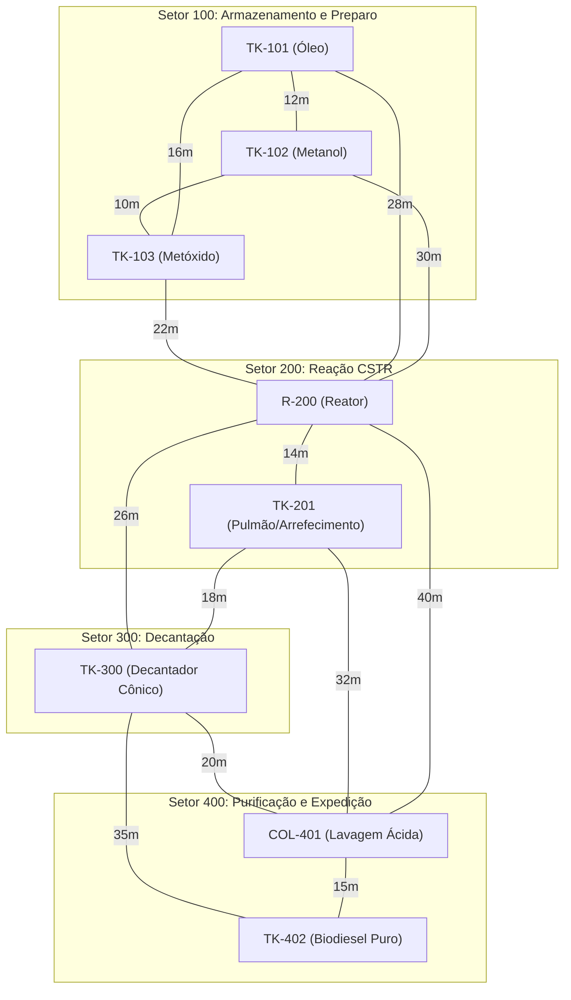

<a href="https://colab.research.google.com/github/igorfantucci/Aula-Automatica---GRUPO-5/blob/main/etapa-03-arvores/Aula%2019%20-%20Algoritmo%20de%20Kruskal%20e%20Prim%20-%20code.ipynb" target="_parent"></a>

# Relatório Técnico: Otimização Topológica de Infraestrutura na Planta de Biodiesel (Grupo 5)

**Dimensionamento Mínimo de Malha de Utilidades (Pipe Racks) e Barramento de Rede SCADA com Algoritmos de Kruskal e Prim**

### Informações do Projeto

| Parâmetro | Detalhe |
| :--- | :--- |
| **Unidade Industrial** | Planta de Produção de Biodiesel por Transesterificação em Batelada (Grupo 5) |
| **Setores Abrangidos** | Setor 100 (Armazenamento/Preparo), Setor 200 (Reator CSTR), Setor 300 (Decantação) e Setor 400 (Purificação/Armazenamento) |
| **Aplicação de Engenharia** | Interconexão de Leitos Estruturais de Tubulações (*Pipe Racks*) de Utilidades e Cabeamento de Barramento SCADA / Fieldbus |
| **Método Formulado** | Árvore Geradora Mínima (MST — *Minimum Spanning Tree*) |
| **Código do Projeto** | BIO-SCADA-G05-ETAPA-03 |

---

## 1. Contextualização e Objetivo de Engenharia

No projeto conceitual e executivo da **Planta Piloto de Produção de Biodiesel por Transesterificação em Batelada (Grupo 5)**, a distribuição física dos insumos e o transporte de fluidos auxiliares exigem uma malha estrutural robusta. Além das tubulações diretas de processo analisadas na Etapa 02 (malhas hidráulicas de transferência de carga e batelada), a planta requer a implementação de dois sistemas vitais de interconexão contínua entre todos os setores operacionais:

1. **Malha de Utilidades Auxiliares (*Pipe Racks* Centrais):**
   * Linha de suprimento de vapor saturado e condensado para a jaqueta térmica do reator encamisado $R-200$ e aquecimento do óleo vegetal degomado ($TK-101$);
   * Linha pressurizada de água de resfriamento de emergência ($CW-201 \ge 3.0\text{ bar}$) para arrefecimento imediato em caso de runaway térmico de metanol;
   * Rede tronco de ar comprimido instrumental ($7.0\text{ bar}$) para acionamento das válvulas pneumáticas fail-safe ($XV-101$, $XV-102$, $XV-201$, $XV-202$, $XV-203$, $XV-301$, $XV-401$).

2. **Barramento Físico de Comunicação e Controle SCADA (Fieldbus / Modbus / Profibus-PA):**
   * Eletrocalhas e leitos blindados para o tráfego de dados de telemetria e segurança funcional interligando os transmissores de campo ($PT-201$, $TT-201$, $LT-201$, $AT-100$, $IT-301$, $LT-402$) e o painel central do CLP (Controlador Lógico Programável).

Na engenharia de instalações industriais (*Plant Layout & Piping Design*), construir ligações ponto a ponto entre todos os equipamentos geraria um emaranhado redundante, disparando o consumo de aço estrutural, bandejamentos aéreos, conexões soldadas, cabos blindados e isolamento térmico, elevando drasticamente o **CAPEX (*Capital Expenditure*)**. Além disso, o excesso de tubulação eleva a perda térmica do vapor e aumenta a atenuação dos sinais analógicos e digitais, onerando o **OPEX (*Operational Expenditure*)**.

O objetivo deste projeto é modelar o layout das unidades de processo da planta de biodiesel como um grafo não direcionado e valorado $G = (V, E, w)$ e determinar a topologia de conexão de menor extensão linear contínua que garanta que todos os equipamentos permaneçam 100% interligados sem ciclos desnecessários, utilizando os algoritmos de **Kruskal** e **Prim**.

---

## 2. Formulação Matemática da Rede Industrial

A infraestrutura da planta de biodiesel é formalizada por um grafo não direcionado e ponderado $G = (V, E, w)$, onde $V$ representa os nós de equipamentos em campo e $E$ representa as passagens e canaletas viáveis de *pipe rack*:

### 2.1. Vértices ($V$ — Unidades de Processo da Planta de Biodiesel):
O conjunto de vértices $|V| = 8$ compreende as unidades operacionais segregadas dos quatro setores da planta:

* **$v_1$ (`TK-101`):** Tanque de Armazenamento de Óleo Vegetal Degomado (Setor 100);
* **$v_2$ (`TK-102`):** Vaso Fechado de Metanol Líquido Anidro (Setor 100);
* **$v_3$ (`TK-103`):** Tanque de Preparação do Catalisador Metóxido de Sódio $\text{CH}_3\text{ONa}$ (Setor 100);
* **$v_4$ (`R-200`):** Reator CSTR Encamisado de Transesterificação — Núcleo Crítico (Setor 200);
* **$v_5$ (`TK-201`):** Tanque Pulmão e Trocador de Arrefecimento Intermediário (Setor 200);
* **$v_6$ (`TK-300`):** Vaso Decantador Cônico de Separação de Fases Biodiesel/Glicerina (Setor 300);
* **$v_7$ (`COL-401`):** Coluna de Lavagem e Neutralização Ácido-Aquosa (Setor 400);
* **$v_8$ (`TK-402`):** Tanque de Estocagem Final de Biodiesel B100 Especificado (Setor 400).

### 2.2. Arestas Ponderadas ($E$ — Vias Estruturais de *Pipe Rack* Viáveis):
As distâncias métricas reais $w(e)$ em metros refletem o layout físico tridimensional da fábrica:



O conjunto completo de rotas preliminares totaliza $|E| = 14$ arestas, somando uma extensão física total de:
$$W_{\text{Total}} = 10 + 12 + 14 + 15 + 16 + 18 + 20 + 22 + 26 + 28 + 30 + 32 + 35 + 40 = 318\text{ metros}$$

Como $|V| = 8$, qualquer **Árvore Geradora Mínima (MST)** conterá exatamente:
$$|E_{\text{MST}}| = |V| - 1 = 8 - 1 = 7\text{ arestas}$$

---

## 3. Algoritmo de Kruskal (Abordagem Centrada em Arestas)

O **Algoritmo de Kruskal** aplica o paradigma guloso (*greedy approach*) de ordenação global das arestas. Ele avalia cada trecho candidato em ordem estritamente crescente de peso e insere a aresta na solução caso seus vértices pertençam a componentes conexas distintas.

Para garantir complexidade quasi-linear $\mathcal{O}(|E| \log |E|)$, a detecção de ciclos é implementada via estrutura de dados **Union-Find (*Disjoint-Set Union* — DSU)** com as heurísticas de **Compressão de Caminho (*Path Compression*)** e **União por Posto (*Union by Rank*)**.

### Histórico Detalhado de Decisões de Projeto (Kruskal):

| Ordem | Aresta $e$ | Segmento Físico Interligado | Distância $w(e)$ | Formação de Ciclo? | Decisão de Projeto | Justificativa Técnica |
| :---: | :---: | :--- | :---: | :---: | :---: | :--- |
| **1** | `(TK-102, TK-103)` | Metanol $\leftrightarrow$ Tanque Metóxido | $10.0\text{ m}$ | Não | **INCLUÍDA** | Une componentes isoladas `{TK-102}` e `{TK-103}` |
| **2** | `(TK-101, TK-102)` | Silo Óleo $\leftrightarrow$ Metanol | $12.0\text{ m}$ | Não | **INCLUÍDA** | Conecta `{TK-101}` ao bloco do Setor 100 |
| **3** | `(R-200, TK-201)` | Reator CSTR $\leftrightarrow$ Vaso Pulmão | $14.0\text{ m}$ | Não | **INCLUÍDA** | Une `{R-200}` e `{TK-201}` no Setor 200 |
| **4** | `(COL-401, TK-402)` | Coluna Lavagem $\leftrightarrow$ Tanque B100 | $15.0\text{ m}$ | Não | **INCLUÍDA** | Une `{COL-401}` e `{TK-402}` no Setor 400 |
| **5** | `(TK-101, TK-103)` | Silo Óleo $\leftrightarrow$ Tanque Metóxido | $16.0\text{ m}$ | **Sim** | **REJEITADA** | Ambos já pertencem à mesma componente do Setor 100 |
| **6** | `(TK-201, TK-300)` | Vaso Pulmão $\leftrightarrow$ Decantador | $18.0\text{ m}$ | Não | **INCLUÍDA** | Conecta o Setor 200 ao Decantador `{TK-300}` |
| **7** | `(TK-300, COL-401)` | Decantador $\leftrightarrow$ Coluna Lavagem | $20.0\text{ m}$ | Não | **INCLUÍDA** | Conecta Setor 300 ao bloco `{COL-401, TK-402}` |
| **8** | `(TK-103, R-200)` | Tanque Metóxido $\leftrightarrow$ Reator CSTR | $22.0\text{ m}$ | Não | **INCLUÍDA** | Conecta o bloco do Setor 100 ao restante da planta |
| -- | *(Parada)* | *Critério $|V|-1=7$ atingido* | -- | -- | **CONCLUÍDO** | Arestas restantes (26m a 40m) descartadas a priori |

### Extensão Métrica Total via Kruskal:
$$W_{\text{Kruskal}} = 10 + 12 + 14 + 15 + 18 + 20 + 22 = 111.0\text{ metros}$$

---

## 4. Algoritmo de Prim (Abordagem Centrada em Vértices)

O **Algoritmo de Prim** adota o princípio de corte de Dijkstra em arborescência: inicia a partir de um vértice arbitrário — fixado na raiz de abastecimento de matéria-prima $v_1$ (`TK-101`) — e expande progressivamente um subconjunto conexo de vértices $S \subset V$. Em cada iteração, seleciona a aresta de corte de menor peso $(u, v)$ tal que $u \in S$ e $v \notin S$, mantida em uma fila de prioridade (*Min-Heap*).

### Histórico Passo a Passo de Expansão (Prim - Raiz: `TK-101`):

| Iteração | Vértices Conectados ($S$) | Fronteira de Corte Elegível | Aresta Escolhida | Vértice Adicionado | Custo ($m$) |
| :---: | :--- | :--- | :---: | :---: | :---: |
| **Inicial** | `{"TK-101"}` | `(TK-101, TK-102): 12`, `(TK-101, TK-103): 16`, `(TK-101, R-200): 28` | `(TK-101, TK-102)` | `TK-102` | $12.0\text{ m}$ |
| **1** | `{"TK-101", "TK-102"}` | `(TK-102, TK-103): 10`, `(TK-101, TK-103): 16`, `(TK-101, R-200): 28`, `(TK-102, R-200): 30` | `(TK-102, TK-103)` | `TK-103` | $10.0\text{ m}$ |
| **2** | `{"TK-101", "TK-102", "TK-103"}` | `(TK-103, R-200): 22`, `(TK-101, R-200): 28`, `(TK-102, R-200): 30` | `(TK-103, R-200)` | `R-200` | $22.0\text{ m}$ |
| **3** | `{"... Setor 100 ...", "R-200"}` | `(R-200, TK-201): 14`, `(R-200, TK-300): 26`, `(R-200, COL-401): 40` | `(R-200, TK-201)` | `TK-201` | $14.0\text{ m}$ |
| **4** | `{"... R-200", "TK-201"}` | `(TK-201, TK-300): 18`, `(R-200, TK-300): 26`, `(TK-201, COL-401): 32` | `(TK-201, TK-300)` | `TK-300` | $18.0\text{ m}$ |
| **5** | `{"... TK-201", "TK-300"}` | `(TK-300, COL-401): 20`, `(TK-201, COL-401): 32`, `(TK-300, TK-402): 35` | `(TK-300, COL-401)` | `COL-401` | $20.0\text{ m}$ |
| **6** | `{"... TK-300", "COL-401"}` | `(COL-401, TK-402): 15`, `(TK-300, TK-402): 35` | `(COL-401, TK-402)` | `TK-402` | $15.0\text{ m}$ |

### Extensão Métrica Total via Prim:
$$W_{\text{Prim}} = 12 + 10 + 22 + 14 + 18 + 20 + 15 = 111.0\text{ metros}$$

---

## 5. Topologia Ótima da Árvore Geradora Mínima (MST)

A topologia final dimensionada para os leitos de utilidades e barramento SCADA da planta de biodiesel é apresentada a seguir:

```mermaid
graph LR
    subgraph S100["SETOR 100"]
        TK101["TK-101 (Óleo)"] ---|12m| TK102["TK-102 (Metanol)"]
        TK102 ---|10m| TK103["TK-103 (Metóxido)"]
    end

    subgraph S200["SETOR 200"]
        R200["R-200 (Reator CSTR)"] ---|14m| TK201["TK-201 (Pulmão)"]
    end

    subgraph S300["SETOR 300"]
        TK300["TK-300 (Decantador)"]
    end

    subgraph S400["SETOR 400"]
        COL401["COL-401 (Lavagem)"] ---|15m| TK402["TK-402 (Biodiesel Puro)"]
    end

    TK103 ===|22m (Tronco Intersetorial)| R200
    TK201 ===|18m (Tronco Intersetorial)| TK300
    TK300 ===|20m (Tronco Intersetorial)| COL401

    style TK103 stroke:#2ecc71,stroke-width:2px
    style R200 stroke:#e74c3c,stroke-width:3px
    style TK300 stroke:#3498db,stroke-width:2px
    style COL401 stroke:#9b59b6,stroke-width:2px
```

---

## 6. Análise de Desempenho e Viabilidade Econômica (CAPEX/OPEX)

### 6.1. Métricas Comparativas de Infraestrutura:
* **Comprimento da Malha Completa com Redundância:** $318.0\text{ metros}$;
* **Comprimento da Malha Otimizada por MST (Kruskal/Prim):** $111.0\text{ metros}$;
* **Redução Direta de Extensão Física:** $\Delta L = 318.0 - 111.0 = 207.0\text{ metros}$;
* **Eficiência Global de Projeto (Economia de Infraestrutura):**
  $$\eta_{\text{CAPEX}} = \left( 1 - \frac{111.0}{318.0} \right) \times 100\% = 65.09\%$$

### 6.2. Recomendações de Aplicação Industrial: FEED vs. Montagem em Campo
Ambos os algoritmos convergem rigorosamente para o mesmo custo mínimo global ($111.0\text{ m}$). Contudo, na prática de engenharia de automação e tubulação industrial, aplicam-se em fases contratuais distintas:

1. **Algoritmo de Kruskal $\mathcal{O}(|E| \log |E|)$ — Fase de Projeto Conceitual e Básico (*FEED - Front-End Engineering Design*):**
   * Opera de forma global e descentralizada, ordenando antecipadamente toda a matriz de distâncias de campo;
   * É ideal para os projetistas de tubulação e orçamentistas determinarem a lista preliminar de materiais (*BOM — Bill of Materials*), quantitativo de aço estrutural de *pipe racks*, metragem de cabos de rede e estimativa de CAPEX antes do início das obras.

2. **Algoritmo de Prim $\mathcal{O}(|E| + |V| \log |V|)$ — Fase de Execução, Montagem e Comissionamento em Campo:**
   * Expande a infraestrutura de forma contínua e adjacente a partir de um nó âncora;
   * Na montagem real, a equipe de instrumentação e montagem mecânica pode partir da subestação/sala de controle ou dos silos de entrada ($TK-101$) e lançar os trechos de leito e cabos mantendo a rede fisicamente contínua e testável em cada etapa, sem deixar trechos órfãos ou ilhas isoladas no canteiro de obras.

---

## 7. Referências Técnicas

1. CORMEN, T. H.; LEISERSON, C. E.; RIVEST, R. L.; STEIN, C. **Algoritmos: Teoria e Prática**. 3. ed. Rio de Janeiro: Elsevier, 2012.
2. PETERS, M. S.; TIMMERHAUS, K. D. **Plant Design and Economics for Chemical Engineers**. 5th ed. New York: McGraw-Hill, 2003.
3. ISA-5.1. **Instrumentation Symbols and Identification**. International Society of Automation, Research Triangle Park, NC, 2009.
4. IEC 61158. **Industrial communication networks - Fieldbus specifications**. International Electrotechnical Commission, 2019.
