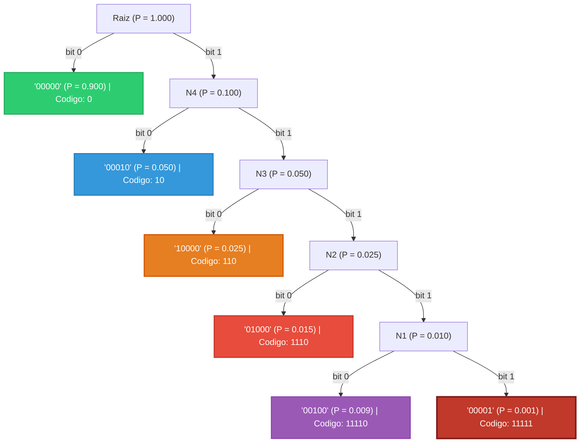

<a href="https://colab.research.google.com/github/igorfantucci/Aula-Automatica---GRUPO-5/blob/main/etapa-03-arvores/Aula%2020%20-%20Algoritmo%20de%20Huffman%20-%20code.ipynb" target="_parent"></a>

# Compressão de Telemetria Industrial via Algoritmo de Huffman no SCADA-Core (Grupo 5)

## 1. Escopo e Arquitetura do Sistema de Transmissão de Campo

Na **Planta Piloto de Produção de Biodiesel por Transesterificação em Batelada (Grupo 5)**, o sistema supervisório **SCADA-Core** monitora em tempo real os transmissores de campo e os nós do **Sistema Instrumentado de Segurança (SIS / SIL 3)** distribuídos nos quatro setores da planta fabril. Os dados operacionais são transmitidos aos painéis de controle e servidores de historiador através de barramentos industriais de campo (como Modbus-RTU sobre canal serial RS-485, barramentos Fieldbus, rádio-modems industriais ou enlaces satelitais de telemetria remota).

Em arquiteturas convencionais sem compressão, o estado booleano da malha de segurança e intertravamento é empacotado e despachado em palavras digitais de tamanho estritamente fixo. Considerando o laço crítico de segurança funcional que supervisiona os riscos mais severos da planta (definidos nas Regras R-01 a R-04 da Etapa 01 e monitorados no SCADA):

1. **`PT-201` (Transmissor de Pressão no Reator R-200):** $1 =$ Alarme de Sobrepressão crítica ($\ge 2.5\text{ bar}$);
2. **`TT-201` (Transmissor de Temperatura no Reator R-200):** $1 =$ Alarme de Sobretemperatura ($\ge 65.0^\circ\text{C}$, risco iminente de *flash boiling* do metanol);
3. **`AT-100` (Detector de Vapores Tóxicos/Inflamáveis de Metanol no Setor 100):** $1 =$ Concentração no ar $\ge 20\text{ ppm}$ (pré-alarme LEL / IDLH);
4. **`LT-201` (Transmissor / Chave de Nível Alto no Reator R-200):** $1 =$ Alarme de Nível Crítico / Risco de transbordo da batelada;
5. **`ESD-100` (Botoeira de Parada de Emergência Geral do Painel SIS):** $1 =$ Desarme geral acionado em modo *Fail-Safe*.

O vetor binário `[PT-201, TT-201, AT-100, LT-201, ESD-100]` exige obrigatoriamente **$5\text{ bits}$ por amostra (frame)** no formato fixo não comprimido.

Com taxas elevadas de varredura (*scan rate* típico de $20\text{ ms}$ a $50\text{ ms}$ exigido para resposta determinística SIL 3) em canais seriais com banda restrita (ex.: $9600\text{ bps}$ ou $19200\text{ bps}$), o envio contínuo de quadros redundantes satura a capacidade do barramento, aumentando a latência de comunicação e a probabilidade de colisão de pacotes.

Dado que plantas químicas operam em **regime contínuo estável durante a esmagadora maioria do tempo** (com todos os sensores em nível lógico `0` nominal), a aplicação do **Algoritmo de Huffman** promove a compressão estatística sem perdas (*lossless compression*), reduzindo maciçamente o volume de dados transmitido sem qualquer degradação da fidelidade dos alarmes de segurança.

---

## 2. Modelo Probabilístico e Algoritmo de Huffman

O alfabeto discreto de mensagens da planta $S = \{s_1, s_2, s_3, s_4, s_5, s_6\}$ modela as configurações dos 5 sensores do vetor `[PT-201, TT-201, AT-100, LT-201, ESD-100]`.

### 2.1. Matriz de Probabilidades Operacionais da Planta de Biodiesel:

| Código do Estado ($s_i$) | Bits Ativos em Nível 1 | Condição Operacional do Processo de Biodiesel | Probabilidade $P(s_i)$ | Frequência Relativa |
| :---: | :---: | :--- | :---: | :---: |
| `00000` | Nenhum | **Operação Nominal Estável** (Reação em 55–60°C, 1 atm, sem vapores) | $0.900$ | $90.0\%$ |
| `00010` | `LT-201` | **Nível Alto Transitório** (Enchimento da batelada no Setor 200) | $0.050$ | $5.0\%$ |
| `10000` | `PT-201` | **Alarme de Sobrepressão** no Reator ($PT-201 \ge 2.5\text{ bar}$) | $0.025$ | $2.5\%$ |
| `01000` | `TT-201` | **Alarme de Sobretemperatura** ($TT-201 \ge 65.0^\circ\text{C}$ - Aquecedor falhou) | $0.015$ | $1.5\%$ |
| `00100` | `AT-100` | **Detecção de Vapores de Metanol** no Setor 100 ($\ge 20\text{ ppm}$) | $0.009$ | $0.9\%$ |
| `00001` | `ESD-100` | **Botoeira de Parada de Emergência Acionada** (Operador em campo) | $0.001$ | $0.1\%$ |

$$\sum_{i=1}^{6} P(s_i) = 0.900 + 0.050 + 0.025 + 0.015 + 0.009 + 0.001 = 1.000\quad (100\%)$$

---

### 2.2. Construção Passo a Passo da Árvore de Huffman

A árvore binária de prefixo ótimo é erguida de baixo para cima (*bottom-up*) utilizando uma fila de prioridade (*Min-Heap*):

1. **Passo 1 (Combinação dos dois nós menos prováveis):**
   * Une `00001` ($P = 0.001$) e `00100` ($P = 0.009$), gerando o nó intermediário $N_1$ com peso $P(N_1) = 0.010$.
2. **Passo 2:**
   * Une o nó $N_1$ ($0.010$) ao símbolo `01000` ($0.015$), gerando o nó intermediário $N_2$ com peso $P(N_2) = 0.025$.
3. **Passo 3:**
   * Une o nó $N_2$ ($0.025$) ao símbolo `10000` ($0.025$), gerando o nó intermediário $N_3$ com peso $P(N_3) = 0.050$.
4. **Passo 4:**
   * Une o nó $N_3$ ($0.050$) ao símbolo `00010` ($0.050$), gerando o nó intermediário $N_4$ com peso $P(N_4) = 0.100$.
5. **Passo 5 (Formação da Raiz):**
   * Une o nó $N_4$ ($0.100$) ao símbolo dominante `00000` ($0.900$), formando a raiz global da árvore com peso exato $1.000$.

Convencionando o bit `0` para a ramificação esquerda (maior probabilidade) e o bit `1` para a ramificação direita (menor probabilidade), deduz-se o dicionário de códigos de prefixo livre (*Prefix-Free Codes*):

| Estado Original (Fixo: 5 bits) | Condição Física no SCADA | Código de Huffman | Comprimento $l(s_i)$ |
| :---: | :--- | :---: | :---: |
| `00000` | Operação Nominal Estável | `0` | **1 bit** |
| `00010` | Nível Alto Transitório (`LT-201`) | `10` | **2 bits** |
| `10000` | Sobrepressão no Reator (`PT-201`) | `110` | **3 bits** |
| `01000` | Sobretemperatura de Risco (`TT-201`) | `1110` | **4 bits** |
| `00100` | Vapores de Metanol Setor 100 (`AT-100`) | `11110` | **5 bits** |
| `00001` | Parada de Emergência Geral (`ESD-100`) | `11111` | **5 bits** |

---

### 2.3. Diagrama Esquemático da Árvore de Huffman



---

### 2.4. Avaliação Teórica de Desempenho e Economia de Banda

#### 1. Entropia de Shannon ($H(S)$ — Limite Físico Inferior de Compressão):
$$H(S) = - \sum_{i=1}^{6} P(s_i) \log_2 P(s_i)$$

Calculando termo a termo:
* $- (0.900 \times \log_2 0.900) = - (0.900 \times -0.15200) = +0.13680$
* $- (0.050 \times \log_2 0.050) = - (0.050 \times -4.32193) = +0.21610$
* $- (0.025 \times \log_2 0.025) = - (0.025 \times -5.32193) = +0.13305$
* $- (0.015 \times \log_2 0.015) = - (0.015 \times -6.05889) = +0.09088$
* $- (0.009 \times \log_2 0.009) = - (0.009 \times -6.79586) = +0.06116$
* $- (0.001 \times \log_2 0.001) = - (0.001 \times -9.96578) = +0.00997$

$$H(S) \approx 0.6480 \text{ bits/símbolo}$$

#### 2. Comprimento Médio Ponderado da Palavra-Código ($L$):
$$L = \sum_{i=1}^{6} P(s_i) \cdot l(s_i)$$
$$L = (0.900 \times 1) + (0.050 \times 2) + (0.025 \times 3) + (0.015 \times 4) + (0.009 \times 5) + (0.001 \times 5)$$
$$L = 0.900 + 0.100 + 0.075 + 0.060 + 0.045 + 0.005 = 1.1850 \text{ bits/símbolo}$$

#### 3. Taxa Real de Economia de Banda:
Comparando com o comprimento da palavra não comprimida ($L_{\text{fixo}} = 5 \text{ bits}$):
$$\text{Redução de Banda} = \left( 1 - \frac{L}{L_{\text{fixo}}} \right) \times 100\% = \left( 1 - \frac{1.1850}{5.0000} \right) \times 100\% = 76.30\%$$

---

## 3. Protocolo de Enquadramento e Integração CLP/SCADA

### 3.1. Estrutura do Pacote de Transmissão Industrial em Campo

Para transmissão segura em canais seriais industriais assíncronos (RS-485 Modbus) ou soquetes TCP/IP de telemetria sem dessincronismo de bits (*bit slippage*), o fluxo de bits comprimido é encapsulado em quadros binários com checagem de integridade:

```
+--------------------+---------------------+--------------------+--------------------+
|  Header (8 bits)   |  Length (8 bits)    |  Huffman Payload   |  CRC-16 (16 bits)  |
| 0xA5 (Start Byte)  | Tamanho dos Bits Úteis| Bits Codificados  | Verificação Cíclica|
+--------------------+---------------------+--------------------+--------------------+
```

1. **Header (8 bits):** Byte de sincronismo delimitador fixo (`0xA5`), permitindo à UART do CLP detectar o início de quadro mesmo após perturbações eletromagnéticas;
2. **Length (8 bits):** Quantidade exata de bits válidos contidos no campo de carga útil (*payload*), impedindo a leitura indevida de bits de enchimento (*padding* de alinhamento por byte);
3. **Huffman Payload (Variável):** Cadeia concatenada de bits de comprimento variável correspondente à telemetria comprimida;
4. **CRC-16 (16 bits):** Código de Redundância Cíclica (polinômio standard industrial $X^{16} + X^{15} + X^2 + 1$) para detecção de pacotes corrompidos na linha física.

---

### 3.2. Mecanismos Operacionais no CLP e Servidor SCADA

* **Codificação no Controlador Lógico Programável (CLP):** A cada ciclo de varredura (*scan cycle* de 20 ms), o firmware do CLP lê os cartões de entrada digital, monta o vetor de 5 bits, realiza consulta instantânea em tempo constante $\mathcal{O}(1)$ na tabela *hash* do dicionário de Huffman e despacha os bits para o buffer circular de saída da porta serial.
* **Decodificação Determinística no Servidor SCADA:** O servidor central lê o fluxo binário comprimido e navega recursivamente na árvore binária armazenada em RAM. Como o código de Huffman é livre de prefixos (*prefix-free*), o algoritmo nunca incorre em ambiguidade: no instante exato em que um nó folha é atingido, o estado do processo é emitido e o ponteiro retorna imediatamente à raiz. A complexidade de decodificação é $\mathcal{O}(k)$, onde $k \le 5$ bits por mensagem.
* **Integridade e Salvaguarda SIS:** Caso ocorra ruído eletromagnético severo na linha de transmissão que corrompa o fluxo e leve o decodificador a um nó inválido da árvore, o parser aciona o alarme de falha de verificação CRC-16, descarta o quadro corrompido e mantém nos visores do operador a última telemetria válida acompanhada do status de advertência de diagnóstico (*Communication Bad Quality Flag*), respeitando a norma **IEC 61508 / ISA-84**.

---

## 4. Referências Técnicas

1. HUFFMAN, D. A. **A Method for the Construction of Minimum-Redundancy Codes**. Proceedings of the IRE, v. 40, n. 9, p. 1098–1101, 1952.
2. SHANNON, C. E. **A Mathematical Theory of Communication**. Bell System Technical Journal, v. 27, p. 379–423, 623–656, 1948.
3. ISA-5.1. **Instrumentation Symbols and Identification**. International Society of Automation, 2009.
4. IEC 61508 / IEC 61511. **Functional safety - Safety instrumented systems for the process industry sector**.
