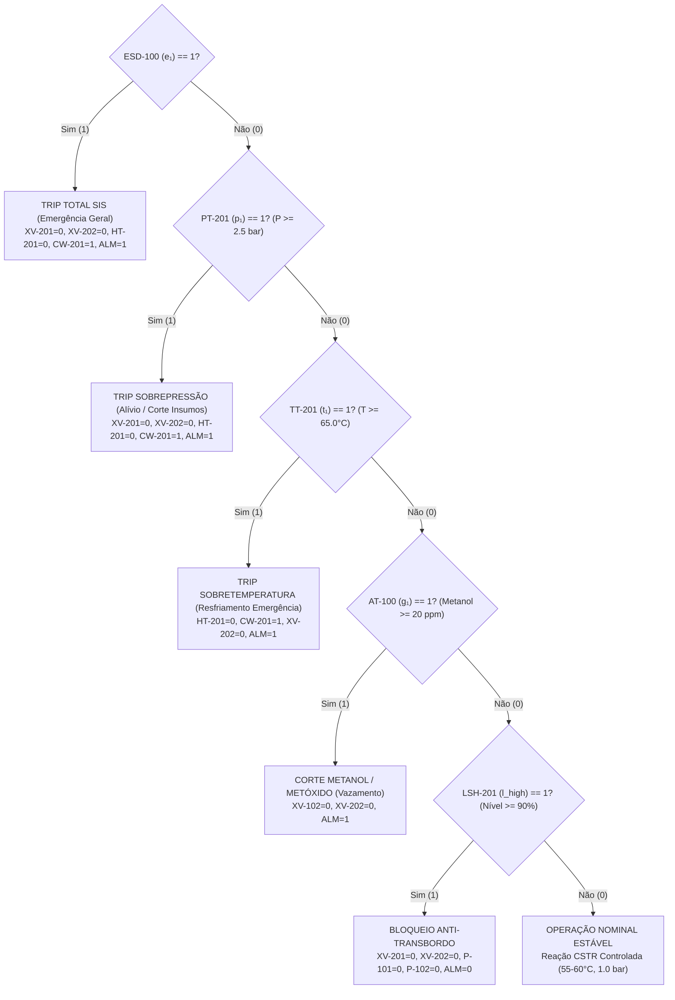
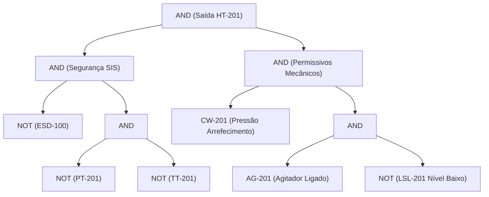



# Aplicações de Árvores Binárias na Planta Piloto de Biodiesel (Grupo 5)

---

| Especificação Técnica | Detalhes |
| :--- | :--- |
| **Unidade Operacional** | Setor 100 (Insumos: $\text{TK-101}$, $\text{TK-103}$), Setor 200 (Reator CSTR $\text{R-200}$) e Historiador SCADA-Core |
| **Domínio de Engenharia** | Engenharia de Processos Químicos, Segurança Funcional (IEC 61511 / SIL-3) e Matemática Discreta |
| **Estruturas de Dados** | Árvores Binárias de Decisão (BDT), Árvores de Expressão Booleana e Árvores AVL Auto-Balanceadas |
| **Status do Documento** | Aprovado para Implementação em Controladores Programáveis (CLP/DCS) e Supervisório |

---

## 1. Árvore Binária de Decisão (BDT) — Sistema Instrumentado de Segurança (SIS) do Reator R-200

### 1.1 Contextualização da Engenharia de Processos
O reator encamisado **R-200** é o coração da planta de transesterificação em batelada, onde triglicerídeos de óleos vegetais reagem com metóxido de sódio ($\text{CH}\_3\text{ONa}$) gerando biodiesel e glicerina:

$$\text{Triglicerídeos} + 3\,\text{CH}\_3\text{OH} \xrightarrow{\text{CH}\_3\text{ONa}} 3\,\text{Ésteres Metílicos (Biodiesel)} + \text{Glicerol}$$

A temperatura operacional deve ser rigorosamente estabilizada entre $55^\circ\text{C}$ e $60^\circ\text{C}$ sob pressão de $1.0\text{ bar}$. Se a temperatura ultrapassar $65.0^\circ\text{C}$ (ponto de ebulição do metanol puro: $64.7^\circ\text{C}$), ocorre o fenômeno crítico de *flash boiling* (ebulição instantânea de metanol), ocasionando rápida expansão de vapores inflamáveis e sobrepressurização abrupta ($P \ge 2.5\text{ bar}$ no sensor $\text{PT-201}$). 

Para impedir eventos catastróficos e proteger o vaso contra ruptura e derramamento tóxico, o **Sistema Instrumentado de Segurança (SIS / SIL 3)** executa uma **Árvore Binária de Decisão (BDT)** estática com tempo de resposta determinístico de varredura $\mathcal{O}(1)$.

### 1.2 Formalização Matemática da Árvore de Decisão
Formaliza-se a BDT como um grafo direcionado acíclico enraizado $T\_{\text{BDT}} = (V, E)$, onde:
* $V = V\_{\text{decisão}} \cup V\_{\text{atuação}}$, em que $V\_{\text{decisão}}$ representa predicados booleanos derivados das tags da norma ISA-5.1 e $V\_{\text{atuação}}$ representa as ações sobre atuadores seguros;
* $E = E\_{\text{verdadeiro}} \cup E\_{\text{falso}}$ são as arestas de transição de decisão binária $\{1, 0\}$.

A prioridade de corte segue a gravidade dos desvios de processo (avaliação por curto-circuito):
1. **$\text{ESD-100}$ ($e\_1 = 1$):** Parada de Emergência Geral (Botoeira do operador em campo);
2. **$\text{PT-201}$ ($p\_1 = 1$):** Sobrepressão Crítica no Reator ($P \ge 2.5\text{ bar}$);
3. **$\text{TT-201}$ / $\text{TSH-201}$ ($t\_1 = 1$):** Sobretemperatura Crítica ($T \ge 65.0^\circ\text{C}$, risco de *flash boiling*);
4. **$\text{AT-100}$ ($g\_1 = 1$):** Vapores Inflamáveis de Metanol no Setor 100/200 ($\ge 20\text{ ppm}$);
5. **$\text{LSH-201}$ ($l\_{\text{high}} = 1$):** Nível Alto / Risco de Transbordo no Reator ($L \ge 90\%$);
6. **Estado Nominal:** Operação Estável em Batelada.

### 1.3 Topologia da Árvore de Intertravamento SIS (Mermaid)

### 1.4 Mapeamento Determinístico dos Instrumentos ISA-5.1

| Nível ($h$) | Nó de Decisão | Tag ISA-5.1 | Condição Booleana | Atuação nos Elementos Finais | Estado Funcional |
| :---: | :---: | :---: | :---: | :---: | :---: |
| **0 (Raiz)** | `ESD-100` | Botoeira SIS | $e\_1 = 1 \implies \text{Ativada}$ | $\text{XV-201}=0, \text{XV-202}=0, \text{HT-201}=0, \text{CW-201}=1$ | Desarme Seguro Geral (*Safe State*) |
| **1** | `PT-201` | Transmissor Pressão | $p\_1 = 1 \implies P \ge 2.5\text{ bar}$ | $\text{XV-201}=0, \text{XV-202}=0, \text{HT-201}=0, \text{CW-201}=1$ | Trip de Sobrepressão Reator R-200 |
| **2** | `TT-201` | Transmissor Temp. | $t\_1 = 1 \implies T \ge 65.0^\circ\text{C}$ | $\text{HT-201}=0, \text{CW-201}=1, \text{XV-202}=0$ | Trip de Sobretemperatura (Anti-*Flash*) |
| **3** | `AT-100` | Detector Metanol | $g\_1 = 1 \implies C \ge 20\text{ ppm}$ | $\text{XV-102}=0, \text{XV-202}=0, \text{ALM}=1$ | Isolamento de Linhas de Metanol |
| **4** | `LSH-201` | Chave Nível Alto | $l\_{\text{high}} = 1 \implies L \ge 90\%$ | $\text{XV-201}=0, \text{XV-202}=0, \text{P-101}=0$ | Bloqueio de Carga Anti-Transbordo |
| **5 (Folha)** | Estado Normal | Todos conformes | $e\_1 = p\_1 = t\_1 = g\_1 = l\_{\text{high}} = 0$ | Malhas PID ativas ($\text{HT-201}, \text{AG-201}$) | Reação de Transesterificação Normal |

---

## 2. Árvores de Expressão Booleana — Validação de Intertravamentos do R-200, TK-101 e TK-103

Nas linguagens de CLPs industriais (IEC 61131-3: FBD e LD), as equações de intertravamento e permissivos de partida são compiladas internamente como **Árvores de Expressão Sintática (*Abstract Syntax Trees* — AST)**. 

### 2.1 Intertravamento de Aquecimento do Reator R-200
O sistema de aquecimento do reator encamisado ($\text{HT-201}$, denotado $h\_1$) só pode operar se houver permissivo de processo e ausência de trips:

$$\text{Permissivo}\_{h\_1} = \big( \neg e\_1 \land \neg p\_1 \land \neg t\_1 \big) \land \big( r\_1 \land m\_{\text{reator}} \land \neg l\_{\text{baixo}} \big)$$

Onde:
* $r\_1$ (`CW-201`): Circuito de arrefecimento de emergência pressurizado e disponível;
* $m\_{\text{reator}}$ (`AG-201`): Agitador mecânico do reator ligado (evita pontos quentes locais);
* $l\_{\text{baixo}}$ (`LSL-201`): Nível mínimo garantido (impede queima das resistências por reator vazio).

### 2.2 Intertravamento de Carga do Tanque de Preparação do Metóxido (TK-103)
A transferência dosada de metanol líquido ($\text{TK-102}$) para o tanque de preparação do catalisador ($\text{TK-103}$) requer ausência de vapores e nível disponível:

$$\text{Permissivo}\_{\text{TK-103}} = \neg e\_1 \land \neg g\_1 \land l\_{\text{met}} \land \neg l\_{\text{mix\_alto}} \land m\_{\text{mix}}$$

Onde $l\_{\text{met}}$ (`LT-102`) confirma estoque de metanol, $l\_{\text{mix\_alto}}$ (`LT-103`) impede transbordo do catalisador e $m\_{\text{mix}}$ (`AG-103`) mantém a agitação de dissolução do hidróxido.

---

## 3. Árvore AVL — Indexador e Historiador de Telemetria SCADA-Core em Tempo Real

### 3.1 Arquitetura de Dados em Tempo Real
O subsistema de arquivo histórico do **SCADA-Core** registra amostras periódicas a cada $50\text{ ms}$ dos sensores críticos do processo:
$$\mathbf{D}(\tau) = \big[ P\_{\text{PT-201}}, \; T\_{\text{TT-201}}, \; C\_{\text{AT-100}}, \; L\_{\text{LT-201}}, \; L\_{\text{LT-101}}, \; L\_{\text{LT-103}} \big]$$

Para garantir consultas instantâneas de auditoria pós-incidente (*Root Cause Analysis* — RCA) e renderização suave de tendências na IHM, as amostras são indexadas na memória em uma **Árvore Binária de Busca Auto-Balanceada (AVL)**, utilizando o carimbo temporal UNIX $\tau \in \mathbb{N}$ (em milissegundos) como chave estrita de ordenação.

### 3.2 Fator de Balanceamento e Rotações de Restauração
Em cada nó $n \in T\_{\text{AVL}}$, o fator de balanceamento é definido rigorosamente por:
$$BF(n) = h(T\_{\text{direita}}) - h(T\_{\text{esquerda}}) \in \{-1, \; 0, \; +1\}$$

Quando $|BF(n)| > 1$ após inserção contínua, o algoritmo executa rotações locais em $\mathcal{O}(1)$:
* **Rotação Simples à Direita (LL):** $BF(n) = -2$ e $BF(n.\text{esq}) \le 0$;
* **Rotação Simples à Esquerda (RR):** $BF(n) = +2$ e $BF(n.\text{dir}) \ge 0$;
* **Rotação Dupla Esquerda-Direita (LR):** $BF(n) = -2$ e $BF(n.\text{esq}) > 0$;
* **Rotação Dupla Direita-Esquerda (RL):** $BF(n) = +2$ e $BF(n.\text{dir}) < 0$.

### 3.3 Análise de Complexidade Assintótica

| Operação SCADA-Core | Busca Linear / Vetor Desordenado | Lista Ordenada | Árvore AVL (Garantido) |
| :--- | :---: | :---: | :---: |
| **Inserção de Amostra ($\tau, \mathbf{D}$)** | $\mathcal{O}(1)$ | $\mathcal{O}(N)$ | $\mathcal{O}(\log\_2 N)$ |
| **Busca Pontual de Evento / Alarme** | $\mathcal{O}(N)$ | $\mathcal{O}(\log\_2 N)$ | $\mathcal{O}(\log\_2 N)$ |
| **Consulta em Faixa de Tempo $[\tau\_1, \tau\_2]$** | $\mathcal{O}(N)$ | $\mathcal{O}(\log\_2 N + K)$ | $\mathcal{O}(\log\_2 N + K)$ |
| **Recuperação Cronológica (In-Order)** | $\mathcal{O}(N \log\_2 N)$ | $\mathcal{O}(N)$ | $\mathcal{O}(N)$ |

*Onde $N$ representa o total de frames telemetrados em memória e $K$ o número de registros encontrados na janela histórica $[\tau\_1, \tau\_2]$.*

---

## 4. Referências Técnicas
1. CORMEN, T. H. et al. **Algoritmos: Teoria e Prática**. 3. ed. Elsevier, 2012.
2. ADELSON-VELSKY, G. M.; LANDIS, E. M. **An algorithm for the organization of information**. Proceedings of the USSR Academy of Sciences, v. 146, p. 263–266, 1962.
3. ISA-5.1. **Instrumentation Symbols and Identification**. International Society of Automation, 2009.
4. IEC 61511. **Functional safety - Safety instrumented systems for the process industry sector**. International Electrotechnical Commission, 2016.
