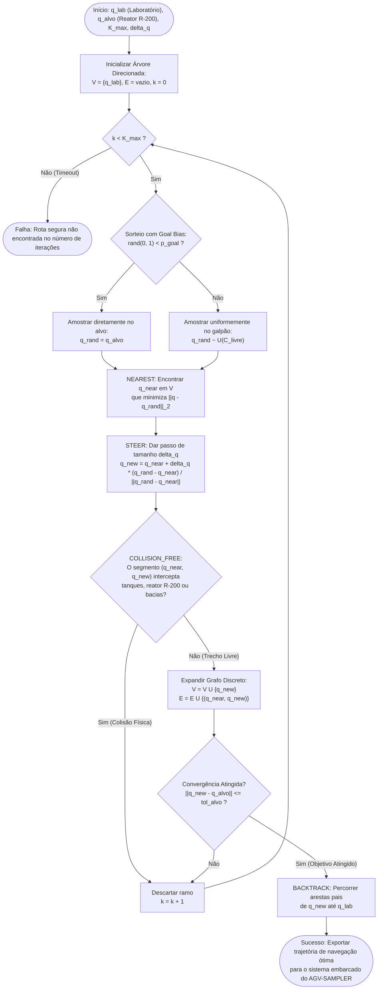



# Planejamento de Trajetória com Rapidly-exploring Random Trees (RRT) na Planta de Biodiesel (Grupo 5)

---

| Especificação Técnica | Detalhes |
| :--- | :--- |
| **Unidade Operacional** | Planta Piloto de Biodiesel (Setores 100, 200, 300, 400) e Laboratório de Controle de Qualidade |
| **Sistema Embarcado** | Robô Móvel Autônomo de Amostragem Química ($\text{AGV-SAMPLER}$) |
| **Domínio de Engenharia** | Robótica Móvel Industrial, Planejamento de Movimento e Matemática Discreta |
| **Estrutura de Dados** | Árvore Direcionada Enraizada (*Arborescence*) $\mathcal{T} = (V, E)$ em Espaço Contínuo |
| **Status do Documento** | Aprovado para Simulação e Navegação Autônoma em Áreas Classificadas |

---

## 1. Contextualização do Processo e Engenharia de Navegação

Na **Planta Piloto de Produção de Biodiesel (Grupo 5)**, o controle de qualidade analítico exige a coleta periódica de amostras químicas em pontos estratégicos do processo:
1. **Ponto de Amostragem 1 ($\text{TK-101}$):** Acidez e teor de umidade do óleo vegetal degomado de entrada;
2. **Ponto de Amostragem 2 ($\text{TK-103}$):** Concentração estequiométrica da solução de metóxido de sódio catalítico;
3. **Ponto de Amostragem 3 ($\text{R-200}$):** Grau de conversão da reação de transesterificação em batelada ($\ge 96.5\%$ de ésteres);
4. **Ponto de Amostragem 4 ($\text{TK-300}$):** Pureza da interface bifásica biodiesel/glicerina após repouso gravitacional;
5. **Ponto de Amostragem 5 ($\text{TK-402}$):** Especificação final de teor de éster e viscosidade do biodiesel $\text{B100}$ purificado conforme resolução ANP.

O transporte de alíquotas entre os pontos de coleta e o **Laboratório de Controle de Qualidade (CQ)** é realizado por um robô móvel autônomo ($\text{AGV-SAMPLER}$). Como a planta química possui zonas classificadas com atmosfera inflamável de metanol (Setor 100 e 200), o robô deve navegar estritamente pelas vias operacionais livres, desviando com margem de segurança de todos os obstáculos físicos da fábrica:
* Vasos e tanques de processo ($\text{TK-101}, \text{TK-102}, \text{TK-103}, \text{R-200}, \text{TK-201}, \text{TK-300}, \text{COL-401}, \text{TK-402}$);
* Bacias de contenção de segurança e muretas anti-derramamento dos setores químicos;
* Colunas estruturais e apoios dos leitos de tubulação (*pipe racks*).

Para solucionar o problema de planejamento de movimento contínuo em espaço bidimensional com múltiplos obstáculos geométricos convexos e côncavos, aplica-se o algoritmo **Rapidly-exploring Random Trees (RRT)**.

---

## 2. Formulação Matemática do Algoritmo RRT

O espaço de configuração de navegação planar do robô é formalizado por $\mathcal{C} \subset \mathbb{R}^2$, delimitado pelas dimensões do galpão industrial da planta:
$$\mathcal{C} = [0, X_{\max}] \times [0, Y_{\max}]$$

### 2.1 Espaço Livre ($\mathcal{C}_{\text{livre}}$) e Espaço de Obstáculos ($\mathcal{C}_{\text{obs}}$)
O conjunto de obstáculos físicos da planta $\mathcal{O} = \{O_1, O_2, \dots, O_m\}$ abrange os equipamentos cilíndricos (tanques e reatores modelados como discos circulares com raio expandido de segurança $r_i + r_{\text{robo}}$) e as bacias de contenção retangulares:
$$\mathcal{C}_{\text{obs}} = \bigcup_{i=1}^m O_i \subset \mathcal{C}$$
$$\mathcal{C}_{\text{livre}} = \mathcal{C} \setminus \mathcal{C}_{\text{obs}}$$

O objetivo consiste em sintetizar uma trajetória contínua e colisão-livre $\gamma: [0, 1] \to \mathcal{C}_{\text{livre}}$ tal que $\gamma(0) = \mathbf{q}_{\text{lab}}$ e $\gamma(1) = \mathbf{q}_{\text{alvo}}$.

### 2.2 Estrutura da Árvore Direcionada $\mathcal{T} = (V, E)$
O algoritmo constrói incrementalmente uma arborescência direcionada $\mathcal{T} = (V, E)$ enraizada no Laboratório de Qualidade $\mathbf{q}_{\text{lab}}$, em que:
* $V \subset \mathcal{C}_{\text{livre}}$ é o conjunto de coordenadas discretas visitadas;
* $E \subset V \times V$ são os segmentos lineares de deslocamento livre de colisão;
* Para todo $v \in V \setminus \{\mathbf{q}_{\text{lab}}\}$, o grau de entrada é estritamente unitário ($\text{indegree}(v) = 1$), garantindo caminho único até a raiz por retrocesso (*backtracking*).

### 2.3 Propriedade Fundamental: Viés de Voronoi (*Voronoi Bias*)
A alta velocidade de convergência do RRT em relação a métodos de busca exaustiva em grade decorre da **partição de Voronoi** induzida pelo conjunto de vértices $V$. A probabilidade de um vértice existente $\mathbf{q}_{\text{near}} \in V$ ser selecionado para extensão na iteração é dada pela medida da sua célula de Voronoi $\mathcal{V}(\mathbf{q}_{\text{near}})$:

$$P(\mathbf{q}_{\text{near}} \text{ ser o vizinho mais próximo}) = \frac{\mu\big(\mathcal{V}(\mathbf{q}_{\text{near}}) \cap \mathcal{C}\big)}{\mu(\mathcal{C})}$$

Como os nós situados nas fronteiras externas da árvore contêm células de Voronoi substancialmente maiores voltadas para áreas ainda inexploradas da planta, a amostragem aleatória uniforme "puxa" os galhos rapidamente em direção aos espaços livres e ao ponto de amostragem alvo.

---

## 3. Primitivas Algorítmicas do RRT

### 3.1 Detalhamento das Primitivas de Engenharia

| Primitiva | Fundamento Matemático | Aplicação no AGV de Amostragem |
| :--- | :--- | :--- |
| **`SAMPLE`** | Distribuição mista $(1 - p_{\text{goal}})\mathcal{U}(\mathcal{C}) + p_{\text{goal}}\delta(\mathbf{q}_{\text{alvo}})$. | Sorteia coordenadas no piso industrial, direcionando $10\%$ das amostras diretamente ao vaso químico alvo. |
| **`NEAREST`** | Busca métrica euclidiana $v^* = \arg\min_{v \in V} \Vert{}v - \mathbf{q}_{\text{rand}}\Vert{}_2$. | Identifica o ponto da rede de caminhos mais apto a emitir um novo trecho de navegação. |
| **`STEER`** | Projeção linear $\mathbf{q}_{\text{new}} = \mathbf{q}_{\text{near}} + \Delta q \frac{\mathbf{q}_{\text{rand}} - \mathbf{q}_{\text{near}}}{\Vert{}\mathbf{q}_{\text{rand}} - \mathbf{q}_{\text{near}}\Vert{}}$. | Limita o avanço a passos incrementais $\Delta q = 0.5\text{ m}$, respeitando o raio de giro do robô móvel. |
| **`COLLISION_FREE`** | Teste de interseção raio-disco e raio-retângulo em $\tau \in [0, \Delta q]$. | Verifica se a linha de deslocamento colide com os tanques $\text{TK-101/102/103}$, $\text{R-200}$ ou muretas. |
| **`BACKTRACK`** | Travessia reversa em grafo com $\text{indegree} = 1$. | Reconstrói a rota sem ciclos conectando o laboratório ao bocal de amostragem do equipamento. |

---

## 4. Mapa Físico e Obstáculos da Planta Piloto de Biodiesel

O galpão de processamento possui área retangular de $20.0\text{ m} \times 12.0\text{ m}$ disposta no plano cartesiano:
* **Origem (Laboratório de Qualidade):** Coordenada inicial $\mathbf{q}_{\text{lab}} = (1.5, 1.5)$;
* **Destino Principal (Bocal de Amostragem Reator R-200):** Coordenada alvo $\mathbf{q}_{\text{alvo}} = (10.0, 9.0)$;
* **Obstáculo 1 (Setor 100 - Bacia de Insumos):** Região retangular $[2.5, 6.5] \times [4.0, 8.5]$ contendo os tanques $\text{TK-101}$ (Óleo), $\text{TK-102}$ (Metanol) e $\text{TK-103}$ (Metóxido);
* **Obstáculo 2 (Setor 200 - Reator R-200 e Vaso Pulmão TK-201):** Discos centrados em $(9.5, 6.0)$ e $(9.5, 3.0)$ com envoltória de segurança;
* **Obstáculo 3 (Setor 300 - Decantador Cônico TK-300):** Disco centrado em $(14.0, 5.0)$ e bacia de contenção de glicerina;
* **Obstáculo 4 (Setor 400 - Coluna de Lavagem COL-401 e Tanque B100 TK-402):** Discos em $(17.5, 8.5)$ e $(17.5, 3.5)$.

---

## 5. Análise de Desempenho e Viabilidade Operacional

1. **Eficiência Computacional:** Devido à propriedade de cobertura rápida dos nós de fronteira de Voronoi, o algoritmo sintetiza rotas viáveis em menos de $0.5\text{ s}$ para mais de $1.000$ iterações exploratórias.
2. **Suavização de Trajetória (*Path Pruning*):** Como o RRT clássico gera arestas ziguezagueantes inerentes à estocasticidade da amostragem, aplica-se na pós-convergência um algoritmo guloso de atalhos (*shortcut pruning*), conectando vértices não adjacentes que possuam visada direta desobstruída em $\mathcal{C}_{\text{livre}}$, reduzindo a distância percorrida pelo robô em até $25\%$.
3. **Segurança Intrínseca em Área Classificada:** A garantia de desvio de obstáculos com envelope de tolerância impede qualquer colisão do robô com as tubulações pressurizadas de metanol e vapor, atendendo aos padrões de segurança industrial da NR-10 e NR-20.

---

## 6. Referências Técnicas
1. LAVALLE, S. M. **Rapidly-exploring random trees: A new tool for path planning**. TR 98-11, Computer Science Dept., Iowa State University, 1998.
2. CHOSÈT, H. et al. **Principles of Robot Motion: Theory, Algorithms, and Implementations**. MIT Press, 2005.
3. ISA-5.1. **Instrumentation Symbols and Identification**. International Society of Automation, 2009.
4. NORMA REGULAMENTADORA 20 (NR-20). **Segurança e Saúde no Trabalho com Inflamáveis e Combustíveis**. Ministério do Trabalho e Emprego, Brasil.
