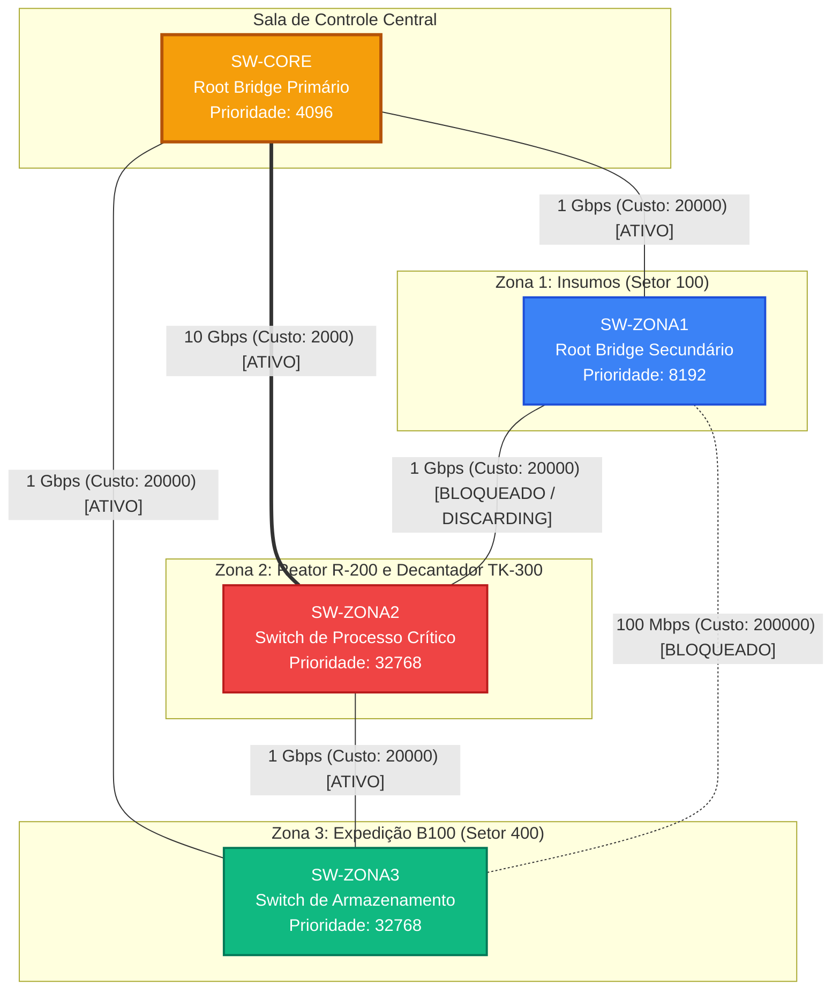



# Protocolo de Árvore Geradora (STP / RSTP) na Rede SCADA-Core da Planta de Biodiesel (Grupo 5)

---

| Especificação Técnica | Detalhes |
| :--- | :--- |
| **Infraestrutura de Rede** | Anel Redundante de Switches Gerenciáveis de Camada 2 (L2) e Backbone SCADA-Core |
| **Zonas de Automação** | Zona 1 (Insumos: Setor 100), Zona 2 (Reação e Decantação: Setores 200/300) e Zona 3 (Expedição: Setor 400) |
| **Domínio de Engenharia** | Redes Industriais de Comunicação (PROFINET / Modbus-TCP), Segurança Funcional e Teoria dos Grafos |
| **Protocolo Implementado** | IEEE 802.1w — *Rapid Spanning Tree Protocol* (RSTP) |
| **Status do Documento** | Aprovado para Configuração de Switches Industriais e Tolerância a Falhas |

---

## 1. Contextualização da Planta e Arquitetura de Comunicação em Anel

Na **Planta Piloto de Produção de Biodiesel por Transesterificação em Batelada (Grupo 5)**, a supervisão contínua e a segurança dos quatro setores operacionais são coordenadas por Controladores Lógicos Programáveis (CLPs) interligados ao servidor supervisório central **SCADA-Core**.

### 1.1 Zoneamento Físico e Criticidade dos Setores:
* **Zona 1 (Armazenamento de Insumos e Preparo de Metóxido — Setor 100):** Supervisiona os tanques $\text{TK-101}$ (Óleo), $\text{TK-102}$ (Metanol) e $\text{TK-103}$ (Metóxido), as bombas $\text{P-101}/\text{P-102}$ e o detector de vapores tóxicos/inflamáveis de metanol $\text{AT-100}$;
* **Zona 2 (Reação CSTR e Decantação Bifásica — Setores 200 e 300):** É o núcleo de maior risco operacional da planta, controlando o reator encamisado $\text{R-200}$ ($\text{PT-201}, \text{TT-201}, \text{LT-201}, \text{HT-201}, \text{CW-201}$) e o vaso decantador $\text{TK-300}$ ($\text{IT-301}, \text{XV-301}$ de dreno de glicerina). Qualquer atraso de comunicação neste bloco pode inviabilizar o desarme de emergência anti-*flash boiling*;
* **Zona 3 (Purificação e Expedição — Setor 400):** Gerencia a coluna de neutralização/lavagem $\text{COL-401}$ e os tanques de produto acabado $\text{TK-402}$ ($\text{LT-402}, \text{P-401}$);
* **SCADA-Core (Sala de Controle Central):** Servidor historiador, estações de operação IHM e concentrador do Sistema Instrumentado de Segurança ($\text{SIS} / \text{SIL 3}$).

Para garantir alta disponibilidade ($> 99.99\%$) e tolerância a rompimentos de cabos de fibra óptica causados por movimentações de cargas ou manutenções, a rede é projetada em **topologia física em anel redundante com enlaces cruzados**.

---

## 2. Fundamentação em Matemática Discreta e o Problema dos Ciclos em Camada 2

A rede de switches gerenciáveis da planta é modelada formalmente como um grafo não direcionado, conexo e ponderado $G = (V, E, w)$, onde:
* $V = \{v_{\text{CORE}}, v_{\text{ZONA1}}, v_{\text{ZONA2}}, v_{\text{ZONA3}}\}$ representa os switches industriais;
* $E$ representa os enlaces físicos de fibra óptica e cabos de cobre par trançado blindado ($\text{STP/SFTP}$);
* $w: E \to \mathbb{R}^+$ é o custo de caminho normalizado da norma **IEEE 802.1w**, inversamente proporcional à largura de banda:

| Taxa Nominal do Enlace | Custo IEEE 802.1w (RSTP) | Tipo Físico na Planta de Biodiesel |
| :--- | :---: | :--- |
| **$10\text{ Gbps}$ (10G Ethernet)** | $2.000$ | Fibra Óptica Monomodo (Backbone Sala de Controle $\leftrightarrow$ Zona 2 Reator) |
| **$1\text{ Gbps}$ (Gigabit Ethernet)** | $20.000$ | Fibra Óptica Multimodo (Anel de Distribuição Interzonal) |
| **$100\text{ Mbps}$ (Fast Ethernet)** | $200.000$ | Cabo de Cobre Blindado Industrial Cat 6A (Enlace Reserva de Campo) |

### 2.1 O Risco Catastrófico de Ciclos na Camada 2 (Ethernet Industrial)
Como os quadros de Camada 2 do padrão IEEE 802.3 **não possuem campo TTL (*Time-To-Live*)**, qualquer pacote de *broadcast* (como requisições ARP ou mensagens de *heartbeat* de CLPs) emitido em uma topologia cíclica é retransmitido infinitamente por todas as portas dos switches. Isso gera:
1. **Tempestade de Broadcast (*Broadcast Storm*):** Saturação instantânea de $100\%$ da banda do barramento, travando os canais de telemetria do reator $\text{R-200}$;
2. **Flapping de Tabela MAC (*MAC Table Thrashing*):** O endereço MAC do CLP de segurança passa a ser registrado alternadamente em portas distintas a cada microssegundo, inviabilizando o envio de comandos determinísticos.

### 2.2 Solução Formal: Árvore Geradora Mínima (MST)
O protocolo **RSTP (IEEE 802.1w)** executa uma variante distribuída para derivar de $G$ uma Árvore Geradora $T = (V, E_T)$ tal que:
1. $T$ é conexo e acíclico, contendo exatamente $|E_T| = |V| - 1$ arestas ativas;
2. As arestas redundantes $e \in (E \setminus E_T)$ são configuradas no estado **Discarding (Bloqueada)** para eliminação de ciclos, permanecendo em *standby* quente para ativação instantânea em caso de corte de cabo.

---

## 3. Comparativo Tecnológico: STP Clássico (802.1D) vs. RSTP (802.1w)

| Critério de Engenharia | STP Tradicional (IEEE 802.1D) | RSTP (IEEE 802.1w) — Adotado | Impacto no SCADA da Planta de Biodiesel |
| :--- | :---: | :---: | :--- |
| **Tempo de Convergência** | $30\text{ a }50\text{ segundos}$ | **$< 50\text{ ms a }200\text{ ms}$** | No STP tradicional, $40\text{ s}$ de perda de pacotes acionaria o *watchdog* dos CLPs, derrubando a batelada do reator $\text{R-200}$. O RSTP restabelece a rede imperceptivelmente. |
| **Mecanismo de Transição** | Temporizadores passivos (*Forward Delay* $2 \times 15\text{ s}$) | Acordo Ativo (*Proposal / Agreement Handshake*) | Comutação instantânea sem espera de temporizadores em enlaces ponto a ponto. |
| **Papéis de Porta** | *Root, Designated, Non-Designated* | *Root, Designated, Alternate, Backup* | A porta *Alternate* já mantém pré-calculada a rota secundária até o Root Bridge. |
| **Estados de Porta** | 5 estados (*Disabled, Blocking, Listening, Learning, Forwarding*) | 3 estados (*Discarding, Learning, Forwarding*) | Simplificação da máquina de estados do firmware dos switches industriais. |

---

## 4. Topologia e Funcionamento do Algoritmo RSTP na Planta

### 4.1 Regras de Eleição Determinística:
1. **Bridge ID (BID):** Composto pela tupla $\text{BID} = (\text{Bridge Priority}, \text{MAC Address})$. O switch de menor BID é aclamado como **Root Bridge**;
2. **Prioridades Pré-Configuradas:**
   * $\text{SW-CORE}$: Prioridade `4096` (Garante a raiz na Sala de Controle);
   * $\text{SW-ZONA1}$: Prioridade `8192` (Raiz reserva em caso de falha do switch central);
   * $\text{SW-ZONA2}$ e $\text{SW-ZONA3}$: Prioridade padrão `32768`;
3. **Seleção de Portas:**
   * **Root Port (RP):** A porta com menor custo de caminho acumulado até o Root Bridge;
   * **Designated Port (DP):** A porta com melhor custo em cada segmento físico;
   * **Alternate Port (AP):** Porta em estado *Discarding* que rompe os anéis.

---

## 5. Simulação de Falha de Link e Reconvergência Rápida

Quando a rota troncal de fibra óptica de $10\text{ Gbps}$ entre $\text{SW-CORE}$ e $\text{SW-ZONA2}$ sofre rompimento acidental:
1. Os transceptores ópticos detectam perda de sinal (*Loss of Signal — LoS*) em menos de $1\text{ ms}$;
2. O switch $\text{SW-ZONA2}$ envia instantaneamente uma BPDU de notificação de alteração de topologia (*Topology Change Notification — TCN*);
3. A porta *Alternate* do enlace $\text{SW-ZONA1} \leftrightarrow \text{SW-ZONA2}$, que estava bloqueada no estado *Discarding*, transita diretamente para *Forwarding* via troca rápida de *Proposal/Agreement* em menos de $50\text{ ms}$;
4. A integridade acíclica da árvore geradora é mantida ($|E_T| = |V| - 1 = 3$), restabelecendo o fluxo de telemetria antes que qualquer alarme falso de perda de comunicação seja disparado na IHM.

---

## 6. Referências Técnicas
1. IEEE Std 802.1w-2001. **IEEE Standard for Local and metropolitan area networks - Common specifications - Amendment 2: Rapid Reconfiguration**. IEEE, 2001.
2. CORMEN, T. H. et al. **Algoritmos: Teoria e Prática**. 3. ed. Elsevier, 2012.
3. IEC 62439-2. **Industrial communication networks - High availability automation networks**. International Electrotechnical Commission, 2016.
4. ISA-5.1. **Instrumentation Symbols and Identification**. International Society of Automation, 2009.
