# Modelagem, Árvore de Atingibilidade e Cobertura em Redes de Petri na Planta de Biodiesel (Grupo 5)

---

| Especificação Técnica | Detalhes |
| :--- | :--- |
| **Unidade Operacional** | Setor 100 (Insumos TK-101/TK-103), Setor 200 (Reator CSTR R-200), Setor 300 (Decantador TK-300) e Setor 400 (Purificação) |
| **Domínio de Engenharia** | Sistemas a Eventos Discretos (SED), Controle de Processos em Batelada (ISA-88), Redes de Petri (P/T Nets) |
| **Estruturas de Dados** | Árvore de Atingibilidade (*Reachability Tree*), Árvore de Cobertura (*Coverability Tree* — Algoritmo de Karp & Miller) |
| **Normas de Referência** | IEC 60848 (GRAFCET), IEC 61131-3 (SFC), IEC 61511 (SIS / SIL 3), ISA-5.1 e ISA-88 (Batch Control) |
| **Status do Documento** | Aprovado para Validação Formal de Concorrência, Ausência de Deadlock e Intertravamentos em CLPs |

---

## 1. Contextualização da Engenharia Química e Coordenação de Batelada

Na **Planta Piloto de Produção de Biodiesel por Transesterificação em Batelada (Grupo 5)**, a síntese de ésteres metílicos ocorre através da reação entre triglicerídeos de óleos vegetais e metóxido de sódio catalítico ($\text{CH}_3\text{ONa}$):

$$\text{Triglicerídeos} + 3\,\text{CH}_3\text{OH} \xrightarrow{\text{CH}_3\text{ONa}} 3\,\text{Ésteres Metílicos (Biodiesel)} + \text{Glicerol}$$

### 1.1 Fases Operacionais do Ciclo de Batelada
A fabricação opera em regime descontínuo cíclico com rigoroso sequenciamento temporal e alocação compartilhada de utilidades e equipamentos:
1. **Fase de Alimentação Segregada (Setor 100 $\to$ Setor 200):** Carga de óleo vegetal desgomado a partir do tanque $\text{TK-101}$ (válvula $\text{XV-201}$ e bomba $\text{P-101}$) e subsequente dosagem estequiométrica da solução de metóxido de sódio preparada em $\text{TK-103}$ (válvula de corte rápido $\text{XV-202}$ e bomba dosadora $\text{P-102}$);
2. **Fase de Reação Térmica e Cinética CSTR (Setor 200):** Acionamento do agitador mecânico $\text{AG-201}$ (garantindo emulsão homogênea entre os líquidos imiscíveis) e energização da jaqueta térmica $\text{HT-201}$. A temperatura é rigorosamente mantida na janela ótima entre $55^\circ\text{C}$ e $60^\circ\text{C}$ sob pressão nominal de $1.0\text{ bar}$. Se a temperatura ultrapassar $65.0^\circ\text{C}$, aproxima-se do ponto de ebulição do metanol puro ($64.7^\circ\text{C}$), deflagrando *flash boiling* e sobrepressão crítica no sensor $\text{PT-201}$;
3. **Fase de Descarga por Gravidade (Setor 200 $\to$ Setor 300):** Concluído o tempo cinético de batelada (conversão $\ge 96.5\%$), a mistura é transferida para o vaso decantador cônico $\text{TK-300}$ através da válvula de fundo $\text{XV-203}$, liberando o reator $\text{R-200}$ para a próxima batelada;
4. **Fase de Separação Bifásica Gravitacional e Drenagem (Setor 300):** No decantador $\text{TK-300}$, a mistura permanece em repouso estático para separação de fases por densidade ($\rho_{\text{biodiesel}} \approx 0.88\text{ g/cm}^3$ vs. $\rho_{\text{glicerina}} \approx 1.26\text{ g/cm}^3$). O sensor de interface óptica $\text{IT-301}$ comanda a abertura da válvula de dreno inferior $\text{XV-301}$ para purga de glicerina pesada, seguida da abertura da válvula de transbordo $\text{XV-302}$ para envio do biodiesel bruto à lavagem no Setor 400.

### 1.2 Riscos de Concorrência, Recursos Compartilhados e Deadlocks
O controle de batelada em sistemas químicos envolve sincronização assíncrona, paralelismo e exclusão mútua. Falhas na lógica de automação podem acarretar acidentes graves:
* **Deadlock Operacional:** Bloqueio mútuo onde o reator aguarda a dosagem de reagentes enquanto o tanque de preparo aguarda confirmação de esvaziamento, paralisando a produção indefinidamente;
* **Concorrência Insegura e Queima Térmica:** Energização do aquecedor $\text{HT-201}$ sem presença confirmada de líquido no reator ($\text{LT-201} \le 15\%$) ou com agitador $\text{AG-201}$ desligado, causando pontos quentes locais e ignição de vapores;
* **Transbordamento por Falta de Limitação:** Acúmulo descontrolado de insumos ou comandos de abertura concorrentes nos tanques intermediários;
* **Violação de Exclusão Mútua na Decantação:** Abertura simultânea da válvula de dreno de glicerina $\text{XV-301}$ e da válvula de transferência de biodiesel $\text{XV-302}$, provocando contaminação mútua de linhas e descarte indevido de produto comercial.

Para garantir que a lógica de controle implementada em CLPs (IEC 61131-3 SFC / GRAFCET) seja **estruturalmente correta, segura e imune a deadlocks**, modela-se o processo como uma **Rede de Petri (P/T Net)** e analisa-se rigorosamente seu espaço de estados através da **Árvore de Atingibilidade** e da **Árvore de Cobertura (Algoritmo de Karp & Miller)**.

---

## 2. Fundamentação Matemática de Redes de Petri Lugar/Transição

Formaliza-se a Rede de Petri como uma quíntupla matemática:

$$\mathcal{N} = (P, T, F, W, M_0)$$

Onde:
* $P = \{p_1, p_2, \dots, p_m\}$ é o conjunto finito e não-vazio de **Lugares (*Places*)**, representando condições operacionais, recursos disponíveis e etapas de processo;
* $T = \{t_1, t_2, \dots, t_n\}$ é o conjunto finito e não-vazio de **Transições (*Transitions*)**, representando eventos discretos, comandos de atuadores e desfechos de sensores;
* $P \cap T = \emptyset$ (o grafo é estritamente bipartido: arcos só conectam lugares a transições ou transições a lugares);
* $F \subseteq (P \times T) \cup (T \times P)$ é o conjunto de **arcos direcionados**;
* $W: F \to \mathbb{Z}^+$ é a função de **peso dos arcos** (arcos ordinários possuem peso $W(f) = 1$);
* $M_0: P \to \mathbb{N}$ é a **marcação inicial (*Initial Marking*)**, associando a cada lugar $p_i$ um número inicial de fichas (*tokens*).

### 2.1 Regra de Habilitação e Disparo de Transições
Uma transição $t_j \in T$ está **habilitada** na marcação corrente $M$, denotado por $M[t_j\rangle$, se e somente se todos os seus lugares de entrada contêm fichas suficientes:

$$\forall p \in {}^\bullet t_j, \quad M(p) \ge W(p, t_j)$$

O disparo de uma transição habilitada $t_j$ consome as fichas dos lugares de entrada e produz fichas nos lugares de saída, gerando uma nova marcação $M'$:

$$M'(p) = M(p) - W(p, t_j) + W(t_j, p), \quad \forall p \in P$$

Denota-se a transição de estado por $M \xrightarrow{t_j} M'$.

### 2.2 Matriz de Incidência e Equação Fundamental de Estado
A topologia da rede é representada matricialmente por:
* Matriz de Pré-Incidência $C^- \in \mathbb{N}^{|P| \times |T|}$, onde $C^-(p_i, t_j) = W(p_i, t_j)$;
* Matriz de Pós-Incidência $C^+ \in \mathbb{N}^{|P| \times |T|}$, onde $C^+(p_i, t_j) = W(t_j, p_i)$;
* **Matriz de Incidência Combinada:** $C = C^+ - C^- \in \mathbb{Z}^{|P| \times |T|}$.

A marcação resultante $M_k$ após uma sequência de disparos a partir de $M_0$ é descrita algebricamente pela **Equação de Estado**:

$$M_k = M_0 + C \cdot \mathbf{u}$$

Onde $\mathbf{u} = [u_1, u_2, \dots, u_n]^T \in \mathbb{N}^{|T|}$ é o **vetor de contagem de disparos (*firing count vector*)**, em que cada elemento $u_j$ indica o número total de vezes que a transição $t_j$ foi disparada.

---

## 3. Árvore de Atingibilidade (*Reachability Tree*)

O **Conjunto de Atingibilidade $R(M_0)$** compreende todas as marcações alcançáveis a partir de $M_0$ mediante sequências válidas de disparos. A **Árvore de Atingibilidade** é uma representação em árvore enraizada cujo nó raiz é $M_0$ e cujos ramos correspondem aos disparos de transições habilitadas.

### 3.1 Algoritmo Construtivo da Árvore de Atingibilidade
1. **Inicialização:** Cria-se o nó raiz com a marcação inicial $M_0$. Rotula-se $M_0$ como nó não explorado;
2. **Iteração de Expansão:** Enquanto existirem nós não explorados $M$:
   * Para cada transição $t \in T$ tal que $M[t\rangle$:
     * Calcula-se a nova marcação gerada $M' = M + C(\cdot, t)$;
     * Adiciona-se o nó filho $M'$ com aresta direcionada $M \xrightarrow{t} M'$;
     * **Classificação de Término de Ramo:**
       * **Nó Duplicado (Repetido):** Se $M'$ já existir na árvore (em outro ramo ou nível ancestral), marca-se $M'$ como nó duplicado e encerra-se a exploração deste caminho (estado cíclico recorrente);
       * **Nó Terminal (Deadlock):** Se nenhuma transição estiver habilitada em $M'$ ($\forall t \in T, \neg M'[t\rangle$), marca-se $M'$ como nó terminal de travamento (*deadlock*);
       * **Nó Regular:** Caso contrário, marca-se $M'$ como não explorado para expansão nas iterações subsequentes.

```mermaid
graph TD
    M0["M₀: Reator Vazio, Insumos Prontos<br>[1, 1, 1, 0, 0, 0, 0, 0, 0, 1, 0, 0, 0]"]
    M0 -->|"t₁: Inicia Carga Óleo"| M1["M₁: Carregando Óleo<br>[0, 0, 1, 1, 0, 0, 0, 0, 0, 1, 0, 0, 0]"]
    M1 -->|"t₂: Fim Carga Óleo"| M2["M₂: Óleo Pronto no R-200<br>[0, 0, 1, 0, 0, 0, 0, 0, 0, 1, 0, 0, 0]"]
    M2 -->|"t₃: Inicia Dosagem Metóxido"| M3["M₃: Dosando Metóxido<br>[0, 0, 0, 0, 1, 0, 0, 0, 0, 1, 0, 0, 0]"]
    M3 -->|"t₄: Fim Dosagem Metóxido"| M4["M₄: Carga Completa R-200<br>[0, 0, 0, 0, 0, 1, 0, 0, 0, 1, 0, 0, 0]"]
    M4 -->|"t₅: Liga Agitador e Aquecedor"| M5["M₅: Reação CSTR 55-60°C<br>[0, 0, 0, 0, 0, 0, 1, 1, 0, 1, 0, 0, 0]"]
    M5 -->|"t₆: Fim Reação (Cinética OK)"| M6["M₆: Batelada Concluída<br>[0, 0, 0, 0, 0, 0, 0, 0, 1, 1, 0, 0, 0]"]
    M6 -->|"t₇: Descarga para TK-300"| M7["M₇: Reator Liberado / Decantação<br>[1, 1, 1, 0, 0, 0, 0, 0, 0, 0, 1, 0, 0]"]
    M7 -->|"t₈: Fim Separação Bifásica"| M8["M₈: Fases Nítidas no TK-300<br>[1, 1, 1, 0, 0, 0, 0, 0, 0, 0, 0, 1, 0]"]
    M8 -->|"t₉: Dreno Glicerina (XV-301)"| M9["M₉: Transf. Biodiesel (XV-302)<br>[1, 1, 1, 0, 0, 0, 0, 0, 0, 0, 0, 0, 1]"]
    M9 -->|"t₁₀: Ciclo Concluído"| M0_ret["M₀ (Nó Duplicado — Retorno ao Ciclo)"]
    
    style M0 fill:#10b981,stroke:#047857,stroke-width:3px,color:#fff
    style M5 fill:#ef4444,stroke:#b91c1c,stroke-width:2px,color:#fff
    style M7 fill:#3b82f6,stroke:#1d4ed8,stroke-width:2px,color:#fff
    style M0_ret fill:#f59e0b,stroke:#b45309,stroke-width:2px,color:#fff
```

---

## 4. Árvore de Cobertura (*Coverability Tree*) e o Algoritmo de Karp & Miller

Se uma Rede de Petri não for limitada, o número de fichas em determinados lugares pode crescer indefinidamente, tornando o conjunto de atingibilidade $R(M_0)$ infinito. Nesses casos, a Árvore de Atingibilidade clássica não termina.

Para contornar essa limitação e viabilizar a análise algorítmica de qualquer rede, **Richard M. Karp e Raymond E. Miller (1969)** introduziram a **Árvore de Cobertura**, utilizando o símbolo especial $\omega$ (*ômega*), que denota uma quantidade arbitrariamente grande de fichas.

### 4.1 Aritmética do Símbolo $\omega$
Para qualquer constante inteira $n \in \mathbb{N}$:
$$\omega > n, \quad \omega \pm n = \omega, \quad \omega \ge \omega$$

### 4.2 Critério de Dominância e Regra de Karp-Miller
Durante a geração da árvore, ao calcular uma nova marcação $M'$ a partir de $M$ via disparo de $t$:
1. Percorre-se o caminho na árvore do nó raiz até o nó ancestral $M''$;
2. Se existir um ancestral $M''$ tal que **$M'$ domina estritamente $M''$**:
   $$M' \ge M'' \quad \text{e} \quad M' \neq M''$$
   Isto é:
   $$\forall p \in P, \; M'(p) \ge M''(p) \quad \text{e} \quad \exists p_k \in P \text{ tal que } M'(p_k) > M''(p_k)$$
3. **Substituição por $\omega$:** Para todo lugar $p_k$ onde $M'(p_k) > M''(p_k)$, atribui-se:
   $$M'(p_k) \leftarrow \omega$$

### 4.3 Propriedade Fundamental de Finitude
Pelo **Lema de Dickson (1913)** sobre ordens parciais bem-fundadas em $\mathbb{N}^k$, qualquer sequência infinita de vetores contém uma subsequência infinita não-decrescente. Portanto, a regra de dominância de Karp-Miller garante que:
> **Teorema de Karp-Miller:** A Árvore de Cobertura de qualquer Rede de Petri Lugar/Transição é **estritamente finita** e sua construção termina em tempo determinístico.

---

## 5. Modelagem Formal da Batelada da Planta de Biodiesel (Grupo 5)

A rede de automação modela o ciclo produtivo integrado entre os Setores 100, 200 e 300:

### 5.1 Especificação dos Lugares ($P$):
* $p_1$ (`P_REATOR_VAZIO`): Reator encamisado $\text{R-200}$ despressurizado, limpo e pronto para carregar;
* $p_2$ (`P_OLEO_DISP`): Recurso do Setor 100: Silo $\text{TK-101}$ com óleo vegetal degomado e permissivo $\text{XV-101}$;
* $p_3$ (`P_METOXIDO_DISP`): Recurso do Setor 100: Tanque $\text{TK-103}$ com solução catalítica $\text{CH}_3\text{ONa}$ pronta;
* $p_4$ (`P_CARREGANDO_OLEO`): Carga de triglicerídeos em andamento no $\text{R-200}$ ($\text{XV-201}$ aberta, $\text{P-101}$ ativa);
* $p_5$ (`P_DOSANDO_METOXIDO`): Dosagem estequiométrica de catalisador em andamento ($\text{XV-202}$ aberta, $\text{P-102}$ ativa);
* $p_6$ (`P_CARGA_COMPLETA`): Carga de reagentes concluída no reator ($\text{LT-201} \approx 65\%$, permissivo de aquecimento);
* $p_7$ (`P_AGITADOR_ATIVO`): Recurso de segurança: Agitador $\text{AG-201}$ ligado a 120 RPM (evita pontos quentes);
* $p_8$ (`P_REACAO_AQUECIMENTO`): Reação CSTR em curso: Jaqueta $\text{HT-201}$ ativa ($55^\circ\text{C} \le T \le 60^\circ\text{C}$, $P \approx 1.0\text{ bar}$);
* $p_9$ (`P_BATELADA_CONCLUIDA`): Reação de transesterificação concluída (tempo cinético atingido, conversão $\ge 96.5\%$);
* $p_{10}$ (`P_DECANTADOR_LIVRE`): Recurso do Setor 300: Vaso $\text{TK-300}$ vazio e pronto para recepção de batelada;
* $p_{11}$ (`P_DECANTACAO_FASES`): Mistura em repouso estático para separação bifásica gravitacional no $\text{TK-300}$;
* $p_{12}$ (`P_PURGA_GLICERINA`): Dreno inferior $\text{XV-301}$ aberto para purga de glicerina pesada ($\rho \approx 1.26\text{ g/cm}^3$);
* $p_{13}$ (`P_TRANSF_BIODIESEL`): Transbordo superior $\text{XV-302}$ aberto para transferência de éster bruto ao Setor 400.

### 5.2 Especificação das Transições ($T$):
* $t_1$ (`T_INICIA_CARGA_OLEO`): CLP emite comando de abertura de $\text{XV-201}$ e partida da bomba $\text{P-101}$;
* $t_2$ (`T_FIM_CARGA_OLEO`): Transmissor $\text{LT-201}$ confirma 50% de volume de óleo; fecha $\text{XV-201}$ e desliga $\text{P-101}$;
* $t_3$ (`T_INICIA_DOSAGEM_MET`): Permissivo OK: CLP abre $\text{XV-202}$ e parte a bomba dosadora $\text{P-102}$;
* $t_4$ (`T_FIM_DOSAGEM_MET`): Volume estequiométrico de metóxido completado ($\text{LT-201} \approx 65\%$); fecha $\text{XV-202}$ e desliga $\text{P-102}$;
* $t_5$ (`T_LIGA_AGITADOR_AQUECEDOR`): Permissivo SIS satisfeito: aciona inversor de $\text{AG-201}$ e energiza $\text{HT-201}$;
* $t_6$ (`T_FIM_REACAO`): Temporizador cinético de batelada esgotado (60 min a $58^\circ\text{C}$); desliga $\text{HT-201}$;
* $t_7$ (`T_DESCARGA_DECANTADOR`): Abertura da válvula de fundo $\text{XV-203}$; descarga por gravidade para $\text{TK-300}$;
* $t_8$ (`T_FIM_SEPARACAO`): Sensor óptico de interface $\text{IT-301}$ detecta linha de demarcação nítida das fases;
* $t_9$ (`T_INICIA_PURGA_GLIC`): Abertura do dreno $\text{XV-301}$ para descarte de glicerina pura no tambor de subproduto;
* $t_{10}$ (`T_FIM_PURGA_GLIC`): Sensor $\text{IT-301}$ acusa fim da fase pesada; bloqueio imediato de $\text{XV-301}$;
* $t_{11}$ (`T_INICIA_TRANSF_BIO`): Abertura de $\text{XV-302}$ para transferência de biodiesel bruto à coluna de lavagem $\text{COL-401}$;
* $t_{12}$ (`T_CICLO_COMPLETO`): Vaso $\text{TK-300}$ esvaziado; restabelecimento das condições iniciais e liberação dos recursos.

### 5.3 Marcação Inicial ($M_0$):
Na partida da planta, o reator está vazio, os estoques de óleo e metóxido estão disponíveis e o decantador está livre:

$$M_0 = \begin{bmatrix} p_1 & p_2 & p_3 & p_4 & p_5 & p_6 & p_7 & p_8 & p_9 & p_{10} & p_{11} & p_{12} & p_{13} \end{bmatrix}^T$$
$$M_0 = \begin{bmatrix} 1 & 1 & 1 & 0 & 0 & 0 & 0 & 0 & 0 & 1 & 0 & 0 & 0 \end{bmatrix}^T$$

---

## 6. Análise Rigorosa das Propriedades Formais do Sistema

Através da exploração completa da Árvore de Atingibilidade e Cobertura gerada pelo Algoritmo de Karp & Miller, provam-se as propriedades essenciais de confiabilidade e segurança funcional:

### 6.1 Limitabilidade e Segurança (*Boundedness & Safeness*)
* **Definição:** Uma rede é $k$-limitada se para toda marcação atingível $M \in R(M_0)$ e todo lugar $p \in P$, tem-se $M(p) \le k$. Se $k=1$, a rede é denominada **estritamente segura (*Safe*) ou binária**;
* **Prova pela Árvore de Cobertura:** A árvore gerada não contém a ocorrência do símbolo $\omega$ em nenhum nó ($\forall M \in \mathcal{T}, \forall p \in P, M(p) \neq \omega$). Além disso, verifica-se exaustivamente que $\max_{M \in R(M_0)} M(p) = 1$ para todos os 13 lugares;
* **Impacto na Automação:** A 1-limitabilidade garante que o modelo pode ser traduzido diretamente para linguagens de programação de CLPs industriais (IEC 61131-3 SFC / LD / FBD) mapeando cada lugar para um registrador booleano de 1 bit (`BOOL`), eliminando riscos de estouro de memória ou transbordamento físico.

### 6.2 Vivacidade (*Liveness*) e Ausência de Deadlock
* **Definição:** Uma transição $t$ é viva de nível $L_4$ se para qualquer marcação atingível $M \in R(M_0)$, existe uma sequência de disparos que reabilita $t$. A rede é **livre de deadlocks** se nenhuma marcação atingível é um nó terminal sem transições habilitadas;
* **Prova:** A Árvore de Atingibilidade é fortemente conexa no espaço de estados fechado: a partir de qualquer folha, o disparo de $t_{12}$ reconduz o sistema à marcação inicial $M_0$. Não há nós terminais não planejados;
* **Impacto Industrial:** O sistema nunca entra em travamento mútuo durante a batelada, assegurando disponibilidade operacional superior a $99.99\%$.

### 6.3 Reversibilidade (*Reversibility*)
* **Definição:** A rede é reversível se para toda marcação $M \in R(M_0)$, a marcação inicial $M_0$ permanece atingível ($M_0 \in R(M)$);
* **Conclusão:** O ciclo de produção de biodiesel é estritamente periódico e auto-restaurável, permitindo execução contínua de bateladas subsequentes.

### 6.4 Invariantes Estruturais: P-Invariantes e T-Invariantes
Os invariantes estruturais independem da marcação inicial e caracterizam leis de conservação da física e da lógica do processo:

#### P-Invariantes (Conservação de Recursos):
Vetores inteiros $\mathbf{y} \in \mathbb{N}^{|P|}$ não-nulos que satisfazem:
$$\mathbf{y}^T C = \mathbf{0}^T \implies \mathbf{y}^T M = \mathbf{y}^T M_0 = \text{constante}, \quad \forall M \in R(M_0)$$

Identificam-se os seguintes P-Invariantes fundamentais na planta de biodiesel:
1. **Invariante do Reator R-200:**
   $$M(p_1) + M(p_4) + M(p_5) + M(p_6) + M(p_8) + M(p_9) = 1$$
   *Significado Físico:* O reator $\text{R-200}$ é um recurso monousuário indecomponível: em qualquer instante da operação, ele está estritamente em um único estado (Vazio, Carregando Óleo, Dosando Metóxido, Carga Completa, Reagindo ou Batelada Concluída);
2. **Invariante do Vaso Decantador TK-300:**
   $$M(p_{10}) + M(p_{11}) + M(p_{12}) + M(p_{13}) = 1$$
   *Significado Físico:* O vaso decantador está ou Livre, ou em Decantação Bifásica, ou em Purga de Glicerina, ou em Transferência de Biodiesel;
3. **Invariante de Exclusão Mútua da Drenagem:**
   $$M(p_{12}) + M(p_{13}) \le 1$$
   *Significado de Segurança:* É matematicamente impossível abrir a purga de subproduto ($\text{XV-301}$) e a expedição de combustível ($\text{XV-302}$) simultaneamente, prevenindo contaminação cruzada.

#### T-Invariantes (Ciclos Periódicos de Batelada):
Vetores inteiros $\mathbf{x} \in \mathbb{N}^{|T|}$ que satisfazem:
$$C \mathbf{x} = \mathbf{0}$$
O T-invariante fundamental da planta de biodiesel é o vetor unitário:
$$\mathbf{x}_{\text{batch}} = [1, 1, 1, 1, 1, 1, 1, 1, 1, 1, 1, 1]^T$$
Indicando que o disparo coordenado de exatamente uma ocorrência de cada transição $t_1 \dots t_{12}$ completa a síntese e purificação de uma batelada de biodiesel, restaurando a energia e os estados do sistema ao ponto de partida.

---

## 7. Mapeamento para Controladores Programáveis (IEC 61131-3 SFC / GRAFCET)

A Rede de Petri formalizada serve de especificação unívoca para programação em linguagens industriais padronizadas:

| Componente da Rede de Petri | Elemento IEC 61131-3 SFC | Variável / Tag ISA-5.1 no CLP | Comportamento Funcional |
| :--- | :--- | :--- | :--- |
| **Lugar $p_1$** | Etapa Inicial `Step_01` | `%X1` (`R200_READY`) | Habilita permissivo de abertura de carga |
| **Transição $t_1$** | Transição `Trans_01` | Receptividade: `%IX0.0` e `XV-101_OPN` | Dispara abertura de $\text{XV-201}$ e liga $\text{P-101}$ |
| **Lugar $p_4$** | Etapa `Step_02` | `%X4` (`OIL_FILLING`) | Bomba $\text{P-101}$ energizada; monitora $\text{LT-201}$ |
| **Transição $t_5$** | Transição `Trans_05` | Receptividade: `LT-201 >= 60%` e `AG-201_RUN` | Permissivo SIS: liga aquecedor $\text{HT-201}$ |
| **Lugar $p_8$** | Etapa `Step_06` | `%X8` (`CSTR_REACTION`) | Malha PID de temperatura ativa ($55-60^\circ\text{C}$) |
| **Lugar $p_{12}$** | Etapa `Step_10` | `%X12` (`GLYC_DRAIN`) | Abre dreno de fundo $\text{XV-301}$; monitora $\text{IT-301}$ |
| **Lugar $p_{13}$** | Etapa `Step_11` | `%X13` (`BIO_TRANSFER`) | Abre $\text{XV-302}$ para lavagem no Setor 400 |

---

## 8. Referências Técnicas e Bibliográficas

1. MURATA, T. **Petri Nets: Properties, Analysis and Applications**. Proceedings of the IEEE, v. 77, n. 4, p. 541–580, 1989.
2. KARP, R. M.; MILLER, R. E. **Parallel Program Schemata**. Journal of Computer and System Sciences, v. 3, n. 2, p. 147–195, 1969.
3. IEC 60848. **GRAFCET specification language for sequential function charts**. International Electrotechnical Commission, 2013.
4. IEC 61131-3. **Programmable controllers - Part 3: Programming languages (Sequential Function Chart - SFC)**. IEC, 2013.
5. ISA-88.01. **Batch Control Part 1: Models and Terminology**. International Society of Automation, 2010.
6. IEC 61511. **Functional safety - Safety instrumented systems for the process industry sector**. IEC, 2016.
7. CASANDRAS, C. G.; LAFORTUNE, S. **Introduction to Discrete Event Systems**. 2. ed. Springer, 2008.
