# Controle Autônomo e Segurança Reativa com Árvores de Comportamento (Behavior Trees) na Planta de Biodiesel (Grupo 5)

---

| Especificação Técnica | Detalhes |
| :--- | :--- |
| **Unidade Operacional** | Setor 100 (Insumos TK-101/TK-102/TK-103), Setor 200 (Reator CSTR R-200), Setor 300 (Decantador TK-300) e Setor 400 (Purificação) |
| **Domínio de Engenharia** | Automação Inteligente, Arquiteturas de Controle Reativo em Tempo Real, Robótica Cognitiva, Teoria dos Grafos Enraizados |
| **Estruturas de Dados** | Árvores de Comportamento (*Behavior Trees* - BT) com Nós de Controle (Fallback, Sequence, Parallel), Folhas (Action, Condition), Decoradores e Blackboard |
| **Normas de Referência** | IEC 61511 / IEC 61508 (SIS / SIL 3), ISA-88 (Batch Control), ISA-5.1 e IEEE Std 1873 |
| **Status do Documento** | Aprovado para Implementação em Controladores de Batelada e Sistema Especialista SCADA-Core |

---

## 1. Contextualização da Engenharia de Processos e Limitações das FSMs

Na **Planta Piloto de Produção de Biodiesel por Transesterificação em Batelada (Grupo 5)**, a síntese de ésteres metílicos envolve reações químicas homogêneas/heterogêneas exotérmicas entre triglicerídeos de óleos vegetais e metóxido de sódio catalítico ($\text{CH}_3\text{ONa}$):

$$\text{Triglicerídeos} + 3\,\text{CH}_3\text{OH} \xrightarrow{\text{CH}_3\text{ONa}} 3\,\text{Ésteres Metílicos (Biodiesel)} + \text{Glicerol}$$

### 1.1 Riscos de Processo e Priorização Operacional
O reator encamisado **R-200** é o centro nervoso da planta e exige um sistema de controle capaz de gerenciar simultaneamente três camadas concorrentes com prioridades estritas:

1. **Camada de Segurança Crítica (SIS / SIL 3 — Prioridade Máxima):**
   * *Risco de Runaway Térmico e Flash Boiling:* A reação ocorre entre $55^\circ\text{C}$ e $60^\circ\text{C}$ sob $1.0\text{ bar}$. Se a temperatura ultrapassar $65.0^\circ\text{C}$, aproxima-se do ponto de ebulição do metanol puro ($64.7^\circ\text{C}$), provocando vaporização violenta (*flash boiling*), expansão volumétrica de 300 vezes e disparo da pressão acima de $2.5\text{ bar}$ no transmissor $\text{PT-201}$;
   * *Risco de Atmosfera Explosiva:* Vazamento de vapores de metanol no Setor 100/200 ($\text{AT-100} \ge 20\text{ ppm}$);
   * *Ação Requerida:* Desarme imediato em Estado Seguro (*Safe State Global*) em $\mathcal{O}(1)$: desenergizar jaqueta $\text{HT-201}$, cortar válvulas de insumos $\text{XV-201}$ e $\text{XV-202}$, e abrir resfriamento de emergência $\text{CW-201}$.

2. **Camada de Salvaguarda Mecânica de Equipamentos (Prioridade Intermediária):**
   * *Risco de Cavitação e Destruição de Pás:* Se o nível do reator for baixo ($\text{LT-201} \le 15\%$), o agitador $\text{AG-201}$ em 120 RPM cria vórtices destrutivos e empenamento mecânico do eixo;
   * *Ação Requerida:* Interrupção imediata do inversor de frequência de $\text{AG-201}$.

3. **Camada de Coordenação Sequencial da Batelada Nominal (Prioridade de Processo):**
   * Sequenciamento ISA-88: Verificação de Permissivos $\to$ Carregamento de Óleo Degomado ($\text{TK-101} \to \text{R-200}$) $\to$ Dosagem Estequiométrica de Metóxido ($\text{TK-103} \to \text{R-200}$) $\to$ Reação CSTR controlada ($58^\circ\text{C}$, $120\text{ RPM}$, $60\text{ min}$) $\to$ Descarga para Decantador $\text{TK-300}$ $\to$ Separação Bifásica e Drenos segregados.

### 1.2 O Problema da Explosão Combinatória em Máquinas de Estados Finitos (FSM)
Tradicionalmente, sistemas de automação de batelada utilizam **Máquinas de Estados Finitos (FSM)**. No entanto, em plantas químicas com múltiplos modos de falha concorrentes, as FSMs sofrem de graves limitações estruturais:
* **Explosão de Transições ($\mathcal{O}(|S|^2)$):** Para que um alarme de segurança (como sobrepressão ou vazamento de metanol) atue a partir de qualquer fase (carregamento, reação, descarga), é necessário criar arcos de transição partindo de *cada um* dos estados para o estado de emergência. A adição de $n$ novas salvaguardas gera um crescimento quadrático de transições;
* **Falta de Modularidade e Reusabilidade:** Se a equipe de engenharia alterar a sequência de dosagem, toda a malha de transições globais de segurança deve ser reescrita e revalidada;
* **Dificuldade de Concorrência e Preempção:** Monitorar sensores continuamente enquanto executa tarefas lentas exige subestados complexos ou interrupções assíncronas inseguras.

A solução formal adotada pelo **SCADA-Core do Grupo 5** consiste na modelagem e execução por **Árvores de Comportamento (*Behavior Trees* — BT)**.

---

## 2. Fundamentação Matemática de Árvores de Comportamento (Behavior Trees)

Formaliza-se a Árvore de Comportamento como um grafo direcionado acíclico enraizado:

$$\mathcal{T} = (V, E)$$

Onde $V$ é o conjunto finito de nós e $E$ é o conjunto de arestas direcionadas da raiz para os nós folha. 

A execução da árvore é impulsionada por um pulso periódico de sinal discreto denominado **tick**, emitido pela raiz a uma frequência fixa $f_{\text{tick}}$ (na planta de biodiesel: ciclo de varredura $\Delta t = 50\text{ ms}$):

$$\tau_k = k \cdot \Delta t, \quad k \in \mathbb{N}$$

Ao receber um tick, cada nó executa sua função lógica interna e retorna deterministicamente para o seu pai um elemento do conjunto de estados de retorno:

$$\Sigma_{\text{status}} = \{\text{SUCCESS}, \; \text{FAILURE}, \; \text{RUNNING}\}$$

### 2.1 Nós de Controle / Composição ($\mathcal{N}_{\text{control}}$)
Os nós de controle possuem um ou mais filhos e gerenciam o fluxo do tick:

#### 1. Fallback / Seletor ($?$, Operador OR com Prioridade):
Avalia seus filhos sequencialmente da esquerda para a direita. 
* Se um filho retorna `RUNNING`, o seletor interrompe o tick e retorna `RUNNING`;
* Se um filho retorna `SUCCESS`, o seletor encerra a busca com êxito e retorna `SUCCESS`;
* Se um filho retorna `FAILURE`, o seletor avança imediatamente para o próximo filho à direita;
* O seletor só retorna `FAILURE` se **todos** os seus filhos falharem.

$$\text{status}(\text{Fallback}) = \begin{cases} \text{SUCCESS}, & \text{se } \exists i \text{ tal que } \text{status}(c_i) = \text{SUCCESS} \text{ e } \forall j < i, \text{status}(c_j) = \text{FAILURE} \\ \text{RUNNING}, & \text{se } \exists i \text{ tal que } \text{status}(c_i) = \text{RUNNING} \text{ e } \forall j < i, \text{status}(c_j) = \text{FAILURE} \\ \text{FAILURE}, & \text{se } \forall i \in \{1, \dots, N\}, \text{status}(c_i) = \text{FAILURE} \end{cases}$$

*Aplicação na Planta:* O nó raiz da planta de biodiesel é um Seletor Reativo. O ramo da esquerda possui prioridade absoluta (Salvaguarda SIS). Enquanto não houver emergência, a salvaguarda retorna `FAILURE`, permitindo que o seletor execute o ramo à direita (Batelada Nominal). Se uma emergência eclodir, o ramo de segurança é ativado no mesmo tick!

#### 2. Sequence ($\to$, Operador AND com Prioridade):
Avalia seus filhos sequencialmente da esquerda para a direita.
* Se um filho retorna `RUNNING`, a sequência retorna imediatamente `RUNNING`;
* Se um filho retorna `FAILURE`, a sequência falha e propaga `FAILURE` ao pai (interrompendo a execução);
* Se um filho retorna `SUCCESS`, a sequência avança para o próximo filho no ciclo seguinte;
* A sequência só retorna `SUCCESS` se **todos** os seus filhos completarem com sucesso.

$$\text{status}(\text{Sequence}) = \begin{cases} \text{FAILURE}, & \text{se } \exists i \text{ tal que } \text{status}(c_i) = \text{FAILURE} \text{ e } \forall j < i, \text{status}(c_j) = \text{SUCCESS} \\ \text{RUNNING}, & \text{se } \exists i \text{ tal que } \text{status}(c_i) = \text{RUNNING} \text{ e } \forall j < i, \text{status}(c_j) = \text{SUCCESS} \\ \text{SUCCESS}, & \text{se } \forall i \in \{1, \dots, N\}, \text{status}(c_i) = \text{SUCCESS} \end{cases}$$

*Aplicação na Planta:* Coordenação das fases sequenciais da batelada (Permissivos $\to$ Carga de Óleo $\to$ Dosagem Metóxido $\to$ Reação CSTR $\to$ Descarga).

#### 3. Parallel ($\rightrightarrows$, Execução Concorrente com Limiar $M$-de-$N$):
Propaga o sinal de tick a todos os seus filhos simultaneamente em cada ciclo.
* Retorna `SUCCESS` se no mínimo $M$ filhos retornarem `SUCCESS`;
* Retorna `FAILURE` se mais de $(N - M)$ filhos retornarem `FAILURE`;
* Caso contrário, retorna `RUNNING`.

*Aplicação na Planta:* Controle concorrente da reação: manter a rotação do agitador $\text{AG-201}$ ativa enquanto a malha térmica modula a jaqueta $\text{HT-201}$ e o temporizador monitora o tempo de batelada.

### 2.2 Nós Folha de Execução ($\mathcal{N}_{\text{leaf}}$)
Não possuem filhos e interagem diretamente com o ambiente da fábrica:

* **Nó de Condição ($(\cdot)$):** Avalia um predicado booleano puro sobre a telemetria do sistema (ex: $TT-201 \ge 65.0^\circ\text{C}$). Não realiza alterações de estado nem consome tempo de execução ($\mathcal{O}(1)$). Retorna estritamente `SUCCESS` (se verdadeiro) ou `FAILURE` (se falso), **nunca** retornando `RUNNING`.
* **Nó de Ação ($[\cdot]$):** Envia comandos físicos para atuadores do processo (válvulas $\text{XV}$, bombas $\text{P}$, resistências $\text{HT}$). Retorna `RUNNING` enquanto a ação estiver em progresso temporal (ex: aguardar nível atingir 65%), `SUCCESS` quando a meta for concluída, e `FAILURE` se houver falha de hardware ou timeout.

### 2.3 Mecanismo de Memória vs. Reatividade Estrita
Em automação industrial de segurança crítica, distingue-se a semântica de memória dos nós de controle:
* **Nó Reativo (Sem Memória):** Em cada tick, o nó reavalia todos os seus filhos desde o primeiro ($c_1$). Isso garante **preempção instantânea**: se uma condição de emergência de alta prioridade surgir, ela é detectada imediatamente, abortando tarefas secundárias em andamento;
* **Nó com Memória ($\to^*$ e $?^*$):** Memoriza o índice do filho que retornou `RUNNING` no tick anterior, retomando a execução diretamente a partir dele. Isso é mandatório em ações de processo (ex: não reiniciar o bombeamento de óleo se a batelada já estiver em $80\%$ de reação).

### 2.4 Blackboard Centralizado ($\mathcal{B}$)
O **Blackboard** atua como o vetor global compartilhado de variáveis de processo e telemetria:

$$\mathcal{B} = \big[ P_{\text{PT-201}}, \; T_{\text{TT-201}}, \; L_{\text{LT-201}}, \; C_{\text{AT-100}}, \; P_{\text{CW-201}}, \; E_{\text{ESD-100}}, \; \mathbf{Status}_{\text{Atuadores}} \big]$$

Garante desacoplamento total entre os nós da árvore, que leem e escrevem variáveis através de chaves atômicas.

---

## 3. Topologia da Árvore de Comportamento da Planta de Biodiesel

```mermaid
graph TD
    Root["? Root: Fallback Geral da Planta"]

    %% Ramo de Segurança SIS (Prioridade 1)
    subgraph SIS_EMERGENCIA["Segurança Funcional SIL 3 (Prioridade 1)"]
        Seq_Trip["-> Reação a Emergência SIS"]
        Cond_Trip{"(Perigo Crítico?)<br>ESD=1 ou PT>=2.5 ou TT>=65 ou AT>=20"}
        Act_Trip["[Trip Safe-State Total]<br>HT-201=0, XV-201/202=0, CW-201=1, ALM=1"]
        Seq_Trip --> Cond_Trip
        Seq_Trip --> Act_Trip
    end

    %% Ramo de Proteção do Agitador (Prioridade 2)
    subgraph PROTECAO_AGITADOR["Salvaguarda Mecânica (Prioridade 2)"]
        Seq_Agit["-> Proteção Anti-Cavitação"]
        Cond_Nivel{"(Nível Baixo com Agitador?)<br>LT-201 <= 15% e AG-201 Ligado"}
        Act_StopAgit["[Desliga Agitador AG-201]<br>Inibe Inversor de Frequência"]
        Seq_Agit --> Cond_Nivel
        Seq_Agit --> Act_StopAgit
    end

    %% Ramo de Batelada Nominal (Prioridade 3)
    subgraph BATELADA_NOMINAL["Batelada Nominal ISA-88 (Prioridade 3)"]
        Seq_Batch["->* Sequência de Batelada R-200"]
        
        %% Etapa 1: Permissivos
        Cond_Perm{"(Permissivos OK?)<br>CW-201 >= 3.0 bar e Sem Alarmes"}
        
        %% Etapa 2: Carga de Óleo
        Act_CargaOleo["[Carga Óleo TK-101]<br>Abre XV-201, Liga P-101 até LT-201=50%"]
        
        %% Etapa 3: Dosagem Metóxido
        Act_DosagemMet["[Dosagem Metóxido TK-103]<br>Abre XV-202, Liga P-102 até LT-201=65%"]
        
        %% Etapa 4: Reação CSTR
        Par_Reacao["=> Reação Termo-Química CSTR"]
        Act_Agitar["[Agitação Mecânica]<br>AG-201 em 120 RPM"]
        Act_Aquecer["[Controle Térmico PID]<br>Jaqueta HT-201 em 55-60°C"]
        Act_Timer["[Temporizador Batelada]<br>Tempo de Residência = 60 min"]
        Par_Reacao --> Act_Agitar
        Par_Reacao --> Act_Aquecer
        Par_Reacao --> Act_Timer

        %% Etapa 5: Descarga
        Act_Descarga["[Descarga para TK-300]<br>Abre XV-203 até LT-201 <= 5%"]

        %% Etapa 6: Separação
        Seq_Sep["-> Separação e Drenagem"]
        Act_Decant["[Repouso Decantação]<br>Espera Estabilização IT-301"]
        Act_Purga["[Purga Glicerina]<br>Abre XV-301 até corte IT-301"]
        Act_Transf["[Transferência Biodiesel]<br>Abre XV-302 para Setor 400"]
        Seq_Sep --> Act_Decant
        Seq_Sep --> Act_Purga
        Seq_Sep --> Act_Transf

        Seq_Batch --> Cond_Perm
        Seq_Batch --> Act_CargaOleo
        Seq_Batch --> Act_DosagemMet
        Seq_Batch --> Par_Reacao
        Seq_Batch --> Act_Descarga
        Seq_Batch --> Seq_Sep
    end

    Root --> Seq_Trip
    Root --> Seq_Agit
    Root --> Seq_Batch

    style Root fill:#f59e0b,stroke:#b45309,stroke-width:3px,color:#fff
    style Seq_Trip fill:#ef4444,stroke:#b91c1c,stroke-width:2px,color:#fff
    style Seq_Agit fill:#f97316,stroke:#c2410c,stroke-width:2px,color:#fff
    style Seq_Batch fill:#10b981,stroke:#047857,stroke-width:2px,color:#fff
    style Par_Reacao fill:#6366f1,stroke:#4338ca,stroke-width:2px,color:#fff
```

---

## 4. Comparativo de Engenharia: FSM Clássica vs. Behavior Trees

| Critério Técnico | Máquina de Estados Finitos (FSM) | Árvores de Comportamento (Behavior Trees) | Impacto no SCADA da Planta de Biodiesel |
| :--- | :---: | :---: | :--- |
| **Complexidade de Adição de Falhas** | $\mathcal{O}(|S|^2)$ (crescimento quadrático) | $\mathcal{O}(1)$ (modular em subárvores) | Adicionar um novo alarme de vazamento requer apenas plugar um nó no Seletor de Emergência. |
| **Preempção de Segurança (SIL 3)** | Exige interrupções ou múltiplos subestados | **Nativa e determinística** via nós Reativos | Em cada ciclo de $50\text{ ms}$, o Seletor avalia o ramo SIS antes de qualquer ação nominal. |
| **Reusabilidade de Procedimentos** | Baixa (estados acoplados às transições) | **Alta** (subárvores encapsuladas) | O procedimento de dosagem pode ser reutilizado para diferentes formulações de biocombustível. |
| **Concorrência e Paralelismo** | Muito difícil (exige produto cartesiano de estados) | **Nativa** através do nó `Parallel` ($\rightrightarrows$) | Agitação mecânica, aquecimento térmico e temporização rodam concorrentemente com elegância. |
| **Rastreabilidade e Auditoria (XAI)** | Histórico de saltos de estado desordenado | **Caminho hierárquico ativo** (Árvore com cores) | Permite visualização imediata da causa de um desarme na tela da IHM do operador. |

---

## 5. Dinâmica Operacional e Cenários de Falha na Planta de Biodiesel

### 5.1 Cenário 1: Operação de Batelada Nominal Estável
1. Em condições normais, os predicados de emergência retornam `FAILURE` no primeiro tick;
2. O Seletor Raiz avança para a salvaguarda de agitador, que também retorna `FAILURE` (nível normal);
3. O Seletor Raiz transfere a execução para a `SequenceWithMemory` da batelada:
   * Verifica permissivos de pressão de água de resfriamento ($\text{CW-201} \ge 3.0\text{ bar}$) $\to$ `SUCCESS`;
   * Executa carregamento de óleo vegetal degomado $\to$ `RUNNING` por múltiplos ticks até $\text{LT-201} \approx 50\% \to$ `SUCCESS`;
   * Executa dosagem estequiométrica de metóxido de sódio $\to$ `RUNNING` até $\text{LT-201} \approx 65\% \to$ `SUCCESS`;
   * Aciona a reação em paralelo $\to$ Agitador a 120 RPM e jaqueta regulando entre $55^\circ\text{C}$ e $60^\circ\text{C}$;
   * Descarrega o produto para o decantador $\text{TK-300}$ e drena fases segregadas $\to$ `SUCCESS`.

### 5.2 Cenário 2: Eclosão de Runaway Térmico de Metanol (Preempção Imediata)
1. Durante a fase de reação ($t = 30\text{ min}$ de batelada), uma falha no vapor provoca excursão térmica descontrolada;
2. O sensor $\text{TT-201}$ detecta $65.2^\circ\text{C}$ (acima do ponto crítico de $65.0^\circ\text{C}$ e do ponto de ebulição do metanol a $64.7^\circ\text{C}$);
3. No ciclo de tick imediatamente seguinte ($\le 50\text{ ms}$):
   * O Seletor Raiz avalia o Ramo 1 (Prioridade 1);
   * A condição `(Perigo Crítico?)` retorna instantaneamente `SUCCESS`;
   * A ação `[Trip Safe-State Total]` é acionada no mesmo instante: fecha $\text{XV-201}$, fecha $\text{XV-202}$, desenergiza $\text{HT-201}$, abre válvula de água de resfriamento $\text{CW-201}$ e soa o alarme de segurança;
   * O Seletor Raiz retorna `SUCCESS`, **preemptando e cancelando** imediatamente o nó paralelo de reação nominal;
   * O reator é arrefecido e despressurizado antes da ocorrência de rompimento mecânico ou ebulição instantânea.

### 5.3 Cenário 3: Vazamento de Vapores de Metanol no Setor 100
1. Durante a fase de dosagem de catalisador, o detector atmosférico $\text{AT-100}$ acusa $22\text{ ppm}$ de metanol;
2. A condição de emergência é satisfeita;
3. O sistema desliga a bomba dosadora $\text{P-102}$ e fecha a válvula de bloqueio $\text{XV-102}$, evitando a propagação de atmosfera inflamável na fábrica.

---

## 6. Mapeamento para Arquitetura SCADA-Core e Normas Industriais

* **Conformidade IEC 61511 / IEC 61508:** As ramificações de emergência da Behavior Tree executam em lógica positiva com verificação contínua de integridade SIL 3, garantindo tempo de resposta determinístico inferior a $100\text{ ms}$;
* **Alinhamento com ISA-88 (Controle em Batelada):** A estrutura de subárvores da Behavior Tree mapeia perfeitamente a hierarquia da norma:
  * Procedimento (*Procedure*): Árvore Global da Planta;
  * Procedimento de Unidade (*Unit Procedure*): Subárvore do Reator $\text{R-200}$;
  * Operação (*Operation*): Subárvore de Reação Termo-Química;
  * Fases (*Phases*): Nós folha de Ação (`Act_CargaOleo`, `Act_DosagemMet`, `Act_Aquecer`).

---

## 7. Referências Técnicas e Bibliográficas

1. COLLEDANCHISE, M.; ÖGREN, P. **Behavior Trees in Robotics and AI: An Introduction**. Boca Raton: CRC Press, 2018.
2. MARZINOTTO, A. et al. **Towards a Unified Behavior Trees Framework for Robot Control**. IEEE International Conference on Robotics and Automation (ICRA), p. 5420–5427, 2014.
3. IEEE Std 1873-2015. **IEEE Standard for Robot Map Data Representation for Navigation**. IEEE, 2015.
4. IEC 61511-1. **Functional safety - Safety instrumented systems for the process industry sector - Part 1: Framework, definitions, system, hardware and application programming**. International Electrotechnical Commission, 2016.
5. ISA-88.01. **Batch Control Models and Terminology**. International Society of Automation, 2010.
6. ISA-5.1. **Instrumentation Symbols and Identification**. International Society of Automation, 2009.
