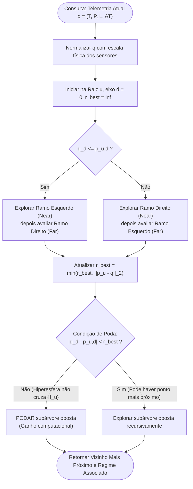

# Indexação Multidimensional de Estados de Processo e Busca Espacial com KD-Trees na Planta de Biodiesel (Grupo 5)

---

| Especificação Técnica | Detalhes |
| :--- | :--- |
| **Unidade Operacional** | Reator CSTR $\text{R-200}$ (Setor 200), Historiador $\text{SCADA-Core}$ e Navegação do $\text{AGV-SAMPLER}$ |
| **Domínio de Engenharia** | Supervisão Multivariável de Processos Químicos, Detecção Precoce de Anomalias e Geometria Computacional |
| **Estrutura de Dados** | Árvore $k$-Dimensional ($\text{KD-Tree}$) para Particionamento Binário de Espaço $\mathbb{R}^k$ |
| **Consultas Implementadas** | Busca por Vizinho Mais Próximo ($k$-NN) e Busca Ortogonal por Intervalo (*Range Search*) |
| **Status do Documento** | Aprovado para Integração ao Historiador SCADA-Core e Módulo de Navegação RRT |

---

## 1. Contextualização de Engenharia e Motivação Industrial

Na **Planta Piloto de Produção de Biodiesel por Transesterificação em Batelada (Grupo 5)**, o sistema supervisório **SCADA-Core** amostra continuamente os transmissores de campo em alta frequência ($\Delta t = 50\text{ ms}$, ou $20\text{ Hz}$). Ao longo de meses de operação em batelada, o historiador acumula dezenas de milhares de vetores de telemetria multidimensional que descrevem o comportamento termodinâmico e hidráulico do processo.

Em uma operação industrial real, dois problemas computacionais críticos exigem indexação espacial eficiente em múltiplas dimensões ($k \ge 2$):

### 1.1 Monitoramento Multivariável do Reator CSTR R-200 ($k = 4$ Dimensões)
Diferentemente de alarmes univariáveis isolados (ex.: apenas $TT\text{-}201 \ge 65.0^\circ\text{C}$), desvios incipientes na reação de transesterificação manifestam-se como **derivas combinadas** no espaço de estados $\mathbf{x} \in \mathbb{R}^4$:
$$\mathbf{x} = \begin{bmatrix} TT\text{-}201 \\ PT\text{-}201 \\ LT\text{-}201 \\ AT\text{-}100 \end{bmatrix} \in \mathbb{R}^4$$
Onde:
* $TT\text{-}201$: Temperatura do reator ($^\circ\text{C}$, janela nominal $55\text{–}60^\circ\text{C}$, limite de *flash boiling* do metanol em $64.7\text{–}65.0^\circ\text{C}$);
* $PT\text{-}201$: Pressão interna do vaso ($\text{bar}$, nominal $1.0\text{ bar}$, limite crítico $2.5\text{ bar}$);
* $LT\text{-}201$: Nível volumétrico da batelada ($\%$, faixa segura $20\text{–}85\%$, cavitação de $\text{AG-201}$ abaixo de $15\%$);
* $AT\text{-}100$: Concentração de vapores de metanol no Setor 100/200 ($\text{ppm}$, pré-alarme em $20\text{ ppm}$).

Quando o operador ou o motor de diagnóstico precisa responder em tempo real:
1. **"Qual regime histórico validado (*Golden Batch* ou falha catalogada) é mais semelhante ao estado atual da planta?"** ($k$-NN Search);
2. **"Quantas amostras históricas violaram simultaneamente o envelope operacional $(T \in [61, 65]^\circ\text{C} \land P \in [1.5, 2.5]\text{ bar})$?"** (*Orthogonal Range Search*);

uma varredura linear (*brute-force*) sobre $N = 10^6$ registros custaria $\mathcal{O}(N \cdot k)$ operações por ciclo de varredura, inviabilizando a resposta determinística em tempo real no SCADA.

### 1.2 Aceleração da Primitiva `NEAREST` do Robô `AGV-SAMPLER` ($k = 2$ Dimensões)
Na **Aula 22**, o algoritmo *Rapidly-exploring Random Trees* ($\text{RRT}$) planejou rotas livres de colisão para o robô de amostragem química no piso fabril $\mathcal{C} \subset \mathbb{R}^2$. O gargalo computacional do $\text{RRT}$ clássico reside na primitiva `NEAREST`, que busca o vértice $\mathbf{q}_{\text{near}} \in V$ mais próximo de $\mathbf{q}_{\text{rand}}$. Ao indexar os vértices da árvore $\mathcal{T}$ em uma **KD-Tree bidimensional ($k=2$)**, o custo de busca reduz-se de $\mathcal{O}(|V|)$ para $\mathcal{O}(\log |V|)$ em média.

---

## 2. Fundamentação Matemática da KD-Tree

Uma **KD-Tree** (*$k$-Dimensional Tree*), introduzida por Jon Bentley (1975), é uma árvore binária de busca (ABB) generalizada para particionar recursivamente um conjunto de pontos $P \subset \mathbb{R}^k$ por meio de **hiperplanos ortogonais aos eixos coordenados**.

### 2.1 Estrutura Formal do Nó
Cada nó interno $u$ da KD-Tree representa uma região hiper-retangular (caixa delimitadora $B_u \subseteq \mathbb{R}^k$) e armazena:
* Um ponto pivô $\mathbf{p}_u = (p_{u,0}, p_{u,1}, \dots, p_{u,k-1}) \in P$;
* Um eixo de corte (*splitting axis*) $d = \text{profundidade}(u) \bmod k \in \{0, 1, \dots, k-1\}$;
* Um valor de corte $s_u = p_{u,d}$ que define o hiperplano $H_u = \{\mathbf{x} \in \mathbb{R}^k : x_d = s_u\}$;
* Subárvore esquerda $u_{\text{esq}}$ contendo todos os pontos com $x_d \le s_u$;
* Subárvore direita $u_{\text{dir}}$ contendo todos os pontos com $x_d > s_u$.

### 2.2 Construção Balanceada via Mediana
Para garantir uma árvore balanceada de altura $h = \lfloor \log_2 N \rfloor + 1$:
1. Seleciona-se o eixo de corte $d = \text{depth} \bmod k$ (ou o eixo de maior variância/amplitude);
2. Ordena-se o subconjunto atual de pontos ao longo da coordenada $d$ e escolhe-se a **mediana** como pivô $\mathbf{p}_u$;
3. Particiona-se os pontos restantes em $P_{\text{esq}}$ e $P_{\text{dir}}$ e aplica-se a construção recursivamente.

Utilizando algoritmo de seleção linear (*Median of Medians*) ou ordenação por nível, a complexidade de construção é $\mathcal{O}(N \log N)$ e o espaço em memória é estritamente $\mathcal{O}(N)$.

### 2.3 Busca por Vizinho Mais Próximo (Nearest Neighbor) com Poda (*Branch-and-Bound*)
Dado um ponto de consulta $\mathbf{q} \in \mathbb{R}^k$ e uma métrica euclidiana ponderada (com normalização *Z-score* ou *Min-Max* das grandezas físicas):
$$\|\mathbf{x} - \mathbf{q}\|_2 = \sqrt{\sum_{j=0}^{k-1} \left(\frac{x_j - q_j}{\sigma_j}\right)^2}$$

> **Nota de Engenharia:** A normalização dimensional ($\sigma_j$ ou faixa nominal) é obrigatória em sistemas SCADA, pois $\Delta T = 5^\circ\text{C}$ e $\Delta P = 1.5\text{ bar}$ possuem ordens de grandeza numéricas incompatíveis se comparadas diretamente sem escala.

O algoritmo de busca opera em dois passos recursivos:
1. **Descida Gulosa:** Atravessa a árvore comparando $q_d$ com $s_u$, visitando primeiro o ramo que contém $\mathbf{q}$ (*near branch*) até atingir uma folha, atualizando a melhor distância conhecida $r_{\text{best}}$;
2. **Retrocesso com Poda Geométrica (*Backtracking & Pruning*):** Ao retornar ao nó $u$, verifica-se se a hiperesfera centrada em $\mathbf{q}$ com raio $r_{\text{best}}$ cruza o hiperplano divisor $H_u$:
   $$|q_d - s_u| < r_{\text{best}}$$
   * **Se falso:** Toda a subárvore oposta (*far branch*) está garantidamente a uma distância superior a $r_{\text{best}}$ e é **podada** sem ser visitada;
   * **Se verdadeiro:** A subárvore oposta pode conter um vizinho mais próximo e deve ser explorada.

### 2.4 Busca Ortogonal por Intervalo (*Orthogonal Range Search*)
Para auditar falhas no historiador SCADA dentro de um hiper-retângulo $R = [l_0, u_0] \times [l_1, u_1] \times \dots \times [l_{k-1}, u_{k-1}]$:
* Se a caixa delimitadora $B_u$ do nó $u$ for disjunta de $R$ ($B_u \cap R = \emptyset$), poda-se toda a subárvore;
* Se $B_u \subseteq R$, reportam-se todos os pontos da subárvore diretamente;
* Caso contrário, testa-se $\mathbf{p}_u \in R$ e desce-se nos filhos cujo semi-espaço intercepta $R$.

---

## 3. Particionamento Espacial Aplicado à Planta de Biodiesel

Considerando a projeção 2D crítica do Reator $\text{R-200}$ ($TT\text{-}201 \times PT\text{-}201$), a KD-Tree divide o plano operacional em regiões disjuntas correspondentes aos regimes físicos da transesterificação:

| Região Particionada | Faixa Térmica ($TT\text{-}201$) | Faixa de Pressão ($PT\text{-}201$) | Diagnóstico Operacional |
| :--- | :---: | :---: | :--- |
| **Zona Nominal (*Golden Batch*)** | $55.0\text{ – }60.0^\circ\text{C}$ | $0.95\text{ – }1.15\text{ bar}$ | Cinética ótima de transesterificação ($\ge 96.5\%$ conversão) |
| **Sub-aquecimento (Viscosa)** | $< 55.0^\circ\text{C}$ | $0.95\text{ – }1.10\text{ bar}$ | Baixa conversão, risco de emulsão persistente |
| **Pré-Alerta Exotérmico** | $60.0\text{ – }64.5^\circ\text{C}$ | $1.15\text{ – }2.40\text{ bar}$ | Aproximação do ponto de ebulição do metanol ($64.7^\circ\text{C}$) |
| **Zona Crítica (*Flash Boiling*)** | $\ge 65.0^\circ\text{C}$ | $\ge 2.50\text{ bar}$ | Vaporização instantânea de metanol — Disparo SIS SIL-3 |

---

## 4. Análise de Complexidade e Limitações (Maldição da Dimensionalidade)

| Operação | Caso Médio (Dados Balanceados) | Pior Caso | Busca Linear (*Brute-Force*) |
| :--- | :---: | :---: | :---: |
| **Construção da KD-Tree** | $\mathcal{O}(N \log N)$ | $\mathcal{O}(N \log N)$ | $\mathcal{O}(1)$ |
| **Vizinho Mais Próximo (NN)** | $\mathcal{O}(\log N)$ | $\mathcal{O}(N)$ | $\mathcal{O}(N)$ |
| **Busca por Intervalo (*Range*)** | $\mathcal{O}(N^{1 - 1/k} + m)$ | $\mathcal{O}(N)$ | $\mathcal{O}(N)$ |

> **Análise Crítica de Engenharia (*Curse of Dimensionality*):**
> A KD-Tree mantém eficiência logarítmica enquanto o número de amostras satisfizer $N \gg 2^k$. Na planta de biodiesel, tanto o monitoramento do reator ($k = 4$, onde $2^4 = 16 \ll N$) quanto o planejamento de trajetória do `AGV-SAMPLER` ($k = 2$, onde $2^2 = 4 \ll |V|$) operam em baixa dimensionalidade, garantindo taxas de poda acima de $85\text{–}95\%$ e execução compatível com o ciclo de $50\text{ ms}$ do CLP/SCADA. Para espaços de altíssima dimensão ($k > 20$), estruturas aproximadas (como LSH ou HNSW) seriam preferíveis.

---

## 5. Referências Técnicas

1. BENTLEY, J. L. **Multidimensional Binary Search Trees Used for Associative Searching**. *Communications of the ACM*, v. 18, n. 9, p. 509–517, 1975.
2. DE BERG, M. et al. **Computational Geometry: Algorithms and Applications**. 3rd ed. Berlin: Springer, 2008. (Capítulo 5: Orthogonal Range Searching & kd-Trees).
3. CORMEN, T. H. et al. **Algoritmos: Teoria e Prática**. 3. ed. Rio de Janeiro: Elsevier, 2012.
4. IEC 61511 / ISA-88 — *Functional Safety and Batch Control Standards for Process Industries*.
