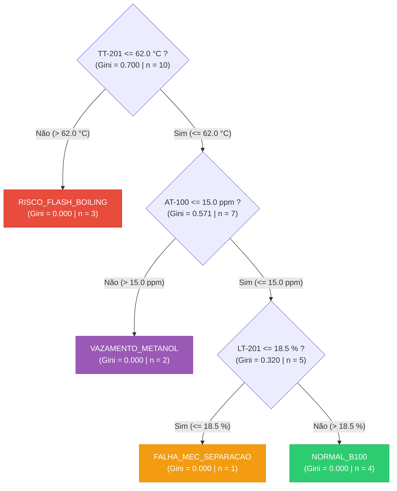

# Árvores de Decisão — Algoritmos Clássicos de Construção (ID3, C4.5 e CART) na Planta de Biodiesel (Grupo 5)

---

| Especificação Técnica | Detalhes |
| :--- | :--- |
| **Unidade Operacional** | Setor 100 (`AT-100`), Setor 200 (Reator CSTR `R-200`: `TT-201`, `PT-201`, `LT-201`) e Setor 300 (Decantador `TK-300`: `IT-301`) |
| **Domínio de Engenharia** | Aprendizado de Máquina Supervisionado, Diagnóstico Automático de Falhas e Controle de Qualidade de Batelada |
| **Algoritmos Formulados** | **ID3** (Entropia / Ganho de Informação), **C4.5** (*Gain Ratio* e Cortes Contínuos) e **CART** (Impureza de Gini) |
| **Hiperparâmetros de Poda** | `max_depth`, `min_samples_split`, `criterion` (`gini` / `entropy`) e particionamento Treino/Teste |
| **Status do Documento** | Aprovado para Integração ao Motor de Diagnóstico do SCADA-Core |

---

## 1. Contextualização de Engenharia: Da Árvore Estática (Aula 21) à Indução Automática de Regras

Na **Aula 21**, modelamos a **Árvore Binária de Decisão (BDT)** estática do Sistema Instrumentado de Segurança ($\text{SIS / SIL 3}$) do Reator $\text{R-200}$, na qual os limiares de desarme ($PT\text{-}201 \ge 2.5\text{ bar}$, $TT\text{-}201 \ge 65.0^\circ\text{C}$, $AT\text{-}100 \ge 20\text{ ppm}$) foram definidos deterministicamente por normas de projeto.

Contudo, em uma planta industrial de **transesterificação em batelada**, o historiador **SCADA-Core** acumula milhares de registros rotulados de bateladas passadas contendo **variáveis analógicas contínuas** que interagem de forma não trivial antes mesmo de um alarme crítico disparar. O problema de engenharia passa a ser:

> **Como extrair automaticamente, a partir dos dados históricos da planta, uma Árvore de Decisão ótima e interpretável (Caixa Branca / XAI) capaz de classificar o estado operacional e diagnosticar desvios de qualidade ou segurança?**

Para responder a essa demanda, aplicamos os algoritmos clássicos de construção gulosa (*top-down greedy induction* / *Hunt's Algorithm*): **ID3**, **C4.5** e **CART**.

### 1.1 Espaço de Atributos (Tags ISA-5.1) e Classes Diagnósticas
Consideramos o vetor de atributos de entrada extraído em tempo real dos quatro setores:
* **`TT-201` ($^\circ\text{C}$):** Temperatura do Reator $\text{R-200}$ (janela ótima: $55\text{–}60^\circ\text{C}$, *flash boiling* $\ge 65^\circ\text{C}$);
* **`PT-201` ($\text{bar}$):** Pressão interna do Reator $\text{R-200}$ (nominal: $1.0\text{ bar}$, crítica $\ge 2.5\text{ bar}$);
* **`LT-201` ($\%$):** Nível volumétrico no Reator $\text{R-200}$ (cavitação de $\text{AG-201}$ se $\le 15\%$);
* **`AT-100` ($\text{ppm}$):** Concentração de vapores de metanol no Setor 100 (pré-alarme $\ge 20\text{ ppm}$);
* **`IT-301` ($\text{u.a.}$):** Leitura do sensor óptico de interface biodiesel/glicerina no Decantador $\text{TK-300}$ (interface nítida $> 0.70\text{ u.a.}$).

O conjunto de classes diagnósticas alvo $\mathcal{C}$ compreende:
1. **`NORMAL_B100`:** Batelada nominal em conformidade com a especificação de ésteres ($\ge 96.5\%$);
2. **`RISCO_FLASH_BOILING`:** Sobretemperatura/sobrepressão por ebulição incipiente de metanol no $\text{R-200}$;
3. **`VAZAMENTO_METANOL`:** Atmosfera tóxica/explosiva detectada no Setor 100 (`AT-100`);
4. **`FALHA_MEC_SEPARACAO`:** Cavitação do agitador $\text{AG-201}$ por nível baixo ou emulsão persistente no $\text{TK-300}$.

---

## 2. Fundamentação Matemática dos Algoritmos Clássicos

Os algoritmos clássicos constroem a árvore de forma recursiva e gulosa (*divide-and-conquer*), selecionando em cada nó o atributo $A$ e o ponto de corte $\theta$ que **maximizam a pureza** dos subconjuntos filhos.

### 2.1 Algoritmo ID3 (Quinlan, 1986) — Entropia e Ganho de Informação
A **Entropia de Shannon** $H(S)$ mede o grau de incerteza (impureza) das classes em um conjunto de amostras $S$:
$$H(S) = -\sum_{c \in \mathcal{C}} p_c \log_2(p_c)$$
Onde $p_c = \frac{|S_c|}{|S|}$ é a proporção de amostras da classe $c$ em $S$ (com a convenção $0 \log_2 0 = 0$).
* $H(S) = 0$: Nó **puro** (todas as bateladas pertencem à mesma classe);
* $H(S) = \log_2(|\mathcal{C}|)$: Impureza **máxima** (distribuição uniforme entre classes).

O **Ganho de Informação ($IG$)** de particionar $S$ pelo atributo discreto $A$ é a redução esperada na entropia:
$$IG(S, A) = H(S) - \sum_{v \in \text{Valores}(A)} \frac{|S_v|}{|S|} H(S_v)$$

### 2.2 Algoritmo C4.5 (Quinlan, 1993) — Razão de Ganho e Atributos Contínuos
O ID3 possui viés favorável a atributos com muitos valores distintos (ex.: IDs de batelada) e não lida nativamente com sensores analógicos contínuos. O **C4.5** resolve ambos os problemas:
1. **Discretização Ótima de Limiares Contínuos:** Ordena os valores do sensor $A$ e avalia pontos médios $\theta = \frac{v_i + v_{i+1}}{2}$ entre mudanças de classe, buscando a partição binária $A \le \theta$ vs. $A > \theta$ de maior ganho;
2. **Razão de Ganho (*Gain Ratio*):** Normaliza o $IG$ pela Entropia da Divisão (*Split Information*):
$$\text{SplitInfo}(S, A) = -\sum_{v} \frac{|S_v|}{|S|} \log_2 \left(\frac{|S_v|}{|S|}\right), \qquad \text{GainRatio}(S, A) = \frac{IG(S, A)}{\text{SplitInfo}(S, A)}$$

### 2.3 Algoritmo CART (Breiman et al., 1984) — Impureza de Gini
O **CART** (*Classification and Regression Trees*) gera estritamente **árvores binárias** utilizando o **Índice de Impureza de Gini**, computacionalmente mais rápido por evitar logaritmos:
$$G(S) = 1 - \sum_{c \in \mathcal{C}} p_c^2$$
Para uma divisão binária $(A \le \theta)$ que particiona $S$ em $S_{\text{esq}}$ e $S_{\text{dir}}$, escolhe-se o par $(A^*, \theta^*)$ que minimiza a impureza ponderada (ou maximiza $\Delta G$):
$$\Delta G(S, A, \theta) = G(S) - \left( \frac{|S_{\text{esq}}|}{|S|} G(S_{\text{esq}}) + \frac{|S_{\text{dir}}|}{|S|} G(S_{\text{dir}}) \right)$$

### 2.4 Controle de *Overfitting* (Critérios de Parada e Poda)
Em sensores industriais sujeitos a ruído de medição, árvores sem restrição memorizam flutuações espúrias (*overfitting*). Aplicam-se critérios de pré-poda (*pre-pruning*):
* **`max_depth`:** Profundidade máxima da árvore (limita o número de decisões sequenciais no CLP);
* **`min_samples_split`:** Número mínimo de amostras exigido em um nó para autorizar nova ramificação.

---

## 3. Estudo Numérico Passo a Passo (Nó Raiz — Bateladas de Biodiesel)

Considere um conjunto didático $S$ com $|S| = 10$ registros históricos do SCADA-Core:

| ID Batelada | `TT-201` ($^\circ\text{C}$) | `PT-201` ($\text{bar}$) | `AT-100` ($\text{ppm}$) | `LT-201` ($\%$) | Classe Diagnóstica |
| :---: | :---: | :---: | :---: | :---: | :--- |
| B01 | $57.0$ | $1.02$ | $1.5$ | $65$ | `NORMAL_B100` |
| B02 | $58.5$ | $1.05$ | $2.0$ | $70$ | `NORMAL_B100` |
| B03 | $56.2$ | $1.00$ | $1.0$ | $60$ | `NORMAL_B100` |
| B04 | $59.1$ | $1.08$ | $3.0$ | $72$ | `NORMAL_B100` |
| B05 | $65.4$ | $2.60$ | $8.0$ | $68$ | `RISCO_FLASH_BOILING` |
| B06 | $66.8$ | $2.85$ | $11.0$ | $64$ | `RISCO_FLASH_BOILING` |
| B07 | $64.9$ | $2.45$ | $6.0$ | $66$ | `RISCO_FLASH_BOILING` |
| B08 | $57.5$ | $1.03$ | $24.0$ | $55$ | `VAZAMENTO_METANOL` |
| B09 | $56.8$ | $1.01$ | $29.5$ | $58$ | `VAZAMENTO_METANOL` |
| B10 | $58.0$ | $1.02$ | $2.2$ | $12$ | `FALHA_MEC_SEPARACAO` |

### 3.1 Cálculo da Impureza Global no Nó Raiz ($S$)
Distribuição das classes: $4$ `NORMAL`, $3$ `FLASH`, $2$ `VAZAMENTO`, $1$ `FALHA_MEC`.

* **Entropia Inicial:**
$$H(S) = -\left(0.4\log_2 0.4 + 0.3\log_2 0.3 + 0.2\log_2 0.2 + 0.1\log_2 0.1\right) \approx 1.8464\text{ bits}$$

* **Impureza de Gini Inicial:**
$$G(S) = 1 - (0.4^2 + 0.3^2 + 0.2^2 + 0.1^2) = 1 - (0.16 + 0.09 + 0.04 + 0.01) = 0.7000$$

### 3.2 Avaliação do Melhor Corte Candidato no Nó Raiz
Testando o limiar térmico $TT\text{-}201 \le 62.0^\circ\text{C}$:
* **$S_{\text{esq}}$ ($7$ amostras):** $4$ `NORMAL`, $2$ `VAZAMENTO`, $1$ `FALHA_MEC` ($0$ `FLASH`):
  $$G(S_{\text{esq}}) = 1 - \left(\left(\frac{4}{7}\right)^2 + \left(\frac{2}{7}\right)^2 + \left(\frac{1}{7}\right)^2\right) = 1 - \frac{21}{49} \approx 0.5714$$
* **$S_{\text{dir}}$ ($3$ amostras):** $3$ `RISCO_FLASH_BOILING` (**Nó Puro!**):
  $$G(S_{\text{dir}}) = 1 - 1^2 = 0.0000$$

* **Redução de Gini obtida:**
$$\Delta G(S, TT\text{-}201, 62.0) = 0.7000 - \left(\frac{7}{10}\cdot 0.5714 + \frac{3}{10}\cdot 0.0000\right) = 0.7000 - 0.4000 = 0.3000$$

Seguindo recursivamente nos nós filhos ($AT\text{-}100 \le 15.0\text{ ppm}$ e $LT\text{-}201 \le 18.5\%$), obtém-se a árvore completa com **100% de pureza nas folhas**:

---

## 4. Comparativo Técnico: ID3 vs. C4.5 vs. CART no Ambiente Industrial

| Critério | ID3 | C4.5 | CART (Adotado no SCADA-Core) |
| :--- | :---: | :---: | :---: |
| **Critério de Divisão** | Ganho de Informação ($IG$) | Razão de Ganho (*Gain Ratio*) | Impureza de Gini (ou MSE p/ regressão) |
| **Topologia da Árvore** | Multi-ramo ($k$-ária) | Multi-ramo / Binária contínua | **Estritamente Binária** |
| **Atributos Contínuos** | Não suporta nativamente | Suporta via ordenação e limiares | **Suporta nativamente** |
| **Custo Computacional** | Logarítmico ($\log_2$) | Logarítmico ($\log_2$) | **Aritmético puro ($p_c^2$, sem $\log$)** |
| **Conversão para CLP (IEC 61131-3)** | Complexa (múltiplos ramos) | Média | **Direta (`IF ... THEN ... ELSE`)** |

> **Decisão de Engenharia:** O algoritmo **CART com Índice de Gini** é o padrão preferencial para embarque em CLPs e supervisórios industriais, pois cada nó interno traduz-se diretamente em uma única instrução de comparação binária (`CMP`), permitindo latência de inferência determinística $\mathcal{O}(\text{max\_depth})$ e auditoria explicável (*White-Box AI*) pelos operadores de sala de controle.

---

## 5. Referências Técnicas

1. BREIMAN, L.; FRIEDMAN, J.; STONE, C. J.; OLSHEN, R. A. **Classification and Regression Trees**. Belmont: Wadsworth, 1984.
2. QUINLAN, J. R. **Induction of Decision Trees**. *Machine Learning*, v. 1, n. 1, p. 81–106, 1986. (ID3).
3. QUINLAN, J. R. **C4.5: Programs for Machine Learning**. San Mateo: Morgan Kaufmann, 1993.
4. CORMEN, T. H. et al. **Algoritmos: Teoria e Prática**. 3. ed. Rio de Janeiro: Elsevier, 2012.
